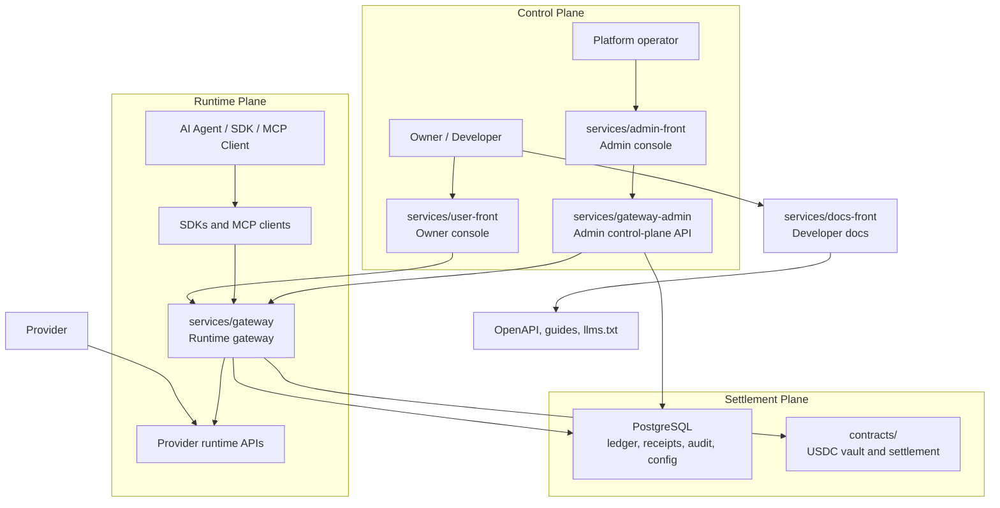

# Synapse Network

Synapse Network is an agent-first payment and settlement layer for AI services.
It lets an owner fund an agent, lets that agent discover and invoke paid APIs,
and settles the call through a fast off-chain gateway with an on-chain USDC
custody boundary.

This repository is the open-source core for the Synapse protocol runtime,
contracts, admin control plane, local development stack, and public developer
documentation.

> Status: public preview. Use testnet or local assets for development. Do not
> route production funds through a fork until you have completed your own
> security review, key-management setup, monitoring, and contract verification.

## Why Synapse Exists

AI agents need to buy API services without a human approving every call. The
normal SaaS API-key model is too coarse for agent-to-agent commerce: it lacks
per-agent budgets, call receipts, provider settlement, and machine-readable
payment semantics.

Synapse splits the system into a fast runtime path and a conservative settlement
boundary:

- **On-chain custody:** USDC deposits, vault accounting, and withdrawal
  settlement live in Solidity contracts.
- **Off-chain execution:** the Gateway handles discovery, quote, invoke,
  budget checks, billing, receipts, provider routing, and audit emission.
- **Agent identity:** runtime access is scoped to agent credentials rather than
  broad owner API keys.
- **Provider marketplace:** providers expose services; agents buy those services
  through a standard Gateway flow.

## Architecture



Core rule: smart contracts stay small and conservative; high-frequency routing,
budget checks, and provider execution stay in the Gateway where they can be
audited, tested, rate-limited, and upgraded safely.

## Repository Map

| Path | Purpose |
| --- | --- |
| `contracts/` | Solidity contracts and Hardhat tooling for the custody and settlement boundary. |
| `services/gateway/` | Python FastAPI runtime Gateway for discovery, quotes, invokes, billing, receipts, ledger writes, and provider routing. |
| `services/gateway-admin/` | Python FastAPI admin control-plane API for RBAC, reviews, projections, approvals, and operations. |
| `services/user-front/` | Next.js owner/developer console for funding, agents, credentials, invocations, and provider flows. |
| `services/admin-front/` | Next.js privileged admin console for finance, operations, risk, audit, and configuration workflows. |
| `services/docs-front/` | Public developer documentation site, API reference source, sitemap, and `llms.txt` assets. |
| `infra/` | Local Docker, Postgres bootstrap, monitoring, and Terraform examples. |
| `scripts/` | Local lifecycle, CI, E2E, chain, deploy, recovery, and evidence tooling. |
| `docs/` | Canonical architecture, workflow, security, operations, and project documentation. |

## Local Development

Prerequisites:

- Node.js 20.x
- Python 3.11+
- Docker
- Foundry or another local EVM toolchain when running contract-backed flows

Start the standard local stack from the repository root:

```bash
npm run dev:bootstrap
npm run dev:all
npm run dev:status
```

Useful local lifecycle commands:

```bash
npm run dev:migrate
npm run dev:restart
npm run dev:logs
npm run dev:stop
```

Service-specific entrypoints:

```bash
cd services/gateway && python3.11 -m venv .venv && .venv/bin/pip install -r requirements.txt
cd services/gateway-admin && python3.11 -m venv .venv && .venv/bin/pip install -r requirements.txt
cd services/user-front && yarn install && yarn dev
cd services/admin-front && yarn install && yarn dev
cd services/docs-front && yarn install && yarn dev
```

Environment templates live beside each service:

- `services/gateway/.env.local.example`
- `services/gateway/.env.example`
- `services/gateway-admin/.env.example`
- `services/user-front/.env.local.example`
- `services/admin-front/.env.staging.example`

Never commit `.env.local`, private keys, database DSNs, bearer tokens, wallet
mnemonics, service-account JSON, or provider secrets. Local `.env.local` files
are ignored by `.gitignore`.

## Validation

Fast checks:

```bash
npm run ci:docs
npm run ci:contracts
npm run ci:gateway
npm run ci:admin-gateway
npm run ci:frontend
```

Full pull-request gate:

```bash
npm run ci:pr
```

Security-oriented checks:

```bash
bash scripts/ci/security_secret_scan.sh
npm run ci:financial-security
npm run ci:e2e-env-isolation
```

For architecture and runtime details, start with:

- [docs/ARCHITECTURE.md](docs/ARCHITECTURE.md)
- [docs/README.md](docs/README.md)
- [docs/security/README.md](docs/security/README.md)
- [docs/reference/Validation_Entry_Points.md](docs/reference/Validation_Entry_Points.md)

## Security And Open-Source Safety

This repository contains payment, wallet, and settlement infrastructure. Treat
every credential and money-moving path as high risk.

Before publishing a fork or release:

1. Run the secret scan and review any match manually.
2. Confirm local env files are not tracked: `git ls-files | grep '.env.local'`
   should print nothing.
3. Replace all local development keys with project-specific secrets managed by
   your own secret manager.
4. Do not use browser-wallet mnemonics or Anvil/Hardhat test private keys in
   staging or production.
5. Verify contracts, deployment manifests, RPC configuration, withdrawal signer
   mode, monitoring, and backup/restore evidence before handling real funds.

Please report vulnerabilities through the process in [SECURITY.md](SECURITY.md).

## Contributing

Read [CONTRIBUTING.md](CONTRIBUTING.md) before opening a pull request. For
agent-assisted development, start with [llms.txt](llms.txt) and
[AGENTS.md](AGENTS.md); they route contributors to the canonical docs and
validation commands.

High-signal contribution areas:

- Gateway runtime correctness, idempotency, and auditability
- Agent SDK and MCP integration ergonomics
- Provider service integration patterns
- Contract and settlement safety tests
- Developer documentation and examples

## License

Licensed under the [Apache License 2.0](LICENSE).
