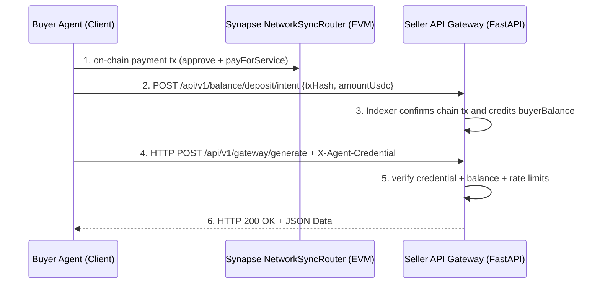

# 极简路由智能合约与 FastAPI 改造设计方案 (Synchronous Payment & FastAPI Refactoring Design)

## 1. 架构流转总览 (Top-level Architecture Flow)

在当前实现架构下，Synapse Network 是**“充值确认 + 网关扣费 + 服务调用”**的 V2 路径。
数据与资金流转如下：



---

## 2. 核心组件 1：极简同步路由合约 (`Synapse NetworkSyncRouter.sol`)

### 2.1 职责说明
该合约不保存任何“任务状态（Status）”。它仅仅是一个**分账器**。接收买方资金，扣除平台手续费，将尾款直接打给卖方，并抛除一个不可篡改的事件（Event）作为支付凭证。

### 2.2 核心接口设计
```solidity
// SPDX-License-Identifier: MIT
pragma solidity ^0.8.19;

import "@openzeppelin/contracts/token/ERC20/IERC20.sol";
import "@openzeppelin/contracts/token/ERC20/utils/SafeERC20.sol";

contract Synapse NetworkSyncRouter {
    using SafeERC20 for IERC20;

    address public feeTreasury;
    uint256 public platformFeeBps = 100; // 1% = 100 BPS

    event ServicePaid(
        address indexed buyer,
        address indexed seller,
        address indexed token,
        uint256 amount,
        string serviceId
    );

    function payForService(
        address token,
        address seller,
        uint256 amount,
        string calldata serviceId
    ) external {
        uint256 fee = (amount * platformFeeBps) / 10000;
        uint256 sellerAmount = amount - fee;

        // 转移代币: Buyer -> Router (Requires Approval)
        IERC20(token).safeTransferFrom(msg.sender, address(this), amount);
        
        // 结算: Router -> Treasury
        IERC20(token).safeTransfer(feeTreasury, fee);
        
        // 结算: Router -> Seller
        IERC20(token).safeTransfer(seller, sellerAmount);

        emit ServicePaid(msg.sender, seller, token, amount, serviceId);
    }
}
```

---

## 3. 核心组件 2：Seller Agent (FastAPI Provider 端)

### 3.1 职责说明
FastAPI 网关承担三件事：
1. 接收充值 intent 并由后台 Indexer 异步确认入账；
2. 在 `/api/v1/gateway/generate` 做凭据、限流、余额扣减与审计；
3. 返回统一业务响应，不再要求每次调用携带 `tx_hash`。

### 3.2 V2 校验器（Gateway Validator）
每次调用 `POST /api/v1/gateway/generate` 时，网关按以下顺序校验：

1. **凭据有效性**：`X-Agent-Credential` 未过期、未撤销、未超配额。
2. **限流策略**：owner/agent/service 三维限流通过。
3. **余额检查**：`buyerBalance >= unitPrice`。
4. **原子扣减与审计**：余额扣减、卖家应收与平台费累计、usage log 写入一次完成。

### 3.3 代码骨架设计 (`seller_api.py`)
```python
from fastapi import FastAPI, Depends, HTTPException, Header
from pydantic import BaseModel

app = FastAPI()

@app.post("/api/v1/gateway/generate")
async def generate_v2(request: RequestPayload, credential: str = Header(alias="X-Agent-Credential")):
    active_credential = validate_credential(credential)
    service = load_service(request.service_id)
    ensure_rate_limit(active_credential, service)
    ensure_balance(active_credential.owner_wallet, service.unit_price)
    billing = charge_and_append_usage(active_credential, service)
    result = llm_agent.analyze(request.data)
    return {"status": "success", "billing": billing, "data": result}
```

---

## 4. 核心组件 3：Buyer Agent (Consumer 端)

### 4.1 职责说明
Buyer 侧标准流程：`链上支付` -> `提交充值 intent` -> `等待余额可用` -> `调用 /api/v1/gateway/generate`。

### 4.2 代码骨架设计 (`buyer_client.py`)
```python
import requests

def buy_ai_service(gateway_url, service_id, credential, payload):
    headers = {
        "Content-Type": "application/json",
        "X-Agent-Credential": credential,
        "X-Service-Id": service_id,
    }
    response = requests.post(f"{gateway_url}/api/v1/gateway/generate", json=payload, headers=headers)
    
    if response.status_code == 200:
        return response.json()
    else:
        raise Exception(f"Seller rejected request: {response.text}")
```

---

## 5. 挑战与争议边界 (Edge Cases & Solutions)

### Q1: 为什么不采用“先锁钱，成功后给钱”的担保模式？
如果顺着担保模式思路，系统必须经历冗长的多跳确认：
1. 买家调用合约 `LockMoney()`（消耗 Gas_1）。
2. 买家发送 HTTP 请求调用 API。
3. 卖家算完数据，返回数据。
4. 买家再发起一笔交易确认收货 `ConfirmDeliveryAndPay()`（消耗 Gas_2）。
5. 如果出现争议，还得引入法官（Jury）仲裁（消耗 Gas_3）。

**结论**：这种流程对低至 $0.05 甚至 $0.001 的微支付 API 调用来说，**时间成本、Token 成本以及合约复杂度（状态机死锁问题）远大于数据本身的价值**。必须彻底抛弃，换成一键结算。

### Q2: 如果买家付了钱，但卖家 API 宕机/跑路了怎么办？ (No Refund Issue)
这是同步无状态路由模式带来的最大妥协。
**解决方案**：放弃链上逆转（Refund），依靠链下“信誉与拉黑机制”兜底。
1. **白名单/大厂自营**：MVP 阶段所有服务由平台自营，确保高可用（SLA 99.9%）。
2. **极其廉价（Micro-transactions）**：一次调用仅需几美分，试错成本极低。
3. **客户端拉黑兜底（Client-side Blacklisting）**：买家 SDK 内置惩罚机制：`API 报错/超时` -> `记录失信` -> `永久本地屏蔽该卖家的所有 API`。良币驱逐劣币。

### Q3: 长时耗任务 (超过 HTTP Timeout 的任务) 怎么处理？
对于需要 10 分钟运行的任务（如深度爬虫，视频生成），采用 **"Ticket 机制"**：
1. 买方完成余额准备后，调用 `POST /api/v1/long-task`。
2. 卖方验证完毕后不等待任务结束，而是立即返回 `HTTP 202 Accepted` 和 `{ "ticket_id": "xxx" }`。
3. 买方开启 `轮询`：`GET /api/v1/result/{ticket_id}` ，直到 Seller 将存在 MinIO 的链接返回。

## 6. 当前落地状态

当前实现已采用 V2 主路径：
1. 充值 intent + indexer 确认入账。
2. `/api/v1/gateway/generate` 统一扣费与审计。
3. Buyer SDK 默认调用 V2 接口。
