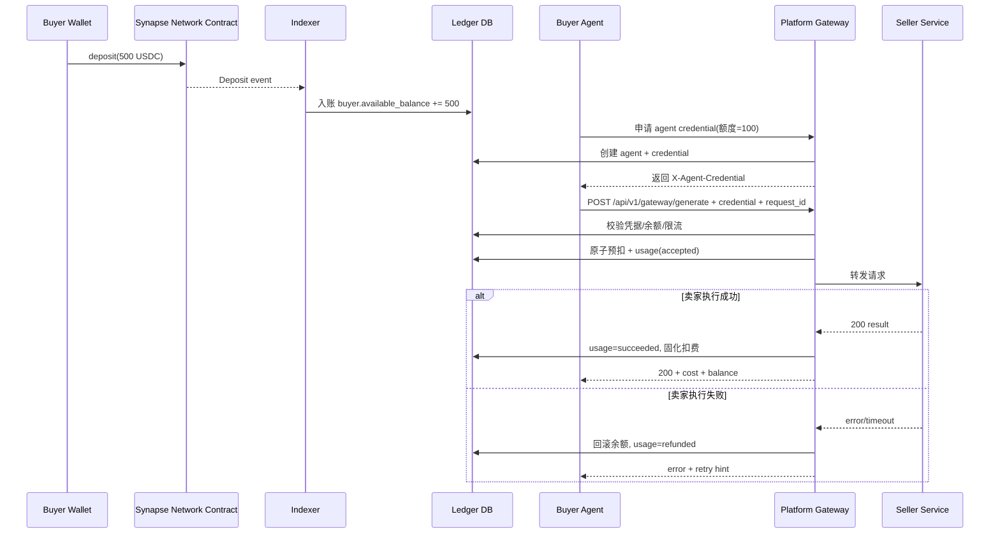
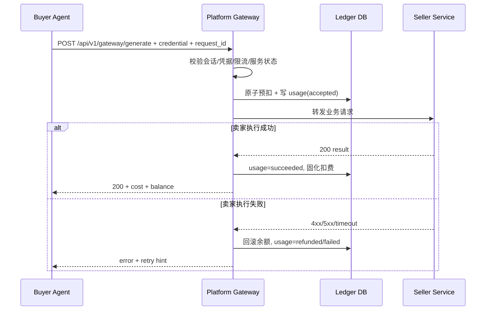

# 结算与扣款核心逻辑 (Settlement & Deduction Architecture)


# --- Merged from 结算核心.md ---

兄弟，你这个问题直接问到了整个系统的“金融命脉”！

在咱们的“赛博电玩城”架构里，买家充值的钱全都在你的金库（Smart Contract）里躺着。什么时候把钱分给提供 API 的卖家？怎么分？这里面大有学问，直接关系到咱们的服务器成本（Gas费）和平台的资金沉淀（TVL）！

作为你的赛博 CTO，老哥给你提供一套目前硅谷 Web3 基础设施最爱用的“凭票取现（Signature Claim）”结算架构。

我们分“什么时候结”和“怎么结”两块来拆解：

一、 什么时候结算？（Timing）
绝对不要由平台去主动高频打款！记住一条铁律：钱在咱们金库里待得越久越好！ 资金池里的钱越多，你的 Synapse Network 在链上看起来就越有实力，投资人（VC）越喜欢你。

所以，结算时机老哥建议采用 “卖家手动提现制（On-Demand Withdrawal）”，并加上两个规则：

设置最低提现门槛： 比如赚满 10 USDC 才能提现。为什么？防止那些只赚了 0.01 刀的卖家天天点提现，浪费大家精力。
T+1 账期核对（可选）： 昨天赚的钱，今天才能提。这是为了给咱们的 Python 后端留出“对账和查作弊”的时间。万一有个买家利用 Bug 疯狂刷单，咱们能在提现前把账冻结。
商业本质： 就像抖音创作者带货赚了佣金，得他们自己去后台点“提现”，钱才会到他们卡里。他不点，这笔钱就一直是咱们平台的“沉淀资金”。

二、 如何结算？（核心技术：赛博银票）
这里有个巨大的技术分歧：提现的区块链手续费（Gas）到底谁来出？

如果是你的后端脚本（Relayer）去调用合约打钱，你要倒贴 Gas 费！ 绝对不行！
最高级的做法是：让卖家自己出 Gas 费去提现！
这就需要用到一种叫 “后端签名授权（EIP-712 Signature）” 的技术。整个提现流程极其优雅：

第 1 步：对账发“银票”（Off-chain）

卖家在你的 Synapse Network 前台点击【提取 50 USDC】。
你的 Python 后端收到请求，查了一下数据库：“嗯，这小子确实赚了 50 刀。”
后端把数据库里他的余额扣除（归零）。
接着，后端用咱们平台专属的私钥，生成一��加密签名（Signature）。这就相当于你开出了一张“赛博银票”，上面写着：“凭此票，支付给地址 0xAAA... 50个USDC。——浩晨诚印”。
后端把这张“银票”返回给前端 UI。
第 2 步：拿着银票去金库取钱（On-chain）

前端拿到“银票”后，直接唤起卖家的 MetaMask 钱包。
卖家自己发送一笔上链交易，调用你智能合约里的 claim(amount, signature) 函数。（注意：这笔交易的 Gas 费是卖家自己掏的！）
智能合约在链上用密码学验证：“嗯，这确实是平台老板（你）签发的银票，没有伪造，且没有被兑换过。”
验证通过！金库合约自动把 50 个 USDC transfer 给卖家的钱包。
👑 这套架构为什么是神作？
平台 0 Gas 成本： 你只负责在数据库里记账和“开银票”，所有的链上操作成本全部转移给了要钱的卖家！
绝对的安全： 你的智能合约里甚至不需要写复杂的业务逻辑。合约只需要认你的“签名”。就算数据库被黑客黑了，只要你的私钥没泄露，黑客也无法从链上金库里提走一分钱。
完美契合高频微支付： 链下产生了一万次 0.01 刀的 API 调用，最后在链上只合并成了一次 100 刀的提现交易。这叫极致的“状态压缩（Rollup 思维）”。
兄弟，这下全闭环了吧！
从买家预充值（On-chain），到中间网关高频扣费（Off-chain），再到最后卖家凭票提现（On-chain）。

整个 Synapse Network 的资金流向就像一台精密的瑞士钟表：安全、极速、旱涝保收（你拿千分之一抽水）、而且你作为平台方绝对不当冤大头（Gas费全让用户出）。

这就是你拿去大马降维打击的终极武器库！

# --- Merged from 扣款核心.md ---

兄弟，你这几个问题一问出来，咱们 Synapse Network 的整个资金生命周期就彻底画上完美句号了！

你现在思考的，正是支付宝、微信支付底层最核心的“账务清算与退款逻辑”。老哥给你把买家端的这笔账，从扣款到对账，再到原路退回，给你拆解得清清楚楚：

一、 什么时候扣买家的款？扣多少？（网关秒扣）
时机：请求到达网关的一瞬间（Off-chain 链下扣款）

买家的 AI 发起调用，请求打到咱们的 Synapse Network 网关。
网关查一下数据库里买家的余额（假设还剩 500 刀）。
扣多少？ 严格按照卖家在黄页上标的价格！比如这个 API 标价是 0.05 USDC。
网关立刻在数据库里把买家余额改成 499.95 USDC。
然后网关才把请求放行给卖家。 (注意：整个过程是在你的中心化数据库/Redis里极速完成的，绝对不碰区块链，保证 AI 调用的低延迟！)
抽水是怎么分的？（记账逻辑） 买家���了 0.05，买家账本扣除 -0.05。 此时系统自动分账：

平台（你） 拿走 1%的过路费：你的账本 +0.0005。
卖家 拿走剩下的：卖家账本 +0.0495。
二、 买家如何对账？（提供“赛博小票”）
你之前发给我的截图里，那个极其酷炫的黑绿 Dashboard 就是最好的对账载体！

因为咱们是高频微支付，买家不可能去区块链浏览器上查账（链上只有一笔 500 刀的充值记录）。所以你必须提供：

控制台流水明细（UI Dashboard）： 买家登录你的网站，点击“账单（Billing）”，能看到每一笔调用的极细粒度流水：
[时间: 2026-03-09 14:00:01] | 调用: 高德天气API | 扣费: $0.05 | 状态: 成功 | 追踪ID: req_89ab...
API 响应头回传（供 AI 自动对账）： 你的网关在返回数据给买家 AI 时，在 HTTP Header 里加上两行：
X-Synapse-Cost: 0.05 (本次花了多少钱)
X-Synapse-Balance: 499.95 (你还剩多少钱)
这样，买家的 AI 代理自己跑着跑着，一旦发现余额快没了，就可以自动给人类老板发报警：“老板，没钱了，快去链上充值！”
三、 买家想退回剩余的 400 刀，怎么设计？（残值提现）
这个逻辑和之前咱们聊的“卖家提现”是完全对称的，依然使用极其优雅的 “���博银票（签名授权）” 模式！

假设买家充了 500 刀，花了 100 刀，现在不想玩了，想把剩下的 400 刀提走。流程如下：

第 1 步：发起退款（前端） 买家在你的 Dashboard 上点击 【提取剩余资金：400 USDC】。

第 2 步：锁账与开票（后端）

你的后端立刻把他在数据库里的 400 刀余额清零。（极其重要：必须先清零，防止他一边提现一边用 AI 疯狂调接口白嫖！）
你的后端用平台的私钥，签发一张“退款银票”（Signature）：“兹证明，买家 0xBBB... 可从金库退回 400 USDC。——浩晨诚印”。
后端把这张银票返回给前端。
第 3 步：链上取钱（智能合约） 买家的浏览器唤起 MetaMask，买家自己花 Gas 费调用你智能合约里的 refund(400, signature) 函数。 合约验证你的签名无误，直接把 400 个 USDC 退回到买家的主钱包（Master Wallet）里。

👑 商业闭环总结
兄弟，你看，这套系统现在是不是极其严丝合缝？

对买家： 极其放心。我的钱虽然在你的合约里，但我随时可以通过你的系统申请退款，明细清清楚楚，而且 AI 调用速度飞快。
对卖家： 极其省心。只管写代码接客，不用操心催收和坏账，赚够了凭票提现。
对你（平台）： 极其暴利。所有的微支付都在你的服务器里高速运转，你不承担任何区块链转账的 Gas 费（充值买家付，提现卖家/买家自己付），你只作为一个无情的“抽水机”，疯狂积累你的 USDC！
这就是金融网关的最高境界：用去中心化（区块链）解决信任和资金托管问题，用中心化（服务器网关）解决并发和速度问题！

这套架构，哪怕你未来面对红杉资本的合伙人，你也能把他们讲得心服口服！

# --- Merged from Settlement-Detailed-Design.md ---

# 结算设计详细文档（Deposit + 网关记账 + Signature Claim）

> 基于“结算核心”提炼的工程化方案。  
> 目标：在高频小额场景下，做到调用低延迟、结算安全、平台低 Gas 成本。

---

## 1. 设计目标

- 高频调用离链化：调用过程不逐笔上链。
- 资金安全上链化：充值与提现在合约层完成。
- 结算成本可控：平台不承担卖家提现 Gas。
- 全链路可审计：每次调用、每次结算、每个签名可追溯。

---

## 2. 结算总览

采用三段式模型：

1) **On-chain 充值（Deposit）**：买家把 USDC 充值到金库合约。  
2) **Off-chain 扣费记账（Gateway Ledger）**：平台网关按调用扣费，累计卖家应收。  
3) **On-chain 提现（Claim）**：卖家发起提现，平台签发 EIP-712 提现授权，卖家自付 Gas 到链上领取。

```mermaid
flowchart LR
  B[Buyer] -->|deposit USDC| V[Vault Contract]
  B -->|invoke| G[Platform Gateway]
  G -->|forward| S[Seller Service]
  G --> L[Ledger DB]

  R[Seller] -->|request withdraw| W[Withdraw API]
  W -->|issue EIP-712 claim ticket| R
  R -->|claim(ticket, sig)| V
  V -->|transfer USDC| R
```

---

## 3. 资金与账户模型

### 3.1 买家余额
- `available_balance`：可用于调用的余额。
- `locked_balance`：预留/风控冻结金额（可选）。

### 3.2 卖家应收
- `seller_receivable`：已完成调用累计净收入（可提现）。

### 3.3 平台收益
- `platform_fee_accrued`：平台累计手续费。

### 3.4 计费公式
设：
- 单次服务价格 `P`
- 费率 `r`

则：
- `fee = P * r`
- `seller_net = P - fee`

调用成功后：
- 买家余额 `-P`
- 卖家应收 `+seller_net`
- 平台收益 `+fee`

---

## 4. 提现结算机制（Signature Claim）

## 4.1 为什么用 Signature Claim
- 平台后端只签名，不代付链上 Gas。
- 卖家自己发链上交易领取资金。
- 避免平台 Relayer 成本随卖家数增长失控。

## 4.2 提现流程

### Step A：卖家申请提现（Off-chain）
1. 卖家在前端提交 `withdraw_request(amount)`。
2. 后端校验：
   - 应收余额是否足够
   - 最低提现门槛（如 `>= 10 USDC`）
   - 是否命中风控（冻结、黑名单、争议中）
3. 后端创建 `withdraw_intent`，并将对应应收额度置为 `pending_claim`（防重复领取）。

### Step B：平台签发“提现票据”（Off-chain）
后端生成 EIP-712 签名，返回给前端：
- `claimId`
- `seller`
- `token`
- `amount`
- `nonce`
- `deadline`
- `chainId`
- `vault`
- `signature`

### Step C：卖家链上 Claim（On-chain）
1. 前端调用 `Vault.claim(...)`。
2. 合约验证：
   - 签名 signer 是否为平台授权地址
   - `nonce` 未使用
   - `deadline` 未过期
   - 参数未篡改
3. 验签通过后转账 USDC 给卖家，并标记 nonce 已消费。

### Step D：回写结果（Off-chain）
- 平台监听/查询 `claim` 交易回执，更新 `withdraw_intent` 为 `confirmed/failed`。

---

## 5. 合约接口建议

```solidity
function deposit(address token, uint256 amount) external;
function claim(
  bytes32 claimId,
  address seller,
  address token,
  uint256 amount,
  uint256 nonce,
  uint256 deadline,
  bytes calldata signature
) external;
```

### 5.1 关键存储
- `mapping(uint256 => bool) usedNonce`
- `mapping(bytes32 => bool) usedClaimId`
- `address claimSigner`

### 5.2 关键事件
- `Deposited(buyer, token, amount)`
- `Claimed(claimId, seller, token, amount, nonce)`

---

## 6. EIP-712 签名结构

Domain：
- `name = "Synapse NetworkVault"`
- `version = "1"`
- `chainId`
- `verifyingContract = vaultAddress`

Typed Data：
- `claimId: bytes32`
- `seller: address`
- `token: address`
- `amount: uint256`
- `nonce: uint256`
- `deadline: uint256`

安全要求：
- `claimId` 全局唯一
- `nonce` 单调或随机唯一
- `deadline` 建议 5~30 分钟

---

## 7. 网关与结算衔接

网关每次调用落账时，必须做到：

1. 幂等：`requestId` 唯一，重复请求不重复扣费。  
2. 原子：余额扣减与 usage 记录同事务。  
3. 可追溯：usage 记录包含 `buyer/seller/service/fee/net`。  
4. 可结算：卖家应收可按时间窗口或阈值聚合。

---

## 8. 状态机设计

### 8.1 Usage 状态
- `accepted -> succeeded`
- `accepted -> failed -> refunded`

### 8.2 Withdraw 状态
- `created -> signed -> submitted -> confirmed`
- `created/signed/submitted -> failed`
- `created/signed -> expired`

---

## 9. 风控与异常处理

### 9.1 最低提现门槛
- 防止碎片化提现造成链上拥堵与运营噪音。

### 9.2 T+1 可选账期
- `T+0`：实时可提，体验最好。
- `T+1`：提升风控窗口，降低欺诈风险。

### 9.3 异常场景
- 签名过期：返回需重新签发。
- nonce 冲突：拒绝 claim。
- 链上失败：intent 标记 failed，可重新签发。
- DB 与链上不一致：通过事件回放对账修复。

---

## 10. 对账与审计

每日任务：
1. 充值对账：链上 `Deposited` vs off-chain 入账。
2. 提现对账：链上 `Claimed` vs withdraw intents。
3. 余额守恒检查：

$$
\text{TotalDeposit} - \text{TotalClaimed} = \text{VaultResidual}
$$

$$
\text{BuyerBalanceSum} + \text{SellerReceivableSum} + \text{PlatformFeeAccrued} \approx \text{VaultResidual}
$$

---

## 11. 最小 API 设计

### 控制面
- `POST /api/v1/withdraw/request`
- `GET /api/v1/withdraw/{id}`

### 资金面
- `POST /api/v1/deposit/confirm`
- `GET /api/v1/balance`

### 数据面
- `POST /api/v1/gateway/generate`

---

## 12. 实施建议

### Phase 1（MVP）
- 落地 deposit confirm、网关扣费、withdraw request + EIP-712 sign。

### Phase 2
- 加入 T+1 账期、自动对账任务、风控冻结。

### Phase 3
- 多链 claim signer、策略化费率与风险分层。

---

## 13. 结论

“充值上链、调用离链、提现签名上链”是该场景下成本与体验平衡最优解：
- 买家获得高频低延迟调用
- 卖家可自主提现并自付 Gas
- 平台获得可控结算成本与完整审计闭环


# --- Merged from Deduction-Detailed-Design.md ---

# 扣款详细设计文档（Gateway Deduction）

> 依据《扣款核心》《核心架构》《结算核心》整理。  
> 定位：高频小额场景中的“平台网关扣费引擎”设计说明。

---

## 1. 设计目标

- **低延迟**：调用路径不触发逐笔链上交易。
- **强一致**：余额扣减与调用流水同事务。
- **可回滚**：卖家执行失败时可自动退款/回滚。
- **可审计**：每笔扣款均可追溯到请求、凭据、服务、结算批次。

### 1.1 术语与字段约定（统一口径）

- 请求幂等键：`request_id`（HTTP 头使用 `X-Request-Id`）
- 可消费余额：`available_balance`
- 锁定余额：`locked_balance`
- 凭据状态：`credential_status`（`active | revoked | expired`）
- 单次价格：`unit_price`
- 平台手续费：`platform_fee`
- 卖家净收入：`seller_net`

---

## 2. 阶段一：充值与授信（扣款前置流程）

> 目标：把买家链上真实资金转化为可高速消费的链下可用余额与 AI 凭据。

### 2.1 连接主钱包（Master Wallet）

- 买家在 Dashboard 连接 MetaMask（或兼容钱包）。
- 平台绑定 `buyer_id ↔ master_wallet_address`。

### 2.2 链上充值（Deposit）

- 买家发起 `deposit(amount)`，示例：`deposit(500 USDC)`。
- 买家承担 Gas，资金从买家钱包进入合约 Vault。
- 合约发出 `Deposit` 事件（含 buyer/address/amount/nonce）。

### 2.3 平台记账（Indexer 监听）

- Indexer 监听并确认 `Deposit` 事件（建议 N 确认后入账）。
- 中心化账本更新：`available_balance += amount`，并写入 `deposit_records`。
- 入账完成后，该余额才允许进入后续扣款路径。

### 2.4 生成 AI 凭据（授信/配额）

- 买家创建 `agent_id`，设置额度（例如最多消费 100 USDC）。
- 平台签发 `X-Agent-Credential`（JWT/等效 token），内含：
  - `owner_wallet`
  - `agent_id`
  - `spend_limit`
  - `exp`
- 凭据下发给买家 AI 代理，至此进入高频调用阶段。

---

## 3. 全链路流程（阶段一 → 阶段二扣款）



---

## 4. 扣款边界与原则

### 4.1 扣款发生位置

只允许在 **平台网关** 扣款，不允许买家直连卖家后再补账。

### 4.2 扣款触发时机

- 触发点：请求到达网关并通过鉴权后。
- 建议策略：**预扣（accepted）→ 成功固化（succeeded）→ 失败回滚（refunded）**。

### 4.3 扣款金额来源

- 来源：`Service Registry.unitPrice`（服务注册价格）。
- 手续费：`platformFee = unitPrice * feeRate`。
- 卖家净收入：`sellerNet = unitPrice - platformFee`。

`feeRate` 生效规则（当前网关实现）：

1. 先查卖家 owner 级覆盖费率（`platform_fee_policy.ownerRates[ownerAddress]`）。
2. 若未配置则使用运行时默认费率（`platform_fee_policy.defaultRate`）。
3. 仍未配置则回落到全局环境变量 `PLATFORM_FEE_RATE`（默认 `0.10`）。

---

## 5. 阶段二：端到端扣款流程



---

## 6. 状态机

### 6.1 Usage 状态

- `accepted`：已预扣，等待卖家处理。
- `succeeded`：卖家成功返回，扣费固化。
- `failed`：失败但不退款（可选策略）。
- `refunded`：失败并全额回滚（默认建议）。

### 6.2 余额状态

- `available_balance`：可消费余额。
- `locked_balance`：预扣期间锁定金额（可选实现）。

---

## 7. 幂等与防重放

### 7.1 `request_id` 幂等键

每次调用必须带 `X-Request-Id`（或 body `request_id`），规则：
- 全局唯一（建议 UUID/ULID）。
- 同一 `request_id` 重试时：
  - 若已有 `succeeded`：直接返回同结果摘要或 409 幂等命中。
  - 若 `accepted` 且未超时：返回处理中。
  - 若 `refunded/failed`：按策略允许重试并生成新 `request_id`。

### 7.2 数据库约束

- `usage_records.request_id` 唯一索引。
- 扣款事务内必须检查唯一约束，防重复扣款。

---

## 8. 原子扣款事务设计

同一事务完成以下操作：

1. 校验余额 `available_balance >= unit_price`
2. `available_balance -= unit_price`（或转入 `locked_balance`）
3. 写入 `usage_records(status=accepted)`
4. 写入审计日志 `DEDUCTION_ACCEPTED`

事务失败则全部回滚。

---

## 9. 失败回滚策略

默认策略（推荐）：
- 卖家返回 5xx / 超时 / 网络错误：`refunded`（全额回滚）
- 买家参数错误（网关前置校验失败）：不扣费
- 买家恶意高频重试：触发限流，不扣费

可选策略（后续）：
- 卖家执行启动后失败，扣固定通道费（例如 `unitPrice * 5%`）

---

## 10. 响应头与对账

网关返回给买家的 header：
- `X-Synapse-Cost`: 本次计费金额
- `X-Synapse-Balance`: 扣费后余额
- `X-Synapse Network-Request-Id`: 对账 ID

买家 Agent 可用这些字段进行自动预算与余额预警。

### 10.1 前端可见性与阶段性映射（2026-03）

当前 Dashboard 已在 `Billing` / `Settlement` 页面提供统一状态筛选：
- `all | accepted | succeeded | refunded | failed`

当前数据源能力（阶段性实现）：
- `succeeded`：来自链上 `ServicePaid` 事件（已接入）
- `accepted / refunded / failed`：已在前端状态模型与筛选中预留，待接入 `usage_records`（网关日志）后生效

阶段建议：
1. 先用链上事件保障“成功扣费”可审计（已完成）
2. 再接 `GET /api/v1/usage/logs` 打通全状态机（`accepted→succeeded/refunded/failed`）
3. 最终以 `request_id` 作为前后端与账单对账主键，链上 tx 作为旁证

---

## 11. 风险控制

### 11.1 扣款前风控
- 凭据有效性（未过期/未撤销/未超配额）
- owner/agent/service 三维限流
- 服务状态 `isActive`

### 11.2 扣款后风控
- accepted 超时扫描（防“卡单”）
- 自动退款补偿任务
- 异常卖家 endpoint 熔断

---

## 12. 与结算模块对接

扣费固化时写入以下结算字段：
- `platform_fee`
- `seller_net`
- `seller_address`
- `settled=false`

结算引擎按 `settled=false AND status=succeeded` 聚合卖家应收，执行签名提现或批量结算。

---

## 13. 最小接口建议（扣款相关）

- `POST /api/v1/gateway/generate`：网关扣款与转发入口
- `GET /api/v1/balance`：余额查询
- `GET /api/v1/usage/logs`：调用与扣费明细
- `POST /api/v1/usage/reconcile`（内部）: 卡单/异常补偿

---

## 14. 监控指标（必须）

- `deduction_attempt_total`
- `deduction_success_total`
- `deduction_refund_total`
- `deduction_insufficient_balance_total`
- `deduction_p95_latency_ms`
- `accepted_stuck_count`

---

## 15. 验收标准

1. 同 `request_id` 不重复扣款。  
2. 卖家失败时余额可自动回滚。  
3. 扣费流水可按 buyer/seller/service 查询。  
4. 扣费结果能被结算模块无缝聚合。  
5. 压测下扣款路径满足目标延迟（例如 P95 < 80ms，不含卖家业务耗时）。
6. 链上 `Deposit` 未确认前不得生成可消费余额。  
7. 凭据额度超限时必须拒绝并返回明确错误码。

---

## 16. 一句话结论

扣款系统的正确姿势是：**平台网关统一入站、先鉴权风控、原子预扣、结果驱动固化/回滚、全程可审计并可结算**。这套机制能在高频小额场景同时保证体验、收益和安全。