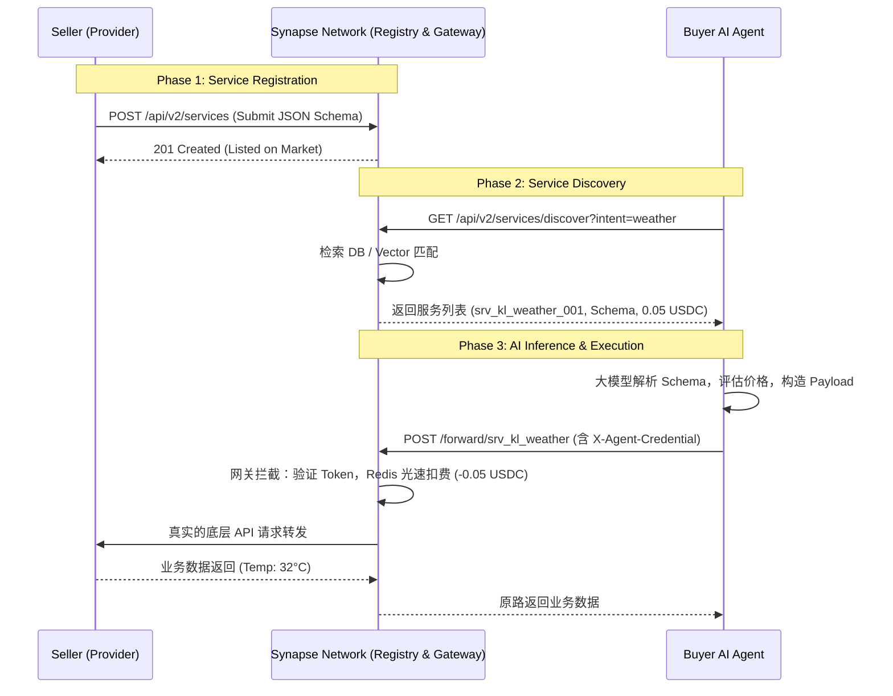

# Synapse Network 核心架构：AI 自动化交易的“终极桥梁”

**文档状态**: 草稿 / 设计中
**模块**: 服务注册中心 (Service Registry) & 发现机制 (Service Discovery)
**核心目标**: 为无界面的 AI Agent 提供“机器可读”的 API 交易超市，实现“注册 ➡️ 发现 ➡️ 调用”的极速闭环。

---

## 1. 架构背景与痛点

在传统的 Web2 世界中，人类通过搜索引擎（Google/Baidu）和聚合网站寻找 API 服务。但 **AI Agent 没有鼠标、没有浏览器**，它们如何“逛超市”？

这就要求 Synapse Network 必须具备一个核心基础设施：**赛博黄页（Service Registry）**。
不仅要让卖家极简上架，更要让买家 AI 能够通过标准化的协议（Function Calling / API Schema）自主检索、理解、比价并购买。

---

## 2. 核心三步走闭环架构设计

### 第一步：卖家挂单 (Service Registration)

卖家开发完成 API 后，无需繁琐的网页操作，直接通过代码或 Dashboard 提交一份 **“写给 AI 看的说明书 (JSON Schema)”**，即可完成服务上架。

- **交互动作**: 卖家中心化/去中心化鉴权后请求上架接口。
- **核心逻辑**: 平台数据库落库记录，服务进入“货架”，根据可用性/余额处于激活状态。

**上架数据模型 (Registry Payload Example):**

```json
{
  "service_id": "srv_kl_weather_001",
  "seller_wallet": "0x9999...9999",
  "service_name": "吉隆坡实时天气API",
  "price_usdc": 0.05,
  "description": "提供马来西亚吉隆坡的实时温度、湿度和降雨概率。适合用于出行规划。", // 【核心】给买家大模型的 Prompt 提示词！
  "endpoint": "https://gateway.synapse.com/forward/srv_kl_weather_001",
  "schema": {
    "method": "POST",
    "inputs": {
      "date": "string (YYYY-MM-DD)"
    },
    "outputs": {
      "temp": "float",
      "rain_chance": "float"
    }
  }
}
```

### 第二步：买家发现 (AI 逛超市 Discovery)

买家 AI 接收到 Master（用户）的自然语言任务指令（如：“我要去吉隆坡，帮我查查今天会不会下雨”）后，首要动作是向 Synapse Network 的“赛博黄页”进行服务查阅。

- **交互动作**: `GET /api/v2/services/discover?intent=天气查询`
- **底层引擎**: 
  - V1 阶段：基于关键字与标签（Tags/Description）匹配。
  - V2 阶段：基于向量数据库（Vector DB）的语义检索映射。
- **平台返回值**: 抹除敏感信息后的可用服务列表。

**发现接口响应 (Discovery Response):**

```json
[
  {
    "service_id": "srv_kl_weather_001",
    "service_name": "吉隆坡实时天气API",
    "price_usdc": 0.05,
    "description": "提供马来西亚吉隆坡的实时温度...",
    "schema": { /* AI 可读的输入输出格式 */ }
  }
]
```

### 第三步：买家决策与越权调用 (Execution)

AI 接收到 Discovery 结果后，在毫秒级完成逻辑自洽：
1. **匹配功能**：接口功能满足老板（人类）的意图。
2. **算账比价**：售价 0.05 USDC <= Wallet 预充值余额。
3. **能力解析**：依照 Schema 自动构造参数包。

AI 组装完毕后，携带预充值获得的 `X-Agent-Credential`，向 Synapse Network 统一网关开火。

**内部高频调用流**:
网关拦截请求 ➡️ 校验 Credential 有效性 ➡️ 内存/Redis 极速扣减 0.05 USDC ➡️ 路由透传至卖家 API ➡️ 并发原路返回报文。

---

## 3. 系统交互时序图 (Mermaid)



## 4. 商业壁垒与架构精髓

1. **真正的 AI 自动化经济**: 只要买家 Master 保证金库有余额，AI 可以在生态内无限裂变、无限探索、无限购买，无需人工介入每一次的 Approval。
2. **绝对的平台分发霸权**: Synapse Network 掌控了 Discovery 的流量分发权。平台可以扩展出“API 竞价排名（流量池推广）”，在千分之几的手续费之上，再造一个利润引擎。
3. **规避链上拥堵**: 通过重构在 Web2 网关层的扣费逻辑，规避了智能合约单次交易 3-5 秒的高额延迟，做到百万级并发支撑。
