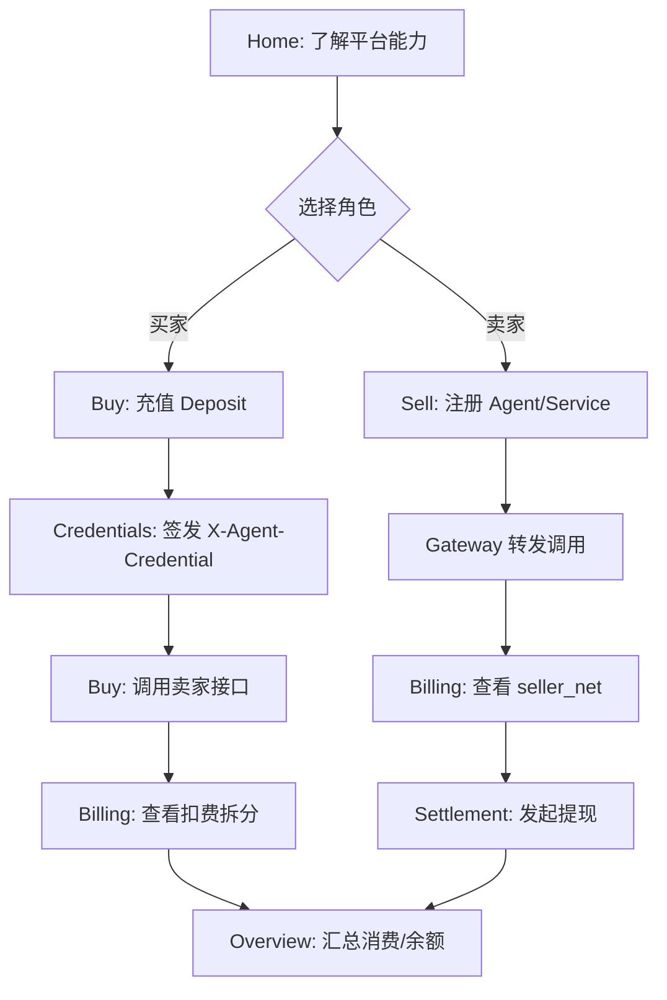

# 官网定位统一下的功能页面拆分设计（V1）

> 目标：围绕首页“Agent 支付与结算基础设施”定位，重构全站信息架构，让用户更容易上手、看懂花费与收入、完成从接入到结算的闭环。

---

## 1. 设计目标与原则

- **一眼看懂价值**：用户 30 秒内知道平台做什么、适合谁、怎么开始。
- **路径极简**：买家与卖家各自最多 4 步完成核心任务。
- **账务透明**：消费、收入、平台费拆分可追踪、可解释、可对账。
- **统一术语**：全站统一 `available_balance`、`unit_price`、`platform_fee`、`seller_net`、`request_id`。
- **流程闭环**：从充值担保 → 授信调用 → 扣费分账 → 结算提现/退款全部串联。

---

## 2. 统一信息架构（IA）

## 2.1 顶部导航（官网 + 产品）

1. `Home`（官网落地页）
2. `Overview`（账户总览）
3. `Buy`（买家工作台）
4. `Sell`（卖家工作台）
5. `Billing`（账单与流水）
6. `Settlement`（结算与提现）
7. `Credentials`（凭据管理）

> 当前已有路由可渐进映射，不必一次改完路径。

## 2.2 页面分层

- **L0 官网层**：讲清“我们是谁、优势、服务、接入方式”。
- **L1 控制台层**：按角色进入买家/卖家任务流。
- **L2 交易层**：充值、调用、分账、结算、退款。
- **L3 审计层**：流水、对账、异常、状态历史。

---

## 3. 功能模块拆分（按用户心智）

## 3.1 Home（官网首页）

**目标**：转化入口，不做复杂操作。

模块：
- 产品定位 Hero
- 3 大优势（安全、低延迟、透明）
- 买家/卖家双路径入口
- 扣费与收益公式说明
- CTA：`进入控制台`

## 3.2 Overview（总览页）

**目标**：一页看清账户状态。

模块：
- 可消费余额卡（`available_balance`）
- 今日消费、今日收入
- 平台费累计（对用户可见部分）
- 最近 10 笔关键事件（充值、调用、结算）
- 快速动作（充值、签发凭据、注册服务、提现）

## 3.3 Buy（买家工作台）

**目标**：最短路径完成“充值→调用”。

模块：
- 充值区（Deposit 发起 + 确认状态）
- 凭据区（签发/轮转/撤销）
- 服务发现区（可调用服务列表）
- 调用控制台（请求参数 + 结果）
- 消费明细（按 `request_id`）

## 3.4 Sell（卖家工作台）

**目标**：最短路径完成“接入→收款”。

模块：
- Agent 与 Service 注册
- `endpoint + unit_price + fee_rate` 配置
- 调用量与成功率
- 收入看板（`seller_net`、待结算）
- 结算入口（跳转 Settlement）

## 3.5 Billing（账单页）

**目标**：把“花了多少钱、赚了多少钱、平台抽了多少”讲清楚。

模块：
- 维度筛选（时间/角色/service_id/status）
- 调用账单表（`unit_price / platform_fee / seller_net`）
- 汇总条（总消费、总收入、净额）
- 导出（CSV）

## 3.6 Settlement（结算页）

**目标**：卖家提现、买家退款清晰可控。

模块：
- 待结算余额
- 提现申请（EIP-712 Claim）
- 最近结算记录（`batch_id / tx_hash`）
- 买家退款入口（剩余余额退款）

## 3.7 Credentials（凭据页）

**目标**：给 Agent 授权，控制风险。

模块：
- 签发凭据（TTL、max_calls、rpm、scope）
- 凭据列表（状态 `active/revoked/expired`）
- 审计日志（谁签发、何时使用、何时撤销）

---

## 4. 全流程串联（官网定位到交易闭环）

---

## 5. 关键数据模块（页面共用）

- **Balance Module**：`available_balance`, `locked_balance`
- **Usage Module**：`request_id`, `service_id`, `status`, `unit_price`
- **Fee Module**：`platform_fee`, `seller_net`, `fee_rate`
- **Credential Module**：`credential_status`, `max_calls`, `rpm`, `exp`
- **Settlement Module**：`seller_receivable`, `batch_id`, `tx_hash`

---

## 6. 状态与文案规范（统一）

- 未连接钱包：`请先连接钱包`
- 未签名登录：`请完成钱包签名登录`
- 充值确认中：`链上确认中，确认后可消费`
- 余额不足：`available_balance 不足，请先充值`
- 凭据失效：`credential_status 非 active，请重新签发`
- 调用失败回滚：`本次调用失败，已按策略回滚`

---

## 7. 页面重构实施顺序（建议）

### P0（2 周）
- 完成 Home/Overview 的定位统一
- Buy/Sell 双工作台入口打通
- Billing 显示扣费拆分
- Settlement 展示提现主流程

### P1（2~3 周）
- 凭据策略可视化（额度/限流/过期）
- 服务发现与调用体验优化
- 账单筛选与导出

### P2（持续）
- 预算预警与收益预测
- 多链支持
- 企业级审计视图

---

## 8. 验收指标（产品）

- 新用户首日完成首笔调用率 ≥ 60%
- 卖家 24 小时内完成服务注册率 ≥ 70%
- 账单页面平均停留时长提升（可读性增强）
- “费用不清晰”相关反馈下降

---

## 9. 一句话结论

这次页面拆分的核心不是“多做页面”，而是把一个复杂支付系统变成两条可执行路径：**买家快速调用、卖家稳定变现，并让扣费与收益始终透明**。