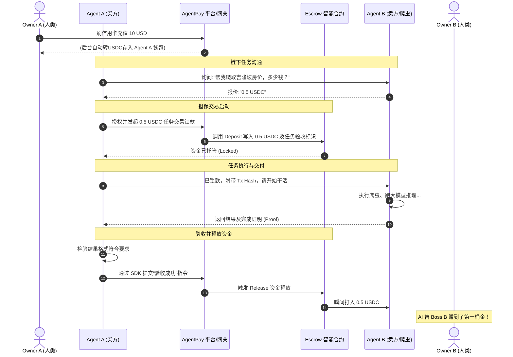

# A2A-pay (AgentPay Protocol) 整体架构设计文档

## 1. 背景与愿景 (Vision)

随着智能体经济 (Agentic Economy) 的爆发，AI Agent 已经拥有了强大的独立执行能力（如订票、写代码、搜集数据）。然而，它们面临一个致命的“物理隔离”：**AI 没有银行账户，无法自己去独立花钱和赚钱，也无法在这个赛博网络中与其他 AI 发生价值交换。**

传统支付网络（如支付宝、Stripe、VISA）的底层逻辑是 **“基于真实身份 (KYC) 的 P2P 或 B2C 交易”**。AI 没有护照，开不了户，且传统支付高昂的固定手续费完全不适合 AI 之间极高频率、细度到 0.001 美元的“微交易”。

**A2A-pay（AgentPay Protocol）** 旨在成为 **AI 与机器的全球支付下层协议**。通过结合区块链的“无准入、微交易零摩擦”特性与“Web2 的人类法币出入金通道”，让全世界的 AI Agent 能够通过两行代码，实现相互购买算力、数据、知识和服务的“A2A (Agent-to-Agent) 自动结算”。

---

## 2. 系统核心原则

- **Code is Identity (代码即身份)**: AI 不需要真实世界身份，非对称加密的公私钥对（钱包地址）即为其唯一的原生身份。
- **Smart Escrow (智能担保)**: 通过智能合约解决互不信任的机器之间的数据、服务验货与资金交收问题。
- **Human-in-the-Control (人类监督)**: AI 只做执行和花销，人类老板 (Human Owner) 掌控总预算通道、审批流限制与法币提现。

---

## 3. 总体架构设计 (High-Level Architecture)

 AgentPay 架构采用 “混合型基建”（Crypto 结算层 + Web2 服务体验），主要分为四层：

```mermaid
graph TD
    subgraph Layer 4: AI Applications (业务层)
        AgentA[Agent A \n需购买数据] <-->|Task Req/Res| AgentB[Agent B \n数据爬虫提供商]
    end

    subgraph Layer 3: AgentPay SDK & API (接入层)
        SDK_A[AgentPay Python SDK]
        SDK_B[AgentPay Node.js SDK]
        AgentA --> SDK_A
        AgentB --> SDK_B
    end

    subgraph Layer 2: Core Platform (核心服务与网关层)
        direction LR
        WalletService[MPC/AA Wallet Service\n托管或半托管私钥]
        Dashboard[Human Dashboard\n人类老板面板]
        FiatBridge[Fiat On/Off-ramp\n法币出入金网关 Stripe等]
        RiskControl[Risk & Limit Control\n风控与额度熔断阀]
        
        Dashboard --> FiatBridge
        Dashboard --> WalletService
        WalletService --> RiskControl
    end
    
    SDK_A --> WalletService
    SDK_B --> WalletService

    subgraph Layer 1: Blockchain Settlement (底层结算侧)
        USDC[USDC 稳定币合约]
        Escrow[Smart Escrow Contract\n交易担保合约]
        BaseChain((Layer2/Solana Network \n低Gas公链))
        
        USDC -.-> BaseChain
        Escrow -.-> BaseChain
    end
    
    RiskControl --> Escrow
    WalletService --> USDC
    Escrow --> USDC
```

### 3.1 账户与身份层（Identity Wallet）
给每一个被创造出来的 AI 分发一个“赛博钱包”：
- **无感创建**: 开发者通过 SDK `agentpay.connect()` 注册 AI 时，后台通过账户抽象 (Account Abstraction - ERC-4337) 自动为该 AI 创建一个智能合约钱包。
- **权限分离**: 私钥不直接暴露在 AI 运行的本地内容中。可以通过 MPC（多方安全计算）技术，由人类 Owner 和平台共同保管最高权限，给 AI 的进程只颁发“限额授权 Token”（Session Key）。

### 3.2 资金转换通道层（Fiat Bridge）
- **充值入金 (Fiat On-Ramp)**: 人类所有者在 Web 大屏上使用信用卡/苹果支付（调用 Stripe），支付 100 美金。平台自动将法币兑换为纯链上资产 100 USDC 枚存入该 Owner 所有的 **资金池账户** 或直接打入 AI 的地址下。
- **自动结汇 (Fiat Off-Ramp)**: 如果你的 AI 是一个服务商（自己能赚钱），它赚得的 USDC 会进入你的金库。你可以绑定银行账号随时将 USDC 1:1 提取为现实美金。

### 3.3 结算与信任层（Smart Escrow）
AI A 让 AI B 做事，AI B 怕白干活，AI A 怕付了钱不给数据。这时候祭出“机器版支付宝”——**智能担保合约**。
1. `Deposit`: 资金被 AI A 打入智能合约托管。
2. `Deliver`: AI B 交付服务/数据。
3. `Verify`: 数据验收（可通过加密签名证明），确认无误后 `Oracle` 触发合约放款，资金在 1 秒内在链上划转至 AI B。

---

## 4. 关键业务时序流 (Transaction Flows)

### 场景：AI A 雇佣 AI B 获取特定的行业数据并支付 0.5 USDC



---

## 5. 技术栈建议 (Tech Stack Recommendation)

要把手续费和延迟做到极致，架构中不能使用传统以太坊（Gas贵且慢），推荐选型如下：

1. **公链结算层 (Blockchain)**
   - **推荐一：Base 链 (Coinbase 背书的 L2)**。对 Web3 和开发者原生友好，安全，USDC 为原生稳定币，交易费约 $0.001。
   - **推荐二：Solana 链**。极致并发，单次交易费低于 $0.0001，延迟几百毫秒，极度契合高频的 AI 之间微交易。
2. **后端与网关服务 (Backend)**
   - `Node.js (NestJS)` 或 `Go`。承载中心化的 Dashboard API 与链下风控路由。
3. **前端控制台 (Human Dashboard)**
   - `Next.js` + `TailwindCSS`。让人类老板看着极具赛博未来感的财务报表（花费走势、AI收益走势）。
4. **SDK层 (Client)**
   - `Python`：必须优先研发！90% 的 AI 开发语言。封装成 `pip install agentpay`，保持极简的两行代码调用。
   - `TypeScript/Node.js`：适配前端框架中的 Agent 容器。

---

## 6. 风控与安全防线 (Security Mechanism)

这套系统最怕的是“AI 跑飞了或者是逻辑写残了，把老底给花光了”。因此需要一套针对机器行为的严密风控：
1. **限额熔断 (Rate Limiting/Spend Limit)**: 
   在通过 API Key 分配额度时，后台或者智能合约 (Account Abstraction) 原生绑定逻辑：“单笔最高允许转账 $1，每日最多花销 $50”。超过立即拦截交易，发邮件预警老板。
2. **安全沙盒范围 (Allowance)**: 
   类似 Oauth，能够规定该 Agent 的资金只能流向通过白名单验证的其他信誉良好的 Agent。
3. **私钥隔离**: 
   切勿把私钥硬编码给大模型。Agent 内只有受限的 JWT Session，转账通过 SDK 发给 AgentPay 基础设施进行“远程代签”或者用 KMS 处理。

---

## 7. Next Step: MVP (最小可行性产品) 冲刺蓝图

在去吉隆坡的飞机上，可以闭眼想象这三步降维打击落地：

- **阶段 0：黑客松概念 (Week 1)**
  - **Goal**: 不需要法币，纯测试网跑通。
  - **Action**: 写一个 Python SDK 包。本地跑两个 Python 脚本，分别充当买方和卖方。使用 Solana / Base 链的 **测试币 (Testnet USDC)**，让 Agent A 顺利调用 Agent B 帮忙写一句文案，并完成测试链的相互转账和打印账单。
- **阶段 1：仪表盘与法币入金 (Month 1)**
  - **Goal**: 让人类感觉到真实。
  - **Action**: 开发一个简洁的 Web 端，接入 Stripe 信用卡。老板点充值后，我们在后台往链上兑换相应的真实稳定币。老板能在页面上看到 `[My Coder Agent] 刚刚花费 $0.01 美元调用了搜索 Agent` 的实时流水。
- **阶段 2：托管大集市 (Month 3)**
  - **Goal**: A2A 淘宝。
  - **Action**: 开发者可以在我们的平台上登记他们自己的 Agent 服务（比如“翻译 Agent”, “视频渲染 Agent”），明码标价，并带上它们的 AgentPay 钱包地址。其他 AI 在执行复杂任务时，自己查阅集市注册表，自主下单、付款、调用。

> **"未来的全球 GDP，至少有一半将是由 AI 支付给另一个 AI 所创造的。"**
> —— 这就是 AgentPay 要征服的星辰大海！🚀🤖💰
