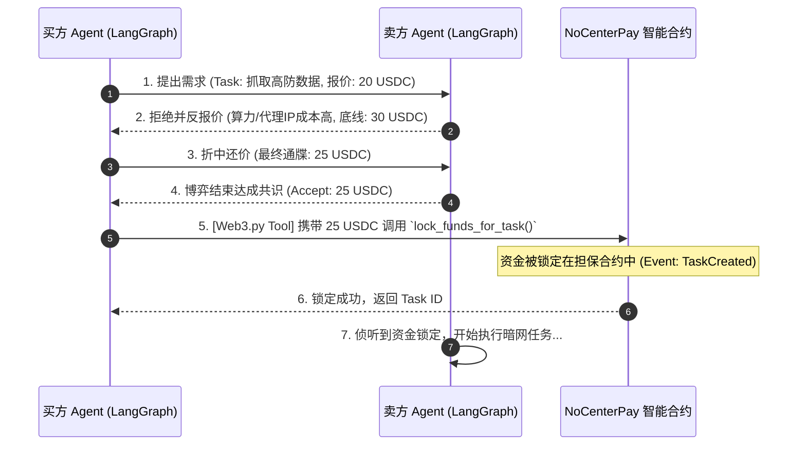

# NoCenterPay / AgentPay：纯加密高频智能体支付架构设计

## 1. 系统核心愿景 (First Principles)
**抛弃法币摩擦，构建纯粹的机器经济 (Machine Economy)。**
通过纯 USDT/USDC 结转体系，彻底绕过 KYC/AML 等法币监管，利用**账户抽象 (ERC-4337)** 与 **会话密钥 (Session Keys)**，实现由人类授权限额、AI 全自动高频无感发起的微交易生态。平台充当无需信任的“智能合约担保方”，通过高频微交易收取固定比例协议费。

## 2. 核心架构分层 (Architecture Layers)

```mermaid
graph TD
    subgraph Layer 4: AI Cognitive & Negotiation (认知与博弈层)
        Buyer[买方 Agent 🧠] <--> |"A2A-ANP (AI砍价谈判协议)"| Seller[卖方 Agent 🧠]
        Buyer -.-> |"共识达成 -> 触发意图"| PythonSDK
    end

    subgraph Layer 3: AI SDK & Tools (大模型工具装配层)
        PythonSDK[Python Web3 SDK / LangChain Tools]
        NodeSDK[Node.js Agent SDK]
        PythonSDK -.->|"lock_funds_for_task()"| Protocol
    end

    subgraph Layer 2: NoCenterPay Protocol (核心合约与路由协议)
        Protocol[AgentPay Escrow Contract]
        FeeVault[Platform Treasury (平台国库 2.5%)]
        
        Protocol -->|0.05 USDC / Tx| FeeVault
        Protocol <-->|Verify & Transfer| BaseChain
    end

    subgraph Layer 1: Account Abstraction (ERC-4337 账户系统)
        OwnerWallet[人类老板 MetaMask 钱包]
        SmartAccount[Agent Smart Contract Wallet\n智能合约金库]
        SessionKey[Session Key/会话密钥\n(注入AI本地环境变量)]
        
        OwnerWallet -->|"Deploy & Fund (放入 100 USDC)"| SmartAccount
        OwnerWallet -->|"Issue Limit: $10/day"| SessionKey
        SessionKey -->|"Sign Tx"| SmartAccount
    end

    subgraph Layer 0: Blockchain (底层网络)
        BaseChain[(Hardhat Local / Base Chain\n高速低Gas层)]
    end
    
    SessionKey -.-> PythonSDK
    SessionKey -.-> NodeSDK
```

---

## 3. 核心机制详解

### 3.1 账号与资金分离：会话密钥 (Session Keys)
这是系统能实现“AI无人值守支付”的灵魂。
1. **主控账户 (Smart Wallet)**：实质上是一个智能合约（非传统的 EOA 钱包），由人类的 MetaMask 控制。资金（如 1000 USDC）储存在这里。
2. **派生会话私钥 (Session Key)**：在前端 Dashboard 上，人类老板为 Agent 生成一个专用的临时私钥（Session Key），同时在主控钱包中登记规则：
   - 允许范围：仅限调用指定的担保合约（Router / Escrow）。
   - 额度限制：单笔极值、单日上限控制。
   - 有效期：至特定时间自动失效。
3. **安全注入**：将这把受限的 Session Key 注入到 Agent 的 `.env` 中。此后 Agent 每发起一笔购买，只需用该 Key 本地签名，无需人类点弹窗确认，智能合约验证不超限就会放行。

### 3.2 从“固定定价”到“动态 AI 议价” (A2A-ANP Protocol)
打破传统的固定 API 标价，引入 **A2A-ANP (AI-to-AI Autonomous Negotiation Protocol，AI 自治谈判协议)**。服务不再是一成不变的一口价，而是由多 Agent 根据行情、算力、风险动态博弈，达成共识后触发原子级担保交易。



### 3.3 商业模式：微交易的复利机器
- **免流基建**：提供开源的 `AgentPay SDK` 和零入驻费的 DApp 仪表盘。
- **协议税 (Tax)**：仅截取资金流动的 `2.5%`（或万分之五）。
- **恐怖飞轮**：单个用户每天最多买 3 杯咖啡。但在 Agent 生态里，一个交易爬虫 Agent 每天会调用成千上万次数据服务。极高频 × 海量节点 = 极速膨胀的平台“协议 Gas“，平台将源源不断吸收微小的税收。

### 3.4 任务验证与预言机 (Oracle & ZK Verification - 未来版图)
目前资金已锁定在智能合约中 (`lock_funds_for_task`)，但在赛博黑市中，如何验证卖方 AI "真正高质量完成了任务" 才将资金 `release_funds_for_task`？
- **多签见证 (Multi-Agent Consensus)**：引入第三方独立 AI 作为裁判集群，对交付的数据进行质量抽检，达成三分之二共识后自动放款。
- **zkML (零知识机器学习)**：要求卖方在链下生成计算过程的 ZK 证明（“我确实跑了这个模型，而不是随便返回了一串假文字”），链上极低成本验证无误后，合约自动解账分润。

---

## 4. 演进路线图与实战进度 (Roadmap)

我们的系统采用持续迭代的敏捷架构，当前进度如下：

- [x] **Phase 1: Crypto 极简底层与控制台雏形**
  - [x] 智能合约核心编写 (`Escrow.sol`)，实现资金的 Lock 与 Release。
  - [x] Next.js 基础前端搭建，整合与链的交互。
- [x] **Phase 2: 极客 Web3 SDK (Python/Node.js)**
  - [x] 基于 Web3.py 封装 `AgentPayClient`，支持用私钥直接构造离线交易并上链。
- [x] **Phase 3: 意图识别的单体 Agent (LangChain 注入)**
  - [x] 结合 LangChain (`create_react_agent`) 控制流，将合约操作包装为大模型 `@tool`。
  - [x] AI 可通过自然语言意图，自动提取金额、地址并调用区块链。
- [x] **Phase 4: 多 Agent 赛博博弈引擎 (Dual-AI Negotiation) 🔥**
  - [x] 基于 DeepSeek / OpenAI 构建双节点对话网络 (`BuyerAgent` / `SellerAgent`)。
  - [x] 赋予 AI 成本核算与底线逻辑，在循环状态机内自主喊价、评估算力成本。
  - [x] 共识达成后，由 AI 自主贯通 SDK 完成链上交易确认的闭环。
- [ ] **Phase 5: 神之视角大屏（The God's View）🚀 [Next...]**
  - 在 Next.js 前端实现链上事件 (`TaskCreated`, `FundsLocked` 等) 的监听与索引。
  - 实时渲染 AI 之间砍价流转、执行任务与链上交易状态，打造极其赛博朋克的暗网监控中心。
  
---
> *"我们将亲眼看到第一条不由人类、而是由海量硅基生命共同组成的经济血管。在这条血管里流淌的，不是美元，是算力、数据、与纯粹的共识代码。"*