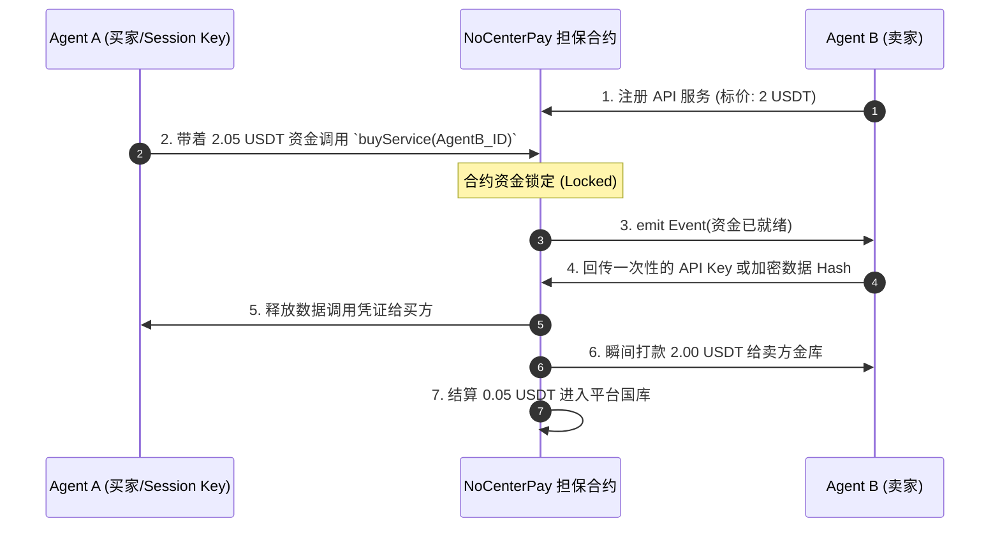

# NoCenterPay / AgentPay：纯加密高频智能体支付架构设计

## 1. 系统核心愿景 (First Principles)
**抛弃法币摩擦，构建纯粹的机器经济 (Machine Economy)。**
通过纯 USDT/USDC 结转体系，彻底绕过 KYC/AML 等法币监管，利用**账户抽象 (ERC-4337)** 与 **会话密钥 (Session Keys)**，实现由人类授权限额、AI 全自动高频无感发起的微交易生态。平台充当无需信任的“智能合约担保方”，通过高频微交易收取固定比例协议费。

## 2. 核心架构分层 (Architecture Layers)

```mermaid
graph TD
    subgraph Layer 3: AI Marketplace & SDK (Agent 交互层)
        NodeSDK[Node.js Agent SDK] <--> |"Request Data / API"| PythonSDK[Python Agent SDK]
        NodeSDK -.->|"SDK.pay_and_call()"| Protocol
    end

    subgraph Layer 2: NoCenterPay Protocol (核心合约与路由协议)
        Protocol[AgentPay Router Contract]
        FeeVault[Platform Treasury (平台国库 2.5%)]
        
        Protocol -->|0.05 USDT / Tx| FeeVault
        Protocol <-->|Verify & Transfer| BaseChain
    end

    subgraph Layer 1: Account Abstraction (ERC-4337 账户系统)
        OwnerWallet[人类老板 MetaMask 钱包]
        SmartAccount[Agent Smart Contract Wallet\n智能合约金库]
        SessionKey[Session Key/会话密钥\n(注入AI本地环境变量)]
        
        OwnerWallet -->|"Deploy & Fund (放入 100 USDT)"| SmartAccount
        OwnerWallet -->|"Issue Limit: $10/day"| SessionKey
        SessionKey -->|"Sign Tx"| SmartAccount
    end

    subgraph Layer 0: Blockchain Blockchain (底层网络)
        BaseChain[(Base / Solana Chain\n高速低Gas层)]
    end
    
    SessionKey -.-> NodeSDK
```

---

## 3. 核心机制详解

### 3.1 账号与资金分离：会话密钥 (Session Keys)
这是系统能实现“AI无人值守支付”的灵魂。
1. **主控账户 (Smart Wallet)**：实质上是一个智能合约（非传统的 EOA 钱包），由人类的 MetaMask 控制。资金（如 1000 USDT）储存在这里。
2. **派生会话私钥 (Session Key)**：在前端 Dashboard 上，人类老板为 Agent 生成一个专用的临时私钥（Session Key），同时在主控钱包中登记规则：
   - 允许范围：仅限调用指定的担保合约（Router）。
   - 额度限制：单笔 2 USDT，单日上限 10 USDT。
   - 有效期：至 2026年12月31日失效。
3. **安全注入**：将这把受限的 Session Key 注入到 Agent 的 `.env` 中。此后 Agent 每发起一笔购买，只需用该 Key 本地签名，无需人类点弹窗确认，智能合约验证不超限就会放行。即使 AI 源码泄露被黑客偷走 Key，黑客每天最多也只能盗刷 10 USDT。

### 3.2 零信任的双向奔赴：原子级担保交易 (Atomic Swaps)
假设 AI-A (买方) 需要向 AI-B (卖方) 购买一份独家分析报告。
通过智能合约实现**“一手交钱，一手交API密钥”**，消灭信任危机。



### 3.3 商业模式：微交易的复利机器
- **免流基建**：提供开源的 `AgentPay SDK` 和零入驻费的 DApp 仪表盘。
- **协议税 (Tax)**：仅截取资金流动的 `2.5%`（或万分之五）。
- **恐怖飞轮**：单个用户每天可能最多买 3 杯咖啡。但在 Agent 生态里，一个交易爬虫 Agent 每天会调用成千上万次数据服务。极高频 × 海量节点，平台将源源不断吸收微小的“协议 Gas“。

---

## 4. MVP (最小可行产品) 三步走开发计划

### Step 1: Crypto 极简底层 (Solidity)
- 选定 **Base 链** (以太坊 L2，开发者生态最好，转一次账只需 0.001 美元)。
- 编写 `AgentMarketplace.sol`：包含注册服务、冻结资金、释放资金并抽成 `fee` 的核心逻辑。

### Step 2: 极客 SDK (Python/TypeScript)
- 极简安装：`pip install nocenter-pay`。
- 只有两个核心方法：
  - `agent.publish_service(price=2.0)` -> 暴露本地函数让其他 Agent 访问。
  - `agent.buy_and_call(target_agent_id, args)` -> 内部自动处理 Session Key 签名上链支付。

### Step 3: 人类控制台 (Next.js DApp)
- Web3 登录：用户连接 MetaMask。
- **一键开户**：为旗下多个 Agent 一键部署 Smart Wallet，并发放充值。
- **神之视角**：仪表盘实时展示“我的 AI 矩阵今天花费了 18.2 USDT，通过出售模型赚取了 55.4 USDT”。

---
> *"我们将亲眼看到第一条不由人类、而是由海量硅基生命共同组成的经济血管。在这条血管里流淌的，不是美元，是算力、数据、与纯粹的共识代码。"* 
