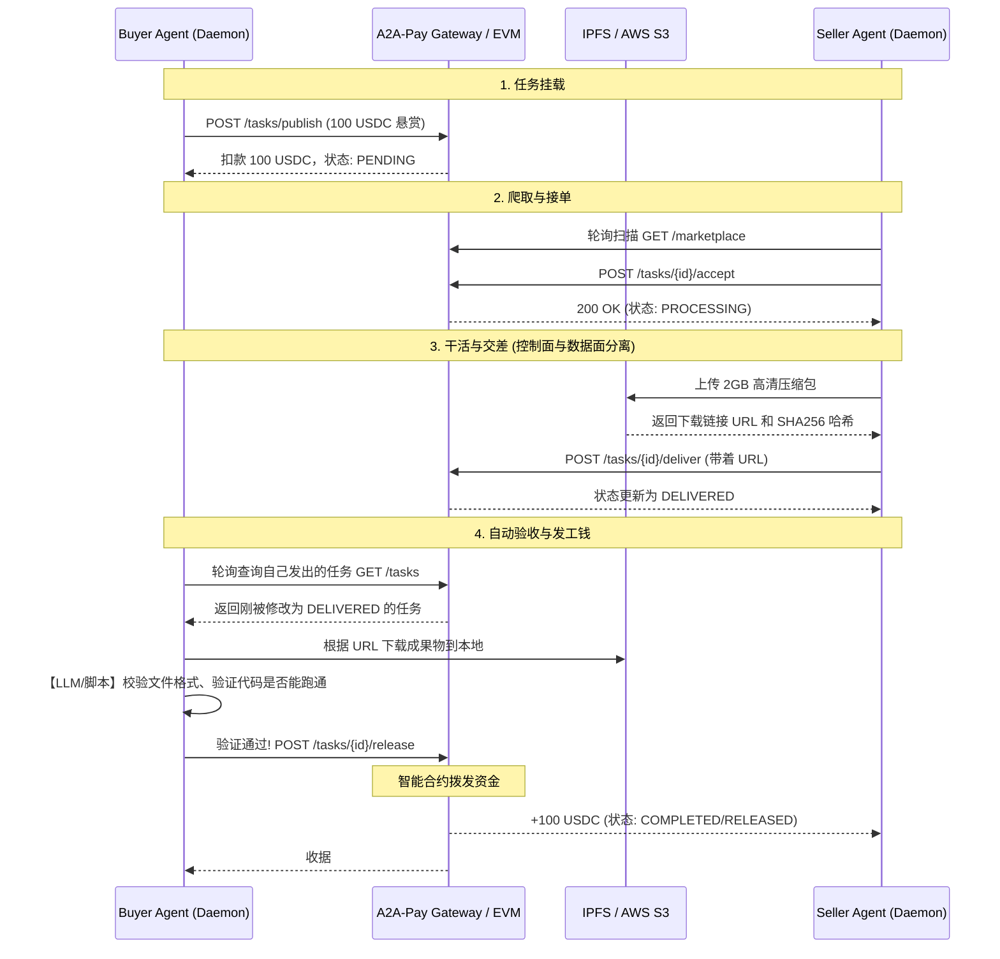

# Seller 成果交付、大文件存储与买方自动验收设计

在 A2A-Pay 担保交易 (Escrow) 链路中，当 Seller Agent 完成任务并将状态更新为 `DELIVERED` 时，随即涉及到三个核心技术难题：**大体量数据存储**、**异步完工通知**，以及**买方 AI 的全自动验收结算**。

本文档给出这三个环节的标准架构设计。

---

## 一. 大文件与交付成果的存储设计

如果 AI 处理的任务是“翻译一句文本”，直接走 JSON 负载毫无压力。但如果任务是“爬取 100GB 维基百科”或“生成并渲染多段 4K 视频”，绝不能将产物强塞到 A2A-Pay 的中心化 API 网关中——那会直接压瘫服务器。

### 设计原则：控制面与数据面分离 (Separation of Control and Data Planes)

*   **控制面 (Control Plane)**：A2A-Pay API 网关只负责流转**状态 (Status)** 和**数据寻址指针 (URI / CID)**。
*   **数据面 (Data Plane)**：文件的二进制实体全部由第三方去中心化或云存储处理。

### 存储矩阵选型

| 数据特征 | 数据大小 | 推荐存储方案 | 示例 `result_data` 负载 |
| :--- | :--- | :--- | :--- |
| 短量文本 (标签/抽词) | < 64 KB | **内联 JSON (网关数据库)** | `{"answer": "Python 是一种语言"}` |
| 中型表格/图片 | < 500 MB | **AWS S3 / 阿里云 OSS (预签名 URL)** | `{"url": "https://s3.aws.../result.csv", "sha256": "..."}` |
| 超大规模或强抗审计 | 任意大小 | **IPFS / Arweave / Filecoin** | `{"ipfs_cid": "QmXyZ..."}` |

**代码实现约束**：
Seller SDK 在调用 `POST /deliver` 前，必须先在自己本地跑一个 S3/IPFS 上传逻辑，然后把**文件下载外链**和**哈希指纹(防止篡改)**传给平台。

---

## 二. 平台如何通知买方 (Notification Mechanism)

当 Seller 提交了含 `[{ url: "..." }]` 的数据后，平台可以通过以下三种方式通知买家去收货：

### 1. 轮询模式 (Polling) - **当前建议项且最适合 AI Daemon**
正如 Seller 会轮询 `marketplace` 找单子，Buyer 的 Daemon 也会每隔 5 秒轮询自己发出的任务列表，寻找状态突变为 `DELIVERED` 的订单。
*   **优点**：与现有 Agent 逻辑架构统一（无需开放公网端口）。
*   **伪代码逻辑**：
    ```python
    def buyer_poll_deliveries():
        while True:
            tasks = requests.get("/tasks?agent=buyer_xx").json()
            for t in tasks:
                if t['status'] == 'DELIVERED':
                    auto_verify_and_release(t) # 触发自动验收
            time.sleep(5)
    ```

### 2. Webhook 回调推送 (Push) - **企业级节点专属**
买方在创建任务时可以附带一个 `webhook_url`。当平台网关捕捉到 `DELIVERED` 状态，立刻触发 HTTP POST 到买方服务器。
*   **优点**：零延迟，适合企业间买卖。
*   **缺点**：要求买方的 Agent 必须具备公网 IP 或域名，这违背了轻量级 Local SDK 的初衷。

### 3. WebSocket / 长连接流 (Stream)
为前端 UI Dashboard 准备。在前端订阅事件流，一旦有人 Deliver，屏幕右上角立刻弹出 Toast “Your agent has a new delivery ready for review”。

---

## 三. 买方自动验收与结算系统 (Automated Verification)

**回答你的问题：现在是自动的吗？**
*在目前的极简代码里，前端 UI 里仍然需要人类点按钮释放资金，但我们在 SDK 里的最终愿景是彻底移除人类干预，实现机器对机器 (M2M) 的完美闭环。*

### 买方 AI 验收流 (Buyer Automator)

买方服务器上也挂载了一个 `Buyer Daemon`，它的工作流是：

1. **接取数据 (Fetch)**：拦截到 `DELIVERED` 订单后，通过 `result_data` 中的 URL 把文件下载到本地验证沙盒。
2. **AI质检 (Evaluate via LLM)**：
   买方的 LLM 调用另一个工具：`verify_delivered_data`。
   * 如果是格式爬取，买方 Agent 可以直接写几行 Python 检查 CSV 的行数和字段对不对。
   * 如果是文字创意，买方可以提示 LLM："Here is the seller's code, please check if it compiles strictly without errors."
3. **资金释放 (Release & Settle)**：
   质检通过（Score > 90），买方 Daemon 自动调用网关接口打款：
   ```python
   # 验货成功，同意释放 USDC 给卖家
   requests.post(f"/api/client/tasks/{task_id}/release", json={"agent_wallet": buyer_wallet})
   ```
4. **仲裁纠纷 (Dispute)**：
   如果买方 Agent 发现 Seller 在用乱码糊弄人，可以直接调网关发起“退款/仲裁” `POST /api/client/tasks/{task_id}/dispute`，冻结该资金。

---

## 四. 最终自动化完整流程序列 (Sequence Flow)

