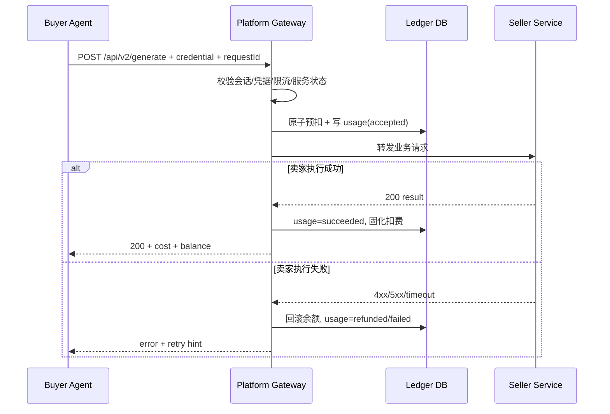

# 扣款详细设计文档（Gateway Deduction）

> 依据《扣款核心》《核心架构》《结算核心》整理。  
> 定位：高频小额场景中的“平台网关扣费引擎”设计说明。

---

## 1. 设计目标

- **低延迟**：调用路径不触发逐笔链上交易。
- **强一致**：余额扣减与调用流水同事务。
- **可回滚**：卖家执行失败时可自动退款/回滚。
- **可审计**：每笔扣款均可追溯到请求、凭据、服务、结算批次。

---

## 2. 扣款边界与原则

### 2.1 扣款发生位置

只允许在 **平台网关** 扣款，不允许买家直连卖家后再补账。

### 2.2 扣款触发时机

- 触发点：请求到达网关并通过鉴权后。
- 建议策略：**预扣（accepted）→ 成功固化（succeeded）→ 失败回滚（refunded）**。

### 2.3 扣款金额来源

- 来源：`Service Registry.unitPrice`（服务注册价格）。
- 手续费：`platformFee = unitPrice * feeRate`。
- 卖家净收入：`sellerNet = unitPrice - platformFee`。

---

## 3. 端到端扣款流程

---

## 4. 状态机

### 4.1 Usage 状态

- `accepted`：已预扣，等待卖家处理。
- `succeeded`：卖家成功返回，扣费固化。
- `failed`：失败但不退款（可选策略）。
- `refunded`：失败并全额回滚（默认建议）。

### 4.2 余额状态

- `available_balance`：可消费余额。
- `locked_balance`：预扣期间锁定金额（可选实现）。

---

## 5. 幂等与防重放

## 5.1 requestId 幂等键

每次调用必须带 `X-Request-Id`（或 body `requestId`），规则：
- 全局唯一（建议 UUID/ULID）。
- 同一 `requestId` 重试时：
  - 若已有 `succeeded`：直接返回同结果摘要或 409 幂等命中。
  - 若 `accepted` 且未超时：返回处理中。
  - 若 `refunded/failed`：按策略允许重试并生成新 `requestId`。

## 5.2 数据库约束

- `usage_records.request_id` 唯一索引。
- 扣款事务内必须检查唯一约束，防重复扣款。

---

## 6. 原子扣款事务设计

同一事务完成以下操作：

1. 校验余额 `available_balance >= unitPrice`
2. `available_balance -= unitPrice`（或转入 `locked_balance`）
3. 写入 `usage_records(status=accepted)`
4. 写入审计日志 `DEDUCTION_ACCEPTED`

事务失败则全部回滚。

---

## 7. 失败回滚策略

默认策略（推荐）：
- 卖家返回 5xx / 超时 / 网络错误：`refunded`（全额回滚）
- 买家参数错误（网关前置校验失败）：不扣费
- 买家恶意高频重试：触发限流，不扣费

可选策略（后续）：
- 卖家执行启动后失败，扣固定通道费（例如 `unitPrice * 5%`）

---

## 8. 响应头与对账

网关返回给买家的 header：
- `X-AgentPay-Cost`: 本次计费金额
- `X-AgentPay-Balance`: 扣费后余额
- `X-AgentPay-Request-Id`: 对账 ID

买家 Agent 可用这些字段进行自动预算与余额预警。

---

## 9. 风险控制

### 9.1 扣款前风控
- 凭据有效性（未过期/未撤销/未超配额）
- owner/agent/service 三维限流
- 服务状态 `isActive`

### 9.2 扣款后风控
- accepted 超时扫描（防“卡单”）
- 自动退款补偿任务
- 异常卖家 endpoint 熔断

---

## 10. 与结算模块对接

扣费固化时写入以下结算字段：
- `platform_fee`
- `seller_net`
- `seller_address`
- `settled=false`

结算引擎按 `settled=false AND status=succeeded` 聚合卖家应收，执行签名提现或批量结算。

---

## 11. 最小接口建议（扣款相关）

- `POST /api/v2/generate`：网关扣款与转发入口
- `GET /api/v2/balance`：余额查询
- `GET /api/v2/usage/logs`：调用与扣费明细
- `POST /api/v2/usage/reconcile`（内部）: 卡单/异常补偿

---

## 12. 监控指标（必须）

- `deduction_attempt_total`
- `deduction_success_total`
- `deduction_refund_total`
- `deduction_insufficient_balance_total`
- `deduction_p95_latency_ms`
- `accepted_stuck_count`

---

## 13. 验收标准

1. 同 `requestId` 不重复扣款。  
2. 卖家失败时余额可自动回滚。  
3. 扣费流水可按 buyer/seller/service 查询。  
4. 扣费结果能被结算模块无缝聚合。  
5. 压测下扣款路径满足目标延迟（例如 P95 < 80ms，不含卖家业务耗时）。

---

## 14. 一句话结论

扣款系统的正确姿势是：**平台网关统一入站、先鉴权风控、原子预扣、结果驱动固化/回滚、全程可审计并可结算**。这套机制能在高频小额场景同时保证体验、收益和安全。