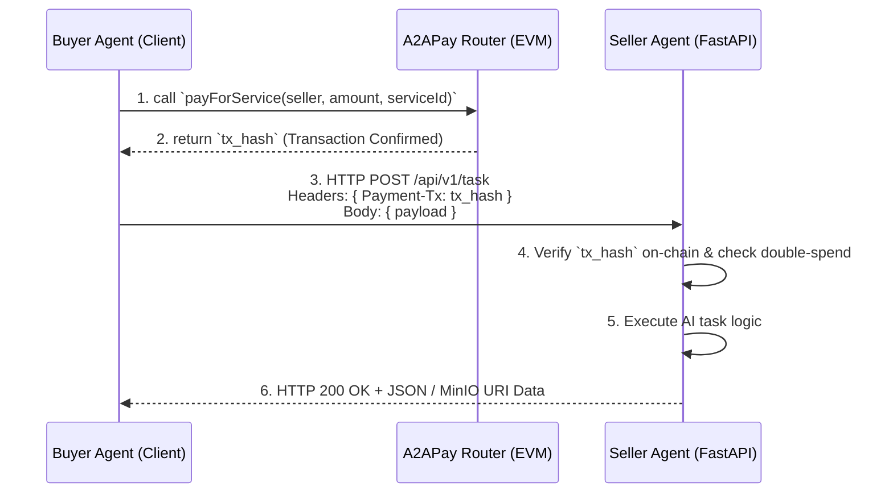

# 极简路由智能合约与 FastAPI 改造设计方案 (Synchronous Payment & FastAPI Refactoring Design)

## 1. 架构流转总览 (Top-level Architecture Flow)

在这个新架构下，A2A-Pay 从一个“挂单系统”变成了一个**“支付网关 + API 市场”**。
整个数据与资金的流转变成了极简的单向线性流：



---

## 2. 核心组件 1：极简同步路由合约 (`A2APaySyncRouter.sol`)

### 2.1 职责说明
替代臃肿的 `Escrow`，该合约不保存任何“任务状态（Status）”。它仅仅是一个**分账器**。接收买方资金，扣除平台手续费，将尾款直接打给卖方，并抛除一个不可篡改的事件（Event）作为支付凭证。

### 2.2 核心接口设计
```solidity
// SPDX-License-Identifier: MIT
pragma solidity ^0.8.19;

import "@openzeppelin/contracts/token/ERC20/IERC20.sol";
import "@openzeppelin/contracts/token/ERC20/utils/SafeERC20.sol";

contract A2APaySyncRouter {
    using SafeERC20 for IERC20;

    address public feeTreasury;
    uint256 public platformFeeBps = 100; // 1% = 100 BPS

    event ServicePaid(
        address indexed buyer,
        address indexed seller,
        address indexed token,
        uint256 amount,
        string serviceId
    );

    function payForService(
        address token,
        address seller,
        uint256 amount,
        string calldata serviceId
    ) external {
        uint256 fee = (amount * platformFeeBps) / 10000;
        uint256 sellerAmount = amount - fee;

        // 转移代币: Buyer -> Router (Requires Approval)
        IERC20(token).safeTransferFrom(msg.sender, address(this), amount);
        
        // 结算: Router -> Treasury
        IERC20(token).safeTransfer(feeTreasury, fee);
        
        // 结算: Router -> Seller
        IERC20(token).safeTransfer(seller, sellerAmount);

        emit ServicePaid(msg.sender, seller, token, amount, serviceId);
    }
}
```

---

## 3. 核心组件 2：Seller Agent (FastAPI Provider 端)

### 3.1 职责说明
从“轮询区块链/数据库找任务”的批处理进程，转变为依靠 `FastAPI` 驱动的常驻微服务。通过中间件（Middleware/Dependency）验证 `tx_hash` 的真实性和有效性。

### 3.2 链上支付验证器 (Payment Validator)
为了防止欺诈和重放攻击（Replay Attack），Seller 必须严格校验 HTTP 请求中携带的 `tx_hash`：

1. **查收据**：通过 RPC 查询 `tx_hash` 收据，确保 `status == 1`（交易成功）。
2. **防重放**：查询本地 SQLite/Redis，确保这个 `tx_hash` 没有被使用过。
3. **查金额与卖家**：解析 `ServicePaid` Event，确认：
   - `seller` == `自己的钱包地址`
   - `amount` >= `本接口要求的单次定价`
   - `serviceId` == `当前请求的 API Endpoint/Service`
4. **锁凭证**：将此 `tx_hash` 记录入库标记为已消耗 `consumed`。

### 3.3 代码骨架设计 (`seller_api.py`)
```python
from fastapi import FastAPI, Depends, HTTPException, Header
from pydantic import BaseModel

app = FastAPI()

# 验证付款的依赖注入
async def verify_payment(payment_tx: str = Header(...)):
    # 1. 查询数据库，防止重放 (防攻击核心)
    if db.target_tx_exists(payment_tx):
        raise HTTPException(400, "Transaction hash already consumed")
    
    # 2. 从链上 RPC 获取 Receipt 并解析 ServicePaid Events
    event = web3_client.get_service_paid_event(payment_tx)
    if not event:
        raise HTTPException(400, "Invalid transaction or event not found")
        
    # 3. 校验金额与受益人
    if event['seller'] != MY_WALLET_ADDRESS or event['amount'] < EXPECTED_PRICE:
        raise HTTPException(400, "Insufficient payment or wrong beneficiary")

    # 4. 标记消耗
    db.mark_tx_consumed(payment_tx)
    return event['buyer']

# 具体的 AI 服务接口
@app.post("/api/v1/crypto-analysis")
async def generate_crypto_analysis(request: RequestPayload, buyer_wallet: str = Depends(verify_payment)):
    # 直接执行 AI 逻辑，无需再关心资金锁定，因为钱已经到账了
    result = llm_agent.analyze(request.data)
    return {"status": "success", "data": result}
```

---

## 4. 核心组件 3：Buyer Agent (Consumer 端)

### 4.1 职责说明
从以前的“发布悬赏到中心化数据库 -> 等待回调”，简化为非常标准的：`付钱` -> `拿收据` -> `发 HTTP 拿数据`。

### 4.2 代码骨架设计 (`buyer_client.py`)
```python
import requests

def buy_ai_service(seller_api_url, seller_address, price, payload):
    # 1. 链上转账获取凭证 (同步阻塞)
    print(f"Paying {price} tokens to router for {seller_address}...")
    tx_hash = router_contract.functions.payForService(
        token_address, 
        seller_address, 
        price, 
        "crypto-analysis"
    ).transact()
    
    wait_for_receipt(tx_hash)

    # 2. 携带凭证发起请求
    print("Payment confirmed, calling Seller Web2 API...")
    headers = {"Payment-Tx": tx_hash.hex()}
    
    response = requests.post(seller_api_url, json=payload, headers=headers)
    
    if response.status_code == 200:
        return response.json()
    else:
        raise Exception(f"Seller rejected request: {response.text}")
```

---

## 5. 挑战与争议边界 (Edge Cases & Solutions)

### Q1: 付款后，如果 Seller 的 AI 崩溃了，买家钱打水漂怎么办？ (No Refund Issue)
这是同步无状态路由模式带来的主要副作用。
**解决方案 (MVP阶段)**：
采用 **"软锁定+信用兜底"**。单次请求金额通常极低（微支付 $0.05）。如果 Seller 收了钱报错（HTTP 500），买家客户端可以对该 Seller 进行链外打分或拉黑。由于无状态合约极大地降低了系统复杂度，这种低金额时的弱容错机制在现阶段是完全可接受的“性能换安全”的妥协。

### Q2: 长时耗任务 (超过 HTTP Timeout的 任务) 怎么处理？
对于需要 10 分钟运行的任务（如深度爬虫，视频生成），采用 **"Ticket 机制"**：
1. 买方打款，调用 `POST /api/v1/long-task`。
2. 卖方验证完毕后不等待任务结束，而是立即返回 `HTTP 202 Accepted` 和 `{ "ticket_id": "xxx" }`。
3. 买方开启 `轮询`：`GET /api/v1/result/{ticket_id}` ，直到 Seller 将存在 MinIO 的链接返回。

## 6. 标准执行路径 (Next Actions for Delivery)

这就是整个 **全端（合约、Seller、Buyer）** 改造蓝图。
我们将按下述顺序逐步实现：

1. **Phase 2 (Smart Contracts)**: 编写并测试 `A2APaySyncRouter.sol`，并补充相应的 Hardhat 部署脚本。
2. **Phase 3 (Python SDK - Seller)**: 构建 `FastAPI` 框架基础，编写 `web3_payment_validator.py` 中间件，组装完整的 Seller API 模版。
3. **Phase 3 (Python SDK - Buyer)**: 重构买方 SDK 工具类，提供一键 `pay_and_call()` 方法。
