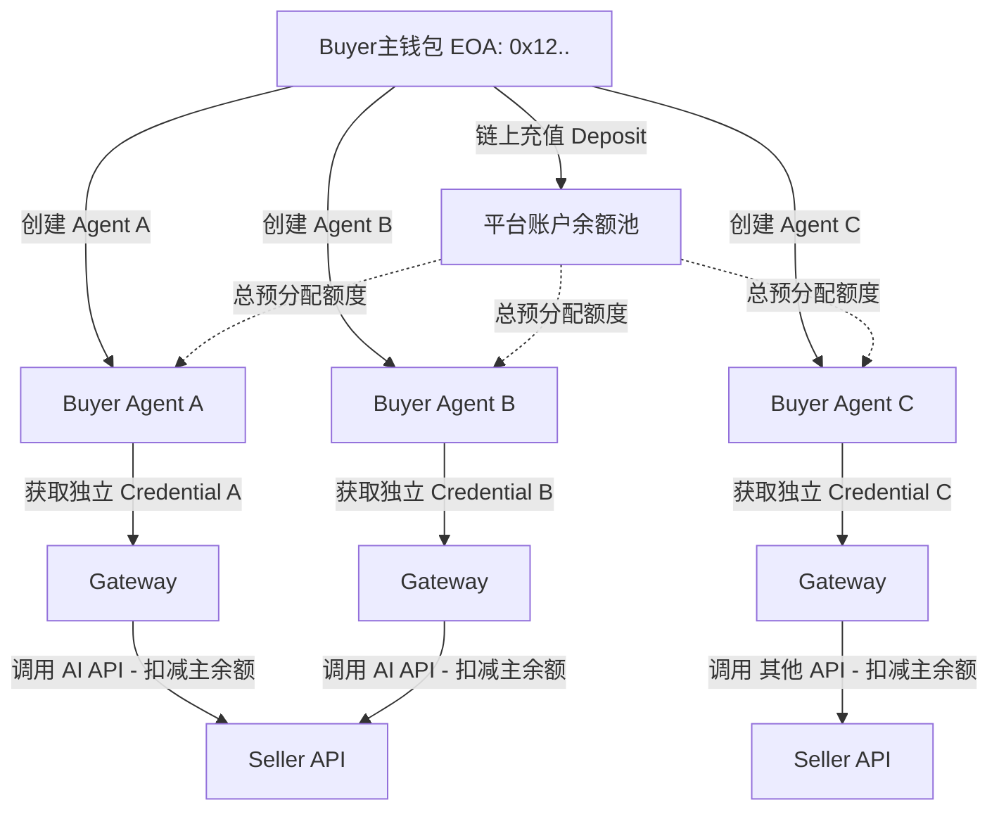

# 买家端架构设计：钱包与Agent的拓扑关系与资金/凭据管理

## 1. 核心设计：一对多（1 Wallet -> N Agents -> 1 Fund）

在 A2A-Pay 平台中，买家的钱包（Wallet）与买方智能体（Buyer Agent）的关系设计为**一对多**。
并且，充值担保（Deposit）是**挂载在主钱包地址**上的，所有归属于该钱包的 Agent **共享同一个资金池**。而凭据（Credential）是**按挂载在每个具体的 Agent 上**分配的。

也就是说：
- **资金（Deposit / 余额）公用**：主钱包统一进行链上充值（Deposit），这笔资金形成了该钱包维度的总余额池。
- **凭据与调用（Credential）独立**：主钱包可以为不同的任务或不同的机器实例创建不同的 Agent，平台为每个 Agent 签发独立的 `X-Agent-Credential`。
- **账单聚合出账**：每个 Agent 独立的调用流水，最终结算时都会统一在其主钱包的余额池中扣抵。

### 1.1 架构模型图

## 2. 为什么这样设计？（设计动机）

如果您设计成“一个钱包一个 Agent，充值和凭据绑定在单个 Agent 上”，会导致：
1. **资金碎片化**：用户跑3个不同的 Agent，就要往 3 个 Agent 钱包里分别打 Gas 和充值 USDC，体验极差。
2. **凭据强耦合**：一旦该 Agent 需要重建或吊销凭据，资金将被锁死或需要繁杂的退款流程。
3. **私钥风险**：如果把控制资金的主私钥直接交给 Agent 去调用（共用一个实体），一旦 Agent 服务器被黑出 API，黑客不仅能发请求，还能把账户里的链上资金转走。

**当前的“一对多（共享资金池、独立凭据）”设计的优势：**

1. **资金安全隔离**：用户只用他手里的 MetaMask / 主钱包去签写链上合约完成大额充值和授权（Deposit），资金处于平台智能合约的安全锁仓中。
2. **细粒度的权限撤销**：用户可以放心地把分别生成的 X-Agent-Credential-A 交给云服务器A的小模型代码，把 X-Agent-Credential-B 交给服务器B。如果 B 的凭据泄露，主钱包点一下“吊销 Agent B”，黑客无法继续调用，且他无法从 Credential 逆向盗取主钱包里的资金。
3. **资金利用率最大化**：充值的 100 USDC，无论是 Agent A 调多一点还是 Agent B 调多一点，都在同一个池子里动态共享，永远不会出现 A 没钱报错而 B 却闲置 50 USDC 的情况。

---

## 3. UI 页面交互设计 (Buyer Workspace)

基于上述架构，在 `Dashboard -> Buy` 空间中的信息流向和 UI 设计如下：

### 3.1 概览页面 (Overview)
- **卡片 1：钱包总览**：显示当前主钱包地址的**总充值担保余额 (Total Deposit Balance)** 和**可用消费余额**。提供一个全局的【去充值配置 (Deposit)】按钮。
- **卡片 2：我的智能体 (My Buyer Agents)**：展示该钱包下挂载的所有 Buyer Agent 列表（名称、最近活跃时间、关联凭据状态）。
- **卡片 3：全局统计**：展示所有 Agents 的汇总消费流水、聚合的 API 调用次数等。

### 3.2 充值担保流程 (Step 1)
这是**全局**操作。
- 页面：在单独的 `Funding` / `Deposit` 弹窗或页面中。
- 操作：拉起 MetaMask -> 授权/转账 USDC 给 Vault 合约。
- 状态：资金挂载于用户的 `ownerAddress`，全局生效。所有已创建或未来创建的 Buyer Agent 都能立刻花这笔钱。

### 3.3 凭据与调用流程 (Step 2)
这是**局部（Agent 级别）**操作。
- 页面：在 `My Buyer Agents -> Agent 详情页` 下。
- 操作：
  1. 用户点击【注册/添加新 Agent】。
  2. 系统生成一对公私钥或直接颁发一个 UUID 作为 Agent ID。
  3. 用户点击【签发调用凭据 (Generate Credential)】，平台为这个 Agent 颁发一个独立的 `X-Agent-Credential` string/jwt。
  4. 页面展示如何将这个具体的 Credential 贴入到买家 Python 脚本环境变量的操作说明。
- 状态：即使一个 Credential 被拉黑/过期，仅影响该 Agent 的 API 调用权限，该 Agent 的历史账单仍在，主账户资金不动。

### 3.4 消费对账 (Step 3)
这是**向下钻取**的树状结构。
- 买家查看大账单：扣掉了 50 USDC 的总额。
- 买家展开明细单：
  - *AgentA-TradingBot: 调用了 10,000 次，花费 30 USDC*
  - *AgentB-SummaryBot: 调用了 5,000 次，花费 20 USDC*

---

## 4. 后端/合约的逻辑映照

1. **Database**：
   - 账户余额表：主键为 `user_wallet_address`，字段 `available_balance`。
   - Agent 实体表：主键为 `agent_id`，字段包含 `owner_wallet_address`，`credential_token`。

2. **鉴权与扣费原子流**（Gateway 层面）：
   - 请求头带上 `X-Agent-Credential: xxx`
   - Gateway 校验：
     - 去库里查这把 `credential` 对应的 `agent_id` 以及其背后的 `owner_wallet_address`。
     - 若该 token 被吊销（Revoked），拦截 401。
     - 拿着 `owner_wallet_address` 去余额表查 `available_balance`，如果发现余额不足调用扣减底线，拦截 402 Payment Required。
     - 若通过，放行请求至 Seller。结束后在同一个账单里记录：`payer_address: owner_wallet`, `caller_agent: agent_id`，统一从 `owner_wallet` 扣除余额。

## 5. 结论总结

对于“充值担保”和“凭据与调用”应当这样设计：

| 维度 | 操作层级 | 影响范围 | 设计原则 |
|---|---|---|---|
| **充值担保 (Deposit)** | 主钱包 (Wallet) 级别 | 全局 | **所有 Agent 公用一个充值担保资金池**。链上交互低频高额化即可。 |
| **凭据 (Credential)** | 智能体 (Agent) 级别 | 局部 | **关联在每个 Agent 上独享**。每个程序实体跑一个独立的 Token，防泄露，安全隔离，离线高频校验。 |
