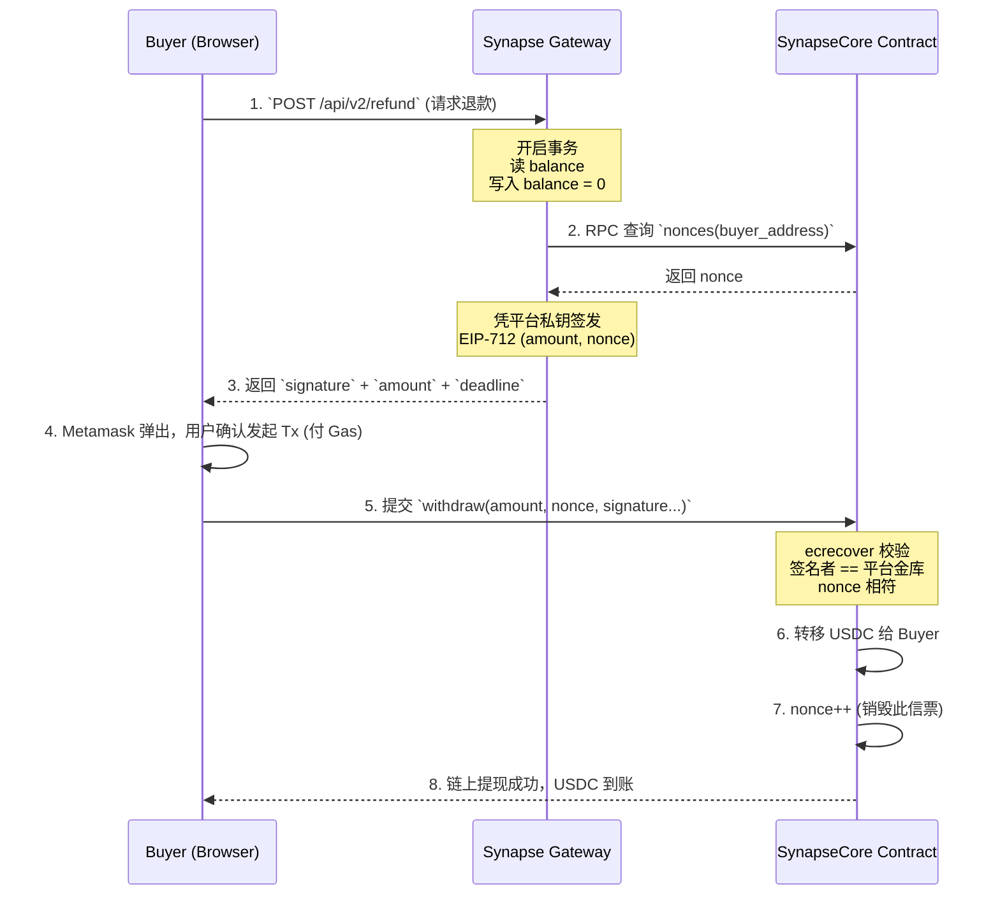

# 🧠 买家退款与极速提现提取流程设计 (Buyer Refund & Withdrawal Design)

## 0. 核心架构哲学：赛博银票，认票不认人
在 Synapse Network 的“**链上充值担保 + 链下网关秒扣 + 凭票免 Gas 提现**”架构下，买家的退款（Refund/Withdraw）完全摒弃了传统的“系统自动退款”这种高耦合、重后端的逻辑。
系统采用的是**“平台开票，买家自提”**的去中心化自运转模式：网关秒级结算离链账本并开出一张“赛博银票 (EIP-712 签名)”，买家自己拿着这张票去智能合约（Vault）里取钱。

---

## 1. 核心问题硬核解答 (Q&A)

### Q1: 是否需要在页面上说明提现时间和到账时间？
**必须说明。** 
在 UI (`/dashboard/buyer`) 上应该明确提示：“**提现极速到账**（具体取决于区块链网络出块时间，Base/Arbitrum 通常在数秒内即可到账）”。因为从网关开票是毫秒级的，剩下的时间全是区块链网络的打包时间。

### Q2: 买家承担退款的 Gas 费用吗？
**是的，完全由买家承担。** 
系统的原则是：买家用网关千万次高频 API 调用时享受 **0 Gas**（如同体验 Web2）。但只要涉及 **与链上金库交互（充值 Deposit / 提现 Withdraw）**，这就是一次标准的区块链交易，必须要有人为链上状态变更买单。既然是买家要拿回自己的钱，由买家自己发起 `Tx` 并支付 Gas 是最合乎代码即法律理念的，平台绝对不替用户打工垫付 Gas。

### Q3: 能够随时提现吗？
**随时提现 (Anytime, Permissionless)。** 
只要买家的离链账本 (`buyerBalances`) 大于 0，随时可以点击退款拉起出金流程。没有审核，没有排队，没有 T+1。

### Q4: 退款金额如何精确计算？
**退款金额 = 买家在链上的存款总和 - 网关已扣除的 API 调用总成本**
当请求达到网关时，网关会做一次最终结算：
```python
refundable_amount = current_ledger[buyer_address].balance
```
由于网关是亚毫秒级的内存记账，此处 `refundable_amount` 就是当前绝对准的可用余额。

### Q5: 申请退款后，用户的凭据 (API Keys) 是否立即失效？
**API Key 本身不删除，但其“购买力”瞬间清零。**
当买家点击“退款”，并在网关生成 EIP-712 签名的瞬间，网关执行的是**硬核清零锁定**逻辑。
```python
# 网关内部数据库操作（在一个事务中）
refundable_amount = buyerBalances[buyer_address]
buyerBalances[buyer_address] = 0 # 余额瞬间清零
```
此时，即使网络拥堵买家还没在链上确认提现，如果其他 AI 还在用这个 API Key 请求网关，网关会直接返回 `HTTP 402 Payment Required (Insufficient Balance)`。 凭证没有失效，只是变成了“空头支票”。

### Q6: 如何保持幂等性？防止反复提交或双花？
这是整个系统最危险也是设计最巧妙的地方，我们需要做到 **“链下防重入，链上防重放”**：
1. **链下（网关）幂等**：买家如果狂点“请求退款”，网关从数据库读到的余额只有第一次是 `N`，后面的请求读到的都是 `0`（因为第一次已经瞬间清零了）。网关可以直接返回之前已经生成的最后一张 **未核销银票**，或者直接报错 `No balance to refund`。
2. **链上（智能合约）幂等（防重放重放攻击）**：依靠 `Nonce`（流水号）机制。
   * 网关向合约查出该买家当前的 nonce（例如 `0`）。
   * 把 nonce = `0` 写入 EIP-712 并签名。
   * 买家去链上提款成功后，合约内 `nonce` ++ 变成 `1`。
   * 如果买家拿同一张签字截图（包含 nonce=0）再去链上提现，智能合约一看当前的 `nonce` 是 `1`，签名里的 `nonce` 是 `0`，直接 revert（`Invalid Signature`）。**极度安全。**

---

## 2. 完整退款 / 提现链路流转 (The Flow)



---

## 3. UI 产品层面建议 (`/dashboard/buyer`)

针对你的截屏和目前 `page.tsx` 代码，退款操作区 (Refund & Settlement) 建议包含以下提示：

1. **当前可提金额展示**：明确展示 `{stats.buyerBalance} USDC`。
2. **免责与Gas提示文本**：
   > “点击申请退款后，系统将为您结算当前全部余额并开具赛博银票 (EIP-712)。
   > 请在弹出的钱包窗口中确认提现交易。资金将极速退回您的原生钱包（视网络出块时间约几秒内）。
   > **注意**：提现需要发起链上交易，需由您支付网络 Gas 费。一旦申请退款，您的可用余额将被清零，所有依赖当前余额的 API Key 请求将立即触发 402 余额不足。”
3. **按钮状态**：
   * 余额为 `0` 时，按钮禁用 `disabled`。
   * 点击后变为 `Generating Ticket...` (此时请求后端拿发票)。
   * 拿到发票拉起钱包阶段变为 `Confirming in Wallet...`。
   * 完成后弹出 `Toast.success("退款成功！提现金额已回到你的钱包。")`