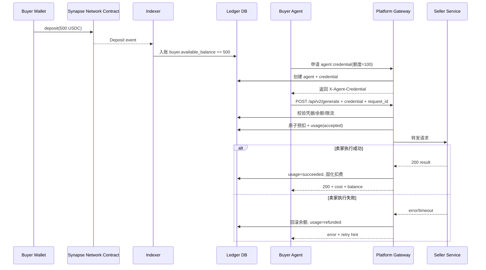
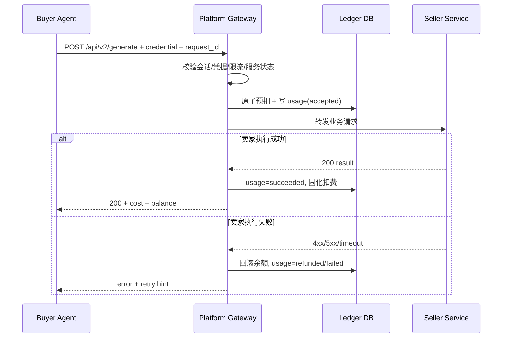

# 扣款详细设计文档（Gateway Deduction）

> 依据《扣款核心》《核心架构》《结算核心》整理。  
> 定位：高频小额场景中的“平台网关扣费引擎”设计说明。

---

## 1. 设计目标

- **低延迟**：调用路径不触发逐笔链上交易。
- **强一致**：余额扣减与调用流水同事务。
- **可回滚**：卖家执行失败时可自动退款/回滚。
- **可审计**：每笔扣款均可追溯到请求、凭据、服务、结算批次。

### 1.1 术语与字段约定（统一口径）

- 请求幂等键：`request_id`（HTTP 头使用 `X-Request-Id`）
- 可消费余额：`available_balance`
- 锁定余额：`locked_balance`
- 凭据状态：`credential_status`（`active | revoked | expired`）
- 单次价格：`unit_price`
- 平台手续费：`platform_fee`
- 卖家净收入：`seller_net`

---

## 2. 阶段一：充值与授信（扣款前置流程）

> 目标：把买家链上真实资金转化为可高速消费的链下可用余额与 AI 凭据。

### 2.1 连接主钱包（Master Wallet）

- 买家在 Dashboard 连接 MetaMask（或兼容钱包）。
- 平台绑定 `buyer_id ↔ master_wallet_address`。

### 2.2 链上充值（Deposit）

- 买家发起 `deposit(amount)`，示例：`deposit(500 USDC)`。
- 买家承担 Gas，资金从买家钱包进入合约 Vault。
- 合约发出 `Deposit` 事件（含 buyer/address/amount/nonce）。

### 2.3 平台记账（Indexer 监听）

- Indexer 监听并确认 `Deposit` 事件（建议 N 确认后入账）。
- 中心化账本更新：`available_balance += amount`，并写入 `deposit_records`。
- 入账完成后，该余额才允许进入后续扣款路径。

### 2.4 生成 AI 凭据（授信/配额）

- 买家创建 `agent_id`，设置额度（例如最多消费 100 USDC）。
- 平台签发 `X-Agent-Credential`（JWT/等效 token），内含：
  - `owner_wallet`
  - `agent_id`
  - `spend_limit`
  - `exp`
- 凭据下发给买家 AI 代理，至此进入高频调用阶段。

---

## 3. 全链路流程（阶段一 → 阶段二扣款）

---

## 4. 扣款边界与原则

### 4.1 扣款发生位置

只允许在 **平台网关** 扣款，不允许买家直连卖家后再补账。

### 4.2 扣款触发时机

- 触发点：请求到达网关并通过鉴权后。
- 建议策略：**预扣（accepted）→ 成功固化（succeeded）→ 失败回滚（refunded）**。

### 4.3 扣款金额来源

- 来源：`Service Registry.unitPrice`（服务注册价格）。
- 手续费：`platformFee = unitPrice * feeRate`。
- 卖家净收入：`sellerNet = unitPrice - platformFee`。

---

## 5. 阶段二：端到端扣款流程

---

## 6. 状态机

### 6.1 Usage 状态

- `accepted`：已预扣，等待卖家处理。
- `succeeded`：卖家成功返回，扣费固化。
- `failed`：失败但不退款（可选策略）。
- `refunded`：失败并全额回滚（默认建议）。

### 6.2 余额状态

- `available_balance`：可消费余额。
- `locked_balance`：预扣期间锁定金额（可选实现）。

---

## 7. 幂等与防重放

### 7.1 `request_id` 幂等键

每次调用必须带 `X-Request-Id`（或 body `request_id`），规则：
- 全局唯一（建议 UUID/ULID）。
- 同一 `request_id` 重试时：
  - 若已有 `succeeded`：直接返回同结果摘要或 409 幂等命中。
  - 若 `accepted` 且未超时：返回处理中。
  - 若 `refunded/failed`：按策略允许重试并生成新 `request_id`。

### 7.2 数据库约束

- `usage_records.request_id` 唯一索引。
- 扣款事务内必须检查唯一约束，防重复扣款。

---

## 8. 原子扣款事务设计

同一事务完成以下操作：

1. 校验余额 `available_balance >= unit_price`
2. `available_balance -= unit_price`（或转入 `locked_balance`）
3. 写入 `usage_records(status=accepted)`
4. 写入审计日志 `DEDUCTION_ACCEPTED`

事务失败则全部回滚。

---

## 9. 失败回滚策略

默认策略（推荐）：
- 卖家返回 5xx / 超时 / 网络错误：`refunded`（全额回滚）
- 买家参数错误（网关前置校验失败）：不扣费
- 买家恶意高频重试：触发限流，不扣费

可选策略（后续）：
- 卖家执行启动后失败，扣固定通道费（例如 `unitPrice * 5%`）

---

## 10. 响应头与对账

网关返回给买家的 header：
- `X-Synapse-Cost`: 本次计费金额
- `X-Synapse-Balance`: 扣费后余额
- `X-Synapse Network-Request-Id`: 对账 ID

买家 Agent 可用这些字段进行自动预算与余额预警。

### 10.1 前端可见性与阶段性映射（2026-03）

当前 Dashboard 已在 `Billing` / `Settlement` 页面提供统一状态筛选：
- `all | accepted | succeeded | refunded | failed`

当前数据源能力（阶段性实现）：
- `succeeded`：来自链上 `ServicePaid` 事件（已接入）
- `accepted / refunded / failed`：已在前端状态模型与筛选中预留，待接入 `usage_records`（网关日志）后生效

阶段建议：
1. 先用链上事件保障“成功扣费”可审计（已完成）
2. 再接 `GET /api/v2/usage/logs` 打通全状态机（`accepted→succeeded/refunded/failed`）
3. 最终以 `request_id` 作为前后端与账单对账主键，链上 tx 作为旁证

---

## 11. 风险控制

### 11.1 扣款前风控
- 凭据有效性（未过期/未撤销/未超配额）
- owner/agent/service 三维限流
- 服务状态 `isActive`

### 11.2 扣款后风控
- accepted 超时扫描（防“卡单”）
- 自动退款补偿任务
- 异常卖家 endpoint 熔断

---

## 12. 与结算模块对接

扣费固化时写入以下结算字段：
- `platform_fee`
- `seller_net`
- `seller_address`
- `settled=false`

结算引擎按 `settled=false AND status=succeeded` 聚合卖家应收，执行签名提现或批量结算。

---

## 13. 最小接口建议（扣款相关）

- `POST /api/v2/generate`：网关扣款与转发入口
- `GET /api/v2/balance`：余额查询
- `GET /api/v2/usage/logs`：调用与扣费明细
- `POST /api/v2/usage/reconcile`（内部）: 卡单/异常补偿

---

## 14. 监控指标（必须）

- `deduction_attempt_total`
- `deduction_success_total`
- `deduction_refund_total`
- `deduction_insufficient_balance_total`
- `deduction_p95_latency_ms`
- `accepted_stuck_count`

---

## 15. 验收标准

1. 同 `request_id` 不重复扣款。  
2. 卖家失败时余额可自动回滚。  
3. 扣费流水可按 buyer/seller/service 查询。  
4. 扣费结果能被结算模块无缝聚合。  
5. 压测下扣款路径满足目标延迟（例如 P95 < 80ms，不含卖家业务耗时）。
6. 链上 `Deposit` 未确认前不得生成可消费余额。  
7. 凭据额度超限时必须拒绝并返回明确错误码。

---

## 16. 一句话结论

扣款系统的正确姿势是：**平台网关统一入站、先鉴权风控、原子预扣、结果驱动固化/回滚、全程可审计并可结算**。这套机制能在高频小额场景同时保证体验、收益和安全。