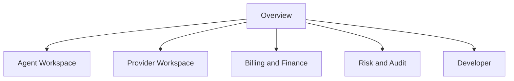

# Gateway Console Information Architecture

> Status: archived IA snapshot.
>
> This file records an earlier dashboard IA and is no longer the canonical route or naming source for the current Provider workspace.
> Current canonical frontend design documents are:
>
> 1. `docs/feature_designs/frontend_product/Provider_Console_IA_V3.md`
> 2. `docs/feature_designs/frontend_product/Wallet_Auth_Challenge_Session_Design.md`
> 3. `docs/feature_designs/frontend_product/Homepage_V2_Functional_Design.md`

## 1. 目标

Gateway Console 是 Owner 的控制台，不是 Agent 的执行界面，也不是后台管理员大盘。

但当前实现已经把 Provider Workspace 的 canonical 入口收敛到 `/provider/**`，不再建议把本文件里的旧 `dashboard` 词汇和旧 IA 文案当成当前路由真相。

它的核心作用只有四个：

1. 帮 Owner 完成首次激活
2. 帮 Owner 管 Agent、预算、账单和风险
3. 帮 Provider role 管服务、收益和提现
4. 用最少认知负担把用户推向首个自主付费调用

## 2. 总体结构

Console 采用“一套控制面，两个工作区，一个共享财务底座”的结构。

## 3. 主导航

### 3.1 Owner Control

1. `Overview`
2. `Agents`
3. `Discovery`
4. `Invocations`
5. `Treasury`
6. `Risk & Audit`
7. `Developer Resources`

历史兼容路径说明：

1. `/dashboard/router` 是旧 owner finance alias，当前应收口到 `/dashboard/billing`（Treasury）。
2. `/dashboard/logs` 是旧审计 alias，当前应收口到 `/dashboard/audit`。
3. `/dashboard/settlement` 只保留为过渡期 reconciliation preview，不再作为主导航入口。

### 3.2 Provider Role

当前 canonical Provider Space 应理解为：

1. `My Services` / `/provider/sell`
2. `API Services` / `/provider/services`
3. `Access Keys` / `/provider/secrets`
4. `Settlements` / `/provider/settlements`
5. `Revenue Analytics` / `/provider/usage`

Provider 不再单独暴露 `/provider/billing`。Owner 资金账本保留在 `/dashboard/billing`，Provider 财务面拆分为 `/provider/settlements` 与 `/provider/usage`。

这组拆分的意义是：

1. Owner 消费侧控制面和 Provider 供给侧工作区并存
2. 两个工作区共享同一根身份，但不共享同一业务心智

## 4. Overview 页面职责

Overview 只负责三件事：

1. 展示 Owner 当前总体状态
2. 展示 Agent Runtime 是否健康工作
3. 把用户路由到下一步最重要动作

它不应承担：

1. 大表格主工作面
2. 复杂过滤器
3. 替代 Billing、Invocations、Provider 页面承载全部细节

### 4.1 Overview 必须显示的核心卡片

1. Spendable balance
2. Provider earnings summary
3. Active agents
4. Successful invocations
5. Risk alerts

### 4.2 Overview 的主 CTA

1. `Add Funds`
2. `Create Agent Credential`
3. `Run First Paid Invocation`
4. `Create API Service`

## 5. Agent Workspace

Agent Workspace 的目标是一站式解决“花钱和执行”的控制问题。

### 5.1 Agents 页面

每个 Agent 卡片至少展示：

1. 名称
2. credential 状态
3. 生命周期预算使用率
4. 日预算使用率
5. 过去 24h 调用数
6. 成功率
7. 最近异常

### 5.2 Discovery 页面

Discovery 页不是电商货架页，而是“帮助 Owner 理解 Agent 将如何选服务”的决策面。

布局原则：

1. 左侧：筛选和任务意图
2. 中间：候选服务排序结果
3. 右侧：Manifest 预览、价格、健康度、示例输出

### 5.3 Invocations 页面

这里是执行结果真相面。

必须展示：

1. invocation 状态
2. quote 价格
3. charged usdc
4. latency
5. error code / action
6. request_id / trace_id 关联线索

### 5.4 Developer 页面

Developer 区域必须直接推动集成，而不是写成长教程仓库。

必须给：

1. SDK 安装命令
2. credential 获取示例
3. discovery 示例
4. quote 示例
5. invoke 示例
6. Python / TypeScript quickstart

## 6. Provider Workspace

Provider Workspace 的目标是一站式解决“挂服务、看收益、提收益”。

### 6.1 API Services / Service Definitions

展示：

1. service_id
2. service_name
3. status
4. endpoint health
5. price model
6. quote requirement

### 6.2 Earnings Summary

展示：

1. gross volume
2. platform fee
3. provider net
4. recent calls
5. top services

### 6.3 Withdrawals

展示：

1. provider receivable
2. provider locked
3. withdrawal history
4. pending ticket status

## 7. 首次 Onboarding 五步

Gateway Console 的首次体验必须压缩成五步：

1. Connect Wallet
2. Deposit USDC
3. Create Agent
4. Issue Credential + Set Budget
5. Run First Paid Invocation

如果第五步没有完成，这个用户就还没有真正激活。

## 8. 不该出现在 Console 主信息架构里的内容

1. Provider 钱包地址
2. 内部分账主键
3. ledger row 主键
4. 低层数据库字段噪音
5. 只有管理员才需要的审批动作

## 9. 文档结论

Gateway Console 的信息架构必须服务三个结果：

1. Owner 快速授权和入金
2. Agent 快速形成自主调用闭环
3. Provider 快速形成服务供给和收益闭环

一切偏离这三点的导航和页面堆叠，都是控制台噪音。

补充说明：

1. 当前数据库和协议主模型仍使用 `Service Manifest` 作为 canonical contract term。
2. 当前 UI 文案已经收敛到 `API Service` / `Service Definition`，这是产品层命名，不是数据库层 rename。
3. 看到旧 `Service Manifests` / `Provider Management` / `nodes` 的地方，应优先以当前 Provider Space 文档和实际页面为准。