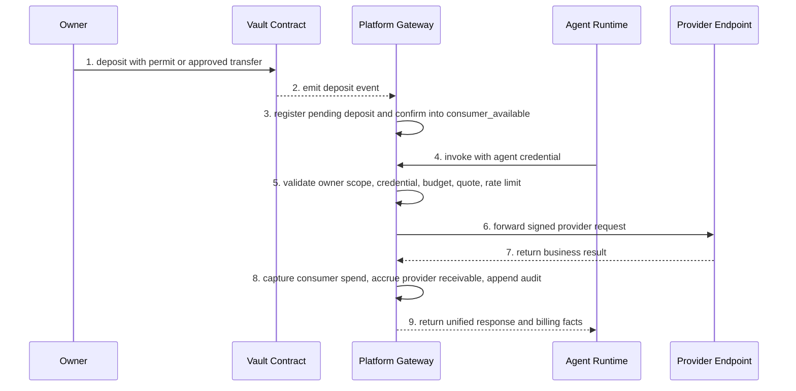

# Owner Funding and Agent Synchronous Invoke Flow

## 1. 文档目标

本文档定义 Synapse 当前最重要的同步主路径：

1. Owner 完成 Vault 入金。
2. Agent 在预算内发起同步调用。
3. Gateway 完成鉴权、扣费、转发、审计。
4. Provider 返回结果并形成收益沉淀。

## 2. 同步主路径

## 3. 主路径分层

### 3.1 入金阶段

1. Owner 通过钱包授权把 USDC 充进 Vault。
2. Indexer 监听链上事件，先记 `consumer_pending`。
3. 达到确认阈值后，再转成 `consumer_available`。
4. 这个阶段的目标不是“立刻能提现”，而是“为 Agent 提供可消费预算”。

### 3.2 调用前校验

Gateway 在同步调用前必须完成：

1. `owner binding`
2. `agent credential` 有效性检查
3. `budget policy` 边界检查
4. `quote` 与 `service` 契约匹配检查
5. owner / agent / service 多维限流
6. 消费侧余额是否充足

### 3.3 调用后结算

同步调用成功后，一次事务内完成：

1. 记录 invocation 结果
2. 扣减 `consumer_available`
3. 增加 `provider_receivable`
4. 增加 `platform_fee`
5. 落 ledger entry
6. 落 audit event

任一步失败都必须整体回滚。

## 4. Provider 端契约

Provider 端只需要关心：

1. 接收平台转发的标准请求。
2. 校验来自平台的签名或共享密钥。
3. 返回标准 JSON 结果。

Provider 不需要承担：

1. 直接处理链上收款
2. 直接处理预算系统
3. 直接处理结算账本

## 5. 长任务处理

如果任务超出同步 HTTP 可接受时延，则切换为 ticket 模式：

1. Agent 发起异步任务创建。
2. Gateway 先完成预算校验与预占。
3. Provider 返回 `accepted + ticket_id`。
4. Agent 轮询或等待回调。
5. 最终 capture 只在任务真实完成后执行。

## 6. 文档结论

Synapse 的同步支付路径不再是“人类付钱调接口”，而是 `Owner funding + Agent autonomous invoke + Provider delivery + Platform ledger finalization` 的统一运行时主线。
