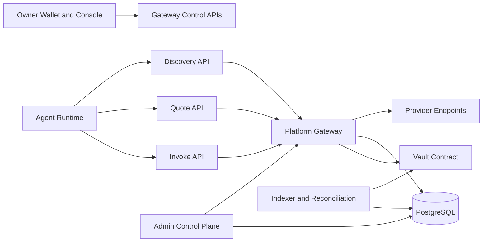

# System Topology and Request Routing

## 1. 目标

本文件定义 Synapse 在生产环境里的核心组件和主请求路径。

最重要的前提是：

**Platform Gateway 不是简单代理，而是带有鉴权、预算、路由、记账和审计能力的执行中枢。**

## 2. 拓扑图

## 3. 核心组件

### 3.1 Owner-side Control Plane

负责：

1. 会话建立
2. 入金
3. Agent 管理
4. Provider 服务管理
5. 收益与风险观测

### 3.2 Agent Runtime APIs

负责：

1. Discovery
2. Quote
3. Invoke

这是 Agent-facing 协议面，不应暴露内部结算字段。

### 3.3 Platform Gateway

负责：

1. owner scope 绑定
2. credential 校验
3. 预算和限流
4. provider health routing
5. invocation settlement
6. audit

### 3.4 Provider Endpoints

负责：

1. 承载真实能力执行
2. 对 Gateway 请求做签名或共享密钥验证
3. 返回原始业务结果

### 3.5 PostgreSQL

负责：

1. Runtime 真相层
2. 资金真相层
3. 审计真相层

### 3.6 Vault Contract

负责：

1. Deposit
2. Withdraw

它不负责：

1. 高频预算
2. 路由
3. 调用限流

## 4. 主请求路径

### 4.1 Owner 路径

Owner 的典型路径是：

1. Connect wallet
2. Establish session
3. Deposit funds
4. Create agent
5. Set budget
6. Publish service or observe runtime

### 4.2 Agent 路径

Agent 的典型路径是：

1. Discovery
2. Quote
3. Invoke
4. Receive result or stable error

### 4.3 Provider 路径

Provider 的典型路径是：

1. Create provider profile
2. Bind payout account
3. Publish service manifest
4. Receive routed invocations
5. Accrue receivable
6. Withdraw

## 5. 路由原则

### 5.1 Discovery 和 Routing 必须共享健康事实源

否则系统会出现：

1. discovery 说可用
2. invoke 转发时却路由到坏节点

因此 discovery ranking 和 invoke routing 都必须基于同一套 `service_health_snapshots`。

### 5.2 Platform 入口必须屏蔽 Provider 真实结算面

对 Agent 来说，可见的是：

1. service
2. price
3. schema
4. result

不该可见的是：

1. provider payout address
2. internal endpoint topology
3. settlement splits

## 6. 文档结论

Synapse 的系统拓扑不是“前端 + 后端 + 合约”这么粗糙，而是：

**Control Plane + Agent Runtime APIs + Gateway Execution Spine + Provider Network + Ledger and Vault**

五层协同的基础设施体系。