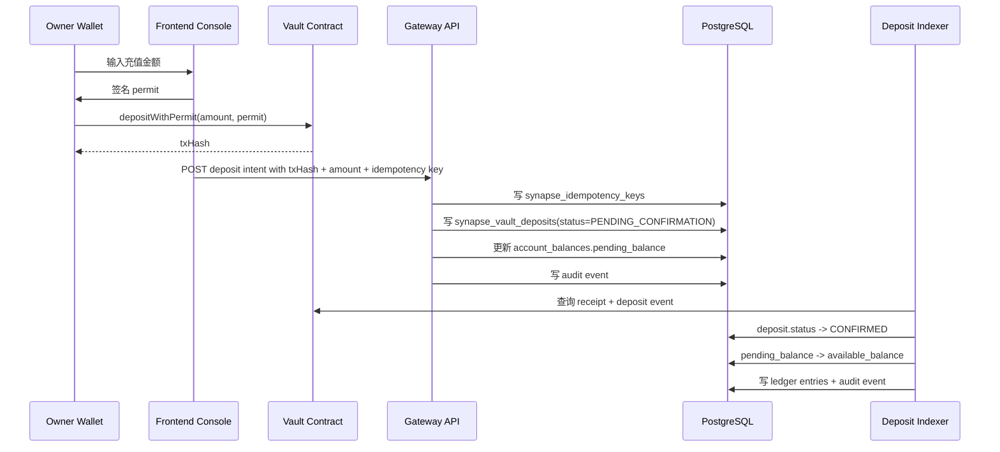

# Deposit and Idempotency

## 1. 目标

Deposit 链路的职责不是“给某个 Agent 单独充值”，而是把 Owner 的链上 USDC 安全桥接进 Platform 的消费资金池。

Deposit 完成后，Agent Runtime 才能在后续 Quote / Invoke 中消耗这笔资金。

一句话：

**Deposit belongs to Owner funding, then Budget Policy decides how Agent spends it.**

## 2. 参与者

1. `Owner`
   控制面根身份，决定入金金额和钱包签名。
2. `Vault Contract`
   只负责收钱和签名出金，不负责预算控制。
3. `Platform Gateway`
   负责接收入金登记、幂等校验、账本推进和审计。
4. `Deposit Indexer / Reconciliation`
   负责确认链上事实并把 pending 资金放行成 available 资金。
5. `PostgreSQL`
   作为资金和状态真相源，持久化 deposit、余额、分录和审计事件。

## 3. 核心表

最新 SQL 下，Deposit 链路的核心真相表是：

| 表 | 作用 |
| --- | --- |
| `synapse_vault_deposits` | 记录 Owner 的链上入金事实和确认状态 |
| `synapse_ledger_accounts` | 定义 Owner consumer wallet 账户 |
| `synapse_account_balances` | 保存 `available_balance / pending_balance / frozen_balance` 快照 |
| `synapse_ledger_entries` | 保存 append-only 资金分录 |
| `synapse_idempotency_keys` | 保存 API 级幂等键 |
| `synapse_audit_events` | 保存入金登记、确认、失败、回放等审计事件 |

## 4. 状态机

`synapse_vault_deposits.status` 只允许三种状态：

1. `PENDING_CONFIRMATION`
   链上交易已被登记，但还没有被索引器确认为最终入账事实。
2. `CONFIRMED`
   receipt、event、金额和归属全部校验通过，资金可以进入 `available_balance`。
3. `FAILED`
   交易失败、回执无效、金额不匹配或对账失败，不能进入可消费余额。

## 5. 主流程

### 5.1 Step A: Owner 发起链上入金

1. Owner 在前端输入 USDC 金额。
2. 前端拉起 ERC-2612 Permit 签名。
3. 钱包执行 Vault `depositWithPermit(...)`。
4. 链上返回 `txHash`。

这里有一个硬边界：

1. 链上广播成功，不等于平台已经入账。
2. 平台必须先看到一笔可验证的 deposit record，才能开始链下账本推进。

### 5.2 Step B: Gateway 登记 Deposit

Gateway 收到 `txHash + amount + owner scope + idempotency key` 后，必须先做四件事：

1. 从 session 推导 Owner，不信任前端传来的 owner。
2. 校验 `tx_hash` 格式与金额合法性。
3. 检查 `synapse_idempotency_keys`，保证同一请求不会重复入账。
4. 检查 `synapse_vault_deposits.tx_hash` 唯一约束，防止重复登记同一链上交易。

登记成功后，事务内执行：

1. 写 `synapse_vault_deposits(status=PENDING_CONFIRMATION)`
2. 找到 Owner 对应的 `consumer_wallet` 账户
3. 更新 `synapse_account_balances.pending_balance += amount_usdc`
4. 写入一条或多条 `synapse_audit_events`

### 5.3 Step C: Indexer 确认链上事实

Deposit Indexer 异步校验：

1. receipt 存在
2. 交易状态成功
3. event 中的 amount 与登记金额一致
4. event 的接收方和链上合约地址匹配

只有全部通过，才能推进到 `CONFIRMED`。

### 5.4 Step D: 资金从 pending 进入 available

确认成功后，Platform 在事务内执行：

1. `synapse_vault_deposits.status = CONFIRMED`
2. `pending_balance -= amount_usdc`
3. `available_balance += amount_usdc`
4. 写入对应的 `synapse_ledger_entries`
5. 写入 `synapse_audit_events`

这一步完成后，这笔钱才真正成为 Owner 可供 Agent Runtime 消费的资金。

## 6. 幂等与防重放

Deposit 链路必须同时做 API 级幂等和链上事实级防重放。

### 6.1 API 级幂等

平台使用 `synapse_idempotency_keys` 实现：

1. 同一个 `scope + owner_id + idempotency_key`
2. 同 payload 重试返回同结果
3. 同 key 不同 payload 直接拒绝

### 6.2 链上事实级防重放

平台使用 `synapse_vault_deposits.tx_hash UNIQUE` 实现：

1. 同一笔链上 deposit 只允许登记一次
2. 即使前端重复提交 intent，也不能重复入账
3. 任何回放行为都必须走审计事件，不允许绕过 deposit 主记录

### 6.3 两层都需要

只做 idempotency key 不够，因为：

1. 用户可能换浏览器或重发请求
2. 同一链上交易可能被多个请求重复提交

只做 `tx_hash UNIQUE` 也不够，因为：

1. API 超时重试需要稳定回包
2. 业务层需要区分“重复请求”和“重复链上事实”

## 7. 失败路径

### 7.1 链上交易失败

1. 不写 `CONFIRMED`
2. 不进入 `available_balance`
3. 可以标记为 `FAILED` 并写审计事件

### 7.2 receipt 找不到或 event 不匹配

1. 保持 `PENDING_CONFIRMATION` 一段时间重试
2. 超过 SLA 后转 `FAILED`
3. 进入对账告警和人工调查

### 7.3 API 重试

1. 如果首个请求已成功登记，后续相同请求直接返回原记录
2. 不重复增加 `pending_balance`

## 8. 数据一致性原则

Deposit 链路必须遵守下面三个不变量：

1. `CONFIRMED` deposit 的金额必须体现在 Owner `available_balance` 中。
2. `PENDING_CONFIRMATION` deposit 的金额只能停留在 `pending_balance`，不能提前消费。
3. 任意时刻都必须能从 `synapse_vault_deposits + synapse_ledger_entries + synapse_account_balances` 三者互相对账。

## 9. 与 Agent Runtime 的关系边界

Deposit 不直接绑定：

1. `agent_id`
2. `credential_id`
3. `quote_id`
4. `invocation_id`

Deposit 的职责只是把 Owner 的钱送进平台资金层。

后续真正消费这笔钱的，是：

1. `synapse_agent_credentials`
2. `synapse_budget_policies`
3. `synapse_service_quotes`
4. `synapse_invocations`

## 10. 文档结论

Deposit 是一条 **Owner funding workflow**，不是一条 Agent execution workflow。

只有把入金确认、幂等、pending/available 分层和 ledger 审计全部做实，后面的 Quote / Invoke 才不会建立在假余额之上。