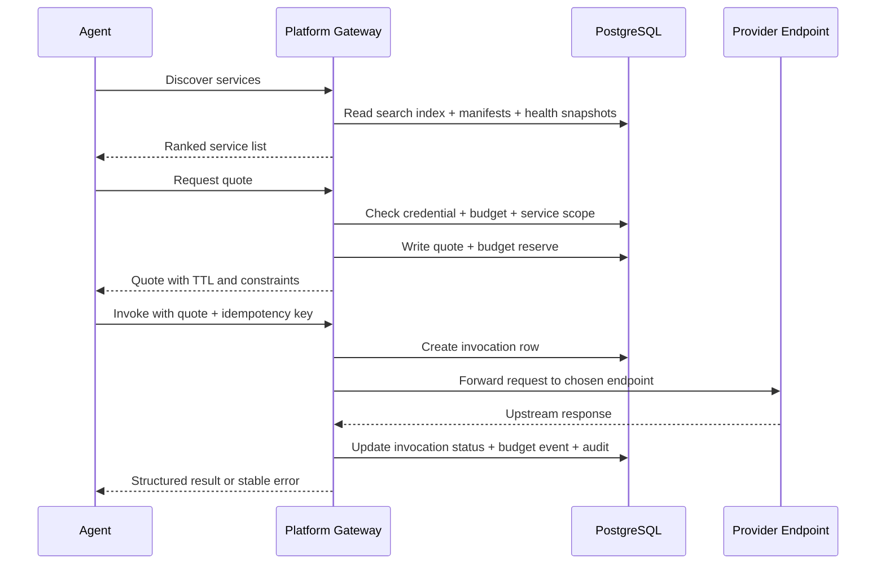

# Discovery and Gateway Call

## 1. 目标

这条链路定义 Agent Runtime 如何完成：

1. 找到可用服务
2. 拿到可执行报价
3. 由 Platform Gateway 代为转发调用
4. 在不暴露 Provider 结算面的前提下拿回结果

Synapse 的核心不是“给人手工点 API”，而是让 Agent 在受控预算下自动完成 `discover -> quote -> invoke`。

## 2. 参与者

1. `Agent`
   真正做 discover、选择服务、发起调用的运行时主体。
2. `Agent Credential`
   Runtime 支付身份和预算约束入口。
3. `Platform Gateway`
   承担发现、报价校验、路由、转发、审计和扣费决策。
4. `Provider Service`
   真正执行上游能力的服务提供方。
5. `PostgreSQL`
   保存 Service Catalog、Quote、Invocation、Budget Event 和 Audit Event。

## 3. 核心表

| 表 | 作用 |
| --- | --- |
| `synapse_service_manifests` | Service 的公开能力、价格和 schema 主体 |
| `synapse_service_endpoints` | 真实上游 endpoint 和运行约束 |
| `synapse_service_health_snapshots` | 健康度、延迟、成功率 |
| `synapse_service_search_index` | discovery 检索索引 |
| `synapse_service_quotes` | 报价、TTL、约束和价格锚点 |
| `synapse_invocations` | 调用生命周期、状态和结果摘要 |
| `synapse_budget_events` | reserve / capture / release 预算事件 |
| `synapse_audit_events` | discover、quote、invoke 过程中的关键审计事件 |

## 4. 主流程总览

## 5. Discovery

Discovery 只做一件事：

**让 Agent 得到足够结构化的服务决策输入，而不是营销卡片。**

### 5.1 Discovery 读取的数据

Gateway 至少要组合：

1. `synapse_service_search_index`
2. `synapse_service_manifests`
3. `synapse_service_health_snapshots`

### 5.2 必须返回给 Agent 的最小信息

1. `service_id`
2. `service_name`
3. `description_for_model`
4. `price_model` / `base_price_usdc`
5. `input_schema` / `output_schema`
6. `health_score`
7. `p95_latency_ms`
8. `success_rate_24h`
9. `quote_required`

### 5.3 不允许暴露给 Agent 的信息

1. `provider_wallet`
2. `payout_account_id`
3. 内部 `endpoint_url`
4. 路由权重和真实 target 列表
5. 平台内部账本主键

## 6. Quote

Quote 是调用前的商业和风控闸门，不是最终扣费点。

### 6.1 Quote 必须解决的问题

1. 当前 credential 是否有权调用这个 service
2. 当前预算是否允许承担这次调用
3. 当前价格和约束在短窗口内是否锁定
4. 后续 invoke 是否有足够的信息直接执行

### 6.2 Quote 写入的真相

在最新 schema 中，Quote 至少会落两类记录：

1. `synapse_service_quotes`
   保存 `quote_id`、`service_id`、`credential_id`、`quoted_price_usdc`、`status`、`expires_at`
2. `synapse_budget_events`
   以 `reserve` 形式预占预算窗口

### 6.3 Quote 状态机

`synapse_quote_status` 只允许：

1. `OPEN`
2. `EXPIRED`
3. `CONSUMED`
4. `CANCELLED`

任何已经 `CONSUMED` 或 `EXPIRED` 的 quote，不能再次被 invoke。

## 7. Invoke

Invoke 是 Discovery / Quote / Call 这条链路的执行点。

### 7.1 Invoke 前的校验顺序

Gateway 必须按成本从低到高执行：

1. Credential 是否存在
2. Credential 是否 active 且未过期
3. Quote 是否存在且未过期
4. Service 是否仍处于可调用状态
5. Budget policy 是否允许
6. Owner 资金池是否足以支撑 quote 金额
7. Idempotency key 是否冲突

### 7.2 Invocation 记录

Gateway 在转发前先写 `synapse_invocations`，至少包含：

1. `invocation_id`
2. `quote_id`
3. `service_id`
4. `endpoint_id`
5. `credential_id`
6. `agent_id`
7. `idempotency_key`
8. `status = PENDING`

后续根据执行推进到：

1. `RUNNING`
2. `SUCCEEDED`
3. `FAILED_RETRYABLE`
4. `FAILED_FINAL`
5. `SETTLED`

### 7.3 Gateway 转发原则

Gateway 不是透明代理，而是 **带风控和结算语义的平台代理层**。

它必须负责：

1. 根据健康度和权重挑选 `synapse_service_endpoints`
2. 附加内部 trace / request id
3. 执行 timeout、payload 限制和 response mode 约束
4. 把上游原始 HTTP 成败映射成平台的执行结果

## 8. 成功与失败映射

### 8.1 成功路径

如果上游完成有效交付：

1. `synapse_invocations.status -> SUCCEEDED`
2. Quote 标记 `CONSUMED`
3. 预算事件从 `reserve` 走向 `capture`
4. 进入后续结算流程

### 8.2 失败路径

如果上游失败、超时、连接错误或返回不可接受结果：

1. `synapse_invocations.status -> FAILED_RETRYABLE` 或 `FAILED_FINAL`
2. Quote 保持可审计但不再作为成功结算依据
3. 预算执行 `release`
4. 写稳定错误码和 `error_action`

### 8.3 为什么不能直接把 Provider 响应原封不动吐给 Agent

因为 Platform 还必须统一处理：

1. 超时和重试语义
2. 预算释放
3. 账本动作
4. 风险审计
5. 不泄露 Provider 内部拓扑和结算字段

## 9. 幂等

Invoke 的业务幂等由 `synapse_invocations UNIQUE (credential_id, idempotency_key)` 保证。

含义是：

1. 同一个 credential 在同一个业务步骤重复提交，只能落一条 invocation 真相
2. 网络重试不会导致重复扣费
3. 平台可以稳定返回同一次调用的最终状态

## 10. 数据边界结论

这条链路必须永远守住两条边界：

1. 对 Agent 暴露的是 `service / quote / invocation / result / stable error`
2. 对平台内部保留的是 `endpoint / routing / payout / ledger / audit`

Synapse 的 Gateway 不是让 Agent 直接撞向 Provider，而是在 Runtime 语义上替 Agent 完成了：

**结构化发现、预算前置、平台代理转发和稳定错误收敛。**