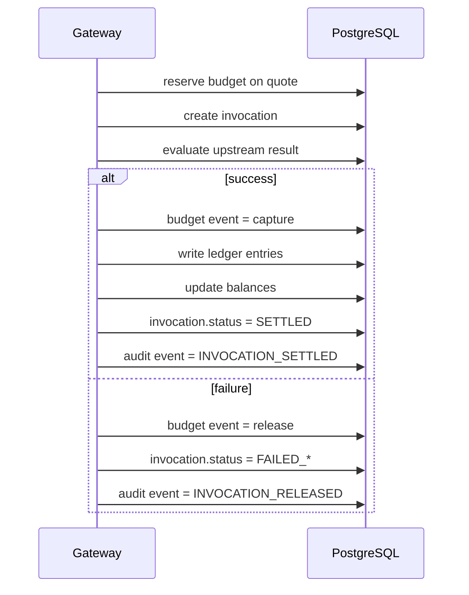

# Billing, Settlement, and Audit

## 1. 目标

Billing / Settlement / Audit 的职责是把一次成功调用转化成一组可审计、可回滚、可对账的资金事实。

这里的设计核心不是“改余额”，而是：

1. 先有预算事件
2. 再有账本分录
3. 最后才体现到账户快照余额

## 2. 参与者

1. `Owner`
   拥有消费资金池。
2. `Agent`
   发起本次调用并消耗预算。
3. `Provider`
   提供服务并累积应收收益。
4. `Platform`
   执行 reserve / capture / release、平台抽成、ledger entry 和 audit event。

## 3. 核心表

| 表 | 作用 |
| --- | --- |
| `synapse_budget_events` | 记录 `reserve / capture / release / adjust` |
| `synapse_ledger_accounts` | 定义 consumer wallet、provider wallet、platform revenue、budget hold |
| `synapse_account_balances` | 保存资金桶快照 |
| `synapse_ledger_entries` | 保存 append-only 资金分录 |
| `synapse_invocations` | 保存调用结果、计费金额和状态 |
| `synapse_audit_events` | 保存业务动作、失败原因、链路证据 |

## 4. 账务模型

在最新 SQL 下，Platform 至少维护四类账户：

1. `consumer_wallet`
   Owner 的消费资金池。
2. `provider_wallet`
   Provider 的应收收益池。
3. `platform_revenue`
   平台费和路由费累积池。
4. `budget_hold`
   Quote 预占预算和执行中冻结金额池。

这意味着同一个 Owner 可以同时拥有：

1. consumer side 资金桶
2. provider side 收益桶

但两者永远不能混算。

## 5. 主流程

## 6. Quote 阶段的预算预占

Quote 成功后，Platform 不立即最终扣费，但可以创建：

1. `synapse_budget_events.event_kind = reserve`
2. `budget_hold` 账户的冻结动作

这样做的原因是：

1. 防止并发下多次 invoke 透支同一 credential
2. 让 quote 在有效期内拥有可执行资金窗口
3. 为失败后的 release 提供对称动作

## 7. 成功调用后的 capture

当 invocation 被判定为成功交付后，Platform 必须在一个事务里完成：

1. 写 `synapse_budget_events(event_kind = capture)`
2. 写 `synapse_ledger_entries`
3. 更新 `synapse_account_balances`
4. 更新 `synapse_invocations.charged_usdc`
5. 写 `synapse_audit_events`

### 7.1 成功调用的最小业务结果

一笔成功调用，至少产生三类业务效果：

1. Owner 消费资金减少
2. Provider 应收收益增加
3. Platform revenue 增加

注意：

最新 SQL 的 `synapse_ledger_entries` 是双边分录模型，因此实际实现中可能拆成多条平衡分录；但业务语义上，这三类效果缺一不可。

### 7.2 数学表达

设：

1. 本次调用价格为 `P`
2. 平台费率为 `r`
3. 平台费为 `F = P * r`
4. Provider 净收入为 `N = P - F`

则结算结果应满足：

$$
P = F + N
$$

并且：

$$
consumer\_decrease = provider\_increase + platform\_revenue\_increase
$$

## 8. 失败调用后的 release

如果上游失败、超时或被策略判定为不计费，则 Platform 必须：

1. 执行 `synapse_budget_events(event_kind = release)`
2. 释放 `budget_hold`
3. 保持 `charged_usdc = 0`
4. 写失败审计事件

### 8.1 禁止的做法

1. 失败后静默回改历史分录
2. 直接改余额，不写 ledger / audit
3. 把失败调用当作“什么都没发生”

即使最终没扣钱，也必须有可检索审计证据。

## 9. Audit Log

`synapse_audit_events` 必须记录：

1. actor type
2. `owner_id`
3. `provider_id`
4. `agent_id`
5. `credential_id`
6. `service_id`
7. `quote_id`
8. `invocation_id`
9. `amount_delta`
10. `result_status`
11. `error_code`

`detail_json` 则保存：

1. request id
2. trace id
3. 上游 HTTP 状态
4. 结算策略
5. 风控命中上下文

### 9.1 Audit Noise Guardrails

对于高频异常事件，审计必须保留可追溯性，但不能无限制洪泛：

1. `DEPOSIT_INTENT_REGISTERED` 这类带 `txHash` 的事件，不应对同一 `owner + txHash` 重复追加相同注册审计。
2. `FINANCE_RATE_LIMIT_HIT` 这类限流异常，应该按 `owner + action + minute bucket` 做降噪，而不是每次 429 都落一行。
3. 限流与重放等异常审计必须显式标记为 `business_type = anomaly`，禁止伪装成 `charge` 污染正常资金视图。
4. `detail_json` 不能只保留通用骨架字段；像 `action`、`backend`、`rateLimitBucket` 这类 anomaly 归因字段必须原样落库，否则后续分钟桶去重与排障会失真。

## 10. Refund 与 Withdrawal 边界

这份文档只覆盖 invocation 结算主链路，但必须明确两件事：

1. `consumer_refund` 作用于 Owner 消费资金桶
2. `provider_withdrawal` 作用于 Provider 收益资金桶

这两个动作都不允许直接篡改 invocation 结算历史，而应通过新的 withdrawal / refund 真相记录完成。

## 11. 不变量

### 11.1 流水不变量

每一笔成功 capture 都必须能够追溯到：

1. 一个 quote
2. 一个 invocation
3. 一组 budget events
4. 一组 ledger entries
5. 一条或多条 audit events

### 11.2 余额不变量

任意时刻，账户快照都必须可由 ledger entry 聚合重建。

### 11.3 桶隔离不变量

1. `consumer_wallet` 不能直接承担 Provider 提现
2. `provider_wallet` 不能回写 Owner 消费退款
3. `platform_revenue` 不能被错误地计入用户余额

## 12. 文档结论

Billing 不是“请求成功后减个数字”，而是一条：

**Budget Event -> Ledger Entry -> Balance Snapshot -> Audit Event**

的严格金融流水链。

只有这样，Synapse 才能同时满足：

1. Agent 自动消费
2. Provider 明确收益
3. Platform 可对账、可抽成、可审计