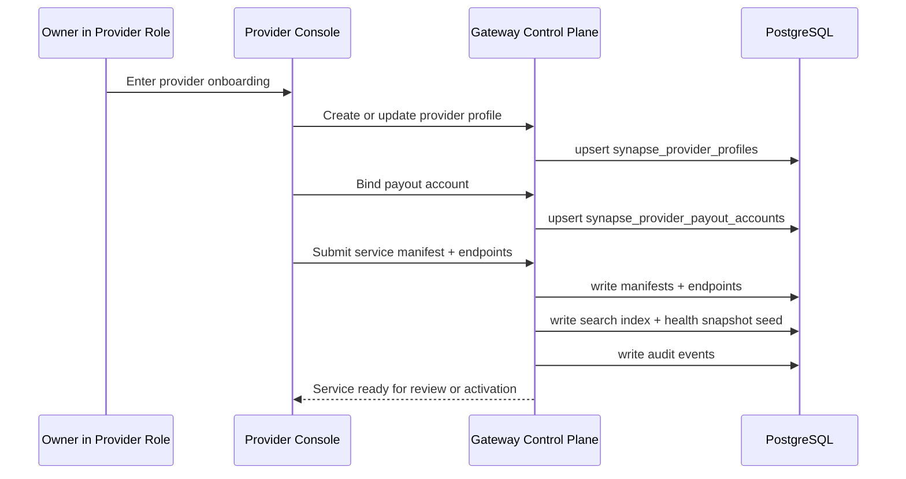

# Provider Registration and Agreement

## 1. 目标

Provider 链路解决两个问题：

1. 谁可以把服务挂进 Synapse 网络
2. Platform 如何确认它的收款身份、服务契约和路由约束

在当前工程真相里，Provider 不是另一套根账户体系，而是：

**同一个 Owner 在供给侧承担 Provider role。**

## 2. 参与者

1. `Owner`
   平台根身份，同时也是 Provider role 的控制者。
2. `Provider Profile`
   Owner 在供给侧的业务身份记录。
3. `Provider Payout Account`
   Provider 的链上收益接收地址。
4. `Service Manifest`
   向 Agent 暴露的结构化服务契约。
5. `Platform Gateway`
   负责字段校验、服务上线、探活和搜索索引构建。

## 3. 核心表

| 表 | 作用 |
| --- | --- |
| `synapse_provider_profiles` | Provider 业务主体 |
| `synapse_provider_payout_accounts` | 收益打款地址和结算币种 |
| `synapse_service_manifests` | 服务能力、价格、schema 主体 |
| `synapse_service_endpoints` | 真实上游地址和运行约束 |
| `synapse_service_health_snapshots` | 健康检查和 SLA 观测 |
| `synapse_service_search_index` | 被 discover 消费的检索层 |
| `synapse_audit_events` | 注册、修改、上线、下线等控制面审计 |

## 4. 注册主流程

## 5. Step A: 建立 Provider 身份

Provider onboarding 的第一步不是填服务，而是建立供给侧主体：

1. 由当前 Owner scope 创建或更新 `synapse_provider_profiles`
2. 绑定展示名和状态
3. 确认这是同一个 Owner 的 Provider role，而不是新账户体系

### 5.2 当前自动化接入里的钱包与登录真相

本地和 CI 自动化里，Provider 不需要预先存在于链上白名单。

当前真实链路是：

1. 测试代码先生成一个新的 EOA 钱包
2. 通过 `challenge -> sign -> verify` 获取 JWT
3. 之后一切 Provider 控制面操作都绑定到这个 Owner wallet scope

也就是说：

**Provider identity 的第一性原语仍然是 Owner wallet，而不是数据库里预先创建的 provider root account。**

### 5.1 为什么必须先有 Provider Profile

因为后面的 Service Manifest 需要明确归属：

1. 它属于哪个 Owner
2. 由哪个 Provider role 运营
3. 收益结算到哪个 payout account

## 6. Step B: 绑定 Payout Account

Provider 不能只声明“我能提供服务”，还要声明：

1. 提现往哪里打
2. 在哪条链上打
3. 默认结算币种是什么

这些信息进入 `synapse_provider_payout_accounts`，但不进入 Agent-facing 协议面。

### 6.1 Agent 不应看到什么

对 Agent 来说，下列信息都不该公开：

1. `payout_address`
2. `payout_account_id`
3. 内部结算映射主键

Agent 只需要知道 service 能做什么、多少钱、如何调用。

## 6.5 Step B.5: Provider Credentials（当前工程真相）

用户在 Provider Console 里常说的 “创建 Credentials”，在当前工程真相里不是 Agent Credential，而是 Provider 自己的控制面 secret：

1. `POST /api/v1/secrets/provider/issue`
2. `GET /api/v1/secrets/provider/list`
3. `DELETE /api/v1/secrets/provider/{secret_id}`

它的职责是：

1. 为 Provider 提供可审计的 secret 生命周期
2. 让供给侧拥有自己的 access key / signing credential
3. 作为 Provider onboarding 自动化测试里的独立步骤存在

需要讲真话的一点：

**当前 `POST /api/v1/services` 注册服务本身并不强依赖先创建 provider secret。**

但在真实 onboarding runbook 里，我们仍然把它放进最低成本接入主链，因为这才是 Provider 控制面完整闭环。

## 7. Step C: 提交 Service Manifest

Provider 提交的是业务语义，不是内部主键。

Platform 要把它落成：

1. `synapse_service_manifests`
2. `synapse_service_endpoints`
3. `synapse_service_search_index`
4. `synapse_service_health_snapshots`

### 7.1 必填结构

至少包括：

1. `service_id` 或 `agent_tool_name`
2. `service_name`
3. `description_for_model`
4. `input_schema`
5. `output_schema`
6. `price_model`
7. `base_price_usdc`
8. `endpoint_url`
9. `timeout_ms`
10. `status`

### 7.2 Gateway 必做的校验

1. `service_id` 全局唯一
2. Build Service Manifest 场景里，如果请求只提交 `agentToolName`，Gateway 会把它绑定到 `serviceId`
3. 如果 `serviceId` 与 `agentToolName` 同时提交但不一致，注册直接拒绝
4. 如果两者都缺失，当前后端会回退生成随机 `SVC_*` 标识，但这不适合 Agent 侧稳定引用
5. input / output schema 合法
6. 价格模型在白名单内
7. endpoint 通过 URL 和健康检查约束
8. timeout、payload 大小、QPS 等约束可被平台执行

## 8. 协议签订在当前系统里的真实落点

用户要求这条链路包含“协议签订”，这里必须讲真话：

最新 SQL schema **没有单独的 provider agreement table**。

因此当前工程真相里，“协议签订”不是一个独立资金对象，而是一个 **控制面审计动作**。

它的最小落点应该是：

1. Provider profile 已建立
2. Payout account 已绑定
3. Manifest 和 endpoint 已提交
4. 平台条款接受、风险确认、人工审批结论进入 `synapse_audit_events.detail_json`

换句话说：

**当前版本的协议签订是 onboarding governance event，不是独立 ledger object。**

## 9. 激活与上线

服务真正进入网络前，Platform 至少要完成：

1. Provider 身份通过校验
2. Payout account 有效
3. Manifest 字段完整
4. Endpoint 能健康探测
5. Search index 已生成
6. 审计事件已落库

只有这样，服务才应该出现在 Discovery 结果中。

### 9.1 当前代码真相

当前实现还没有独立的“服务注册人工审核”状态机。

也就是说：

1. `POST /api/v1/services` 校验通过后会直接写入 owner scope 的 service registry
2. 请求里的 `status=active` 只代表控制面状态，不等于一定可被 discover
3. Public discover 还要额外满足运行健康检查通过
4. “review or activation” 目前仍是目标态产品语义，不是已落地工作流

## 10. 风险边界

Provider 链路必须守住三条红线：

1. 不能让 Provider 控制面字段冒充 Agent-facing 协议字段
2. 不能把 payout 信息暴露给 Discovery / Quote / Invoke
3. 不能绕过审计直接上线新 service

## 11. 文档结论

Provider registration 不是“填个表单然后开放 API”。

它是：

**Owner scope -> Provider role -> Payout binding -> Manifest contract -> Endpoint validation -> Audited activation**

的一整条控制面闭环。

## 12. 对应自动化测试参考

针对 `http://localhost:3000/provider/services/deploy` 的真实控制面测试方案见：

`docs/06_Reference/test/gateway/provider_service_deploy_e2e_test_design.md`

这份文档对应的是当前工程里真正可执行的链路：

1. fresh wallet
2. auth login
3. issue provider secret
4. register service
5. verify provider-owned service list
