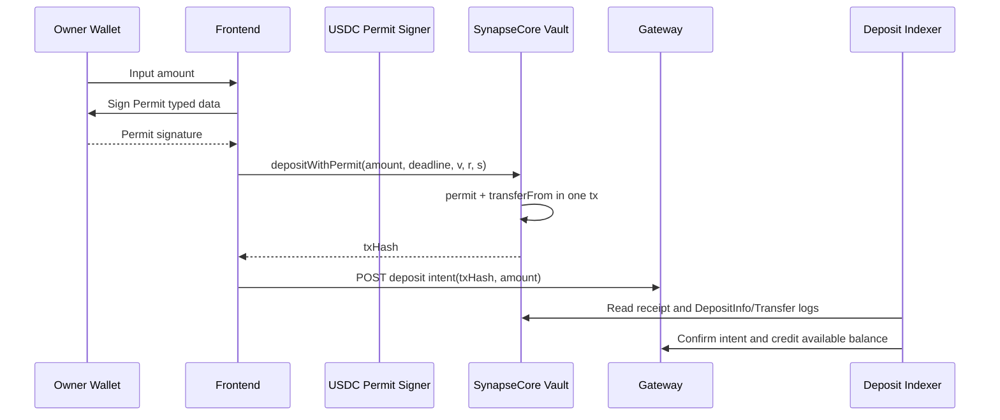
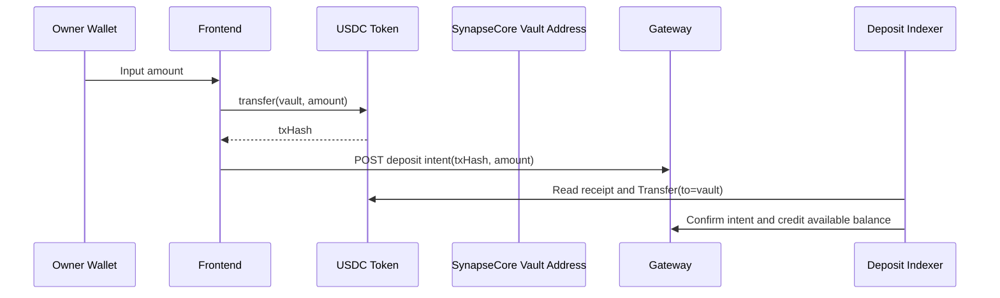

# Deposit Entry Architecture Comparison

## 1. Why This Document Exists

Owner funding is the only human-in-the-loop money action that every Synapse consumer must complete before an Agent can spend budget autonomously.

That means the deposit entry path must be judged by four standards at the same time:

1. Wallet UX friction for the Owner
2. On-chain compatibility across real tokens and wallets
3. Gateway/indexer ability to confirm and replay safely
4. Auditability and financial consistency after the chain transaction lands

This document compares two concrete deposit entry architectures:

1. `Permit + depositWithPermit` (current primary path)
2. Direct ERC20 `transfer(vault, amount)` (candidate simplification path)

The goal is not to debate abstract Web3 purity. The goal is to decide which entry path gets Owner funds into the Synapse Vault with the least friction and the least financial ambiguity.

## 2. Current Code Truth

Current implementation facts in this repo:

1. The Vault contract already supports `depositWithPermit(...)` and plain `deposit(...)`.
2. The frontend Owner funding flow currently signs a permit message first, then sends one on-chain `depositWithPermit(...)` transaction.
3. The Gateway still requires a deposit intent registration step keyed by `txHash`.
4. The deposit indexer confirms a deposit by inspecting the transaction receipt and matching either:
   - a Vault deposit event such as `DepositInfo`
   - or a fallback ERC20 `Transfer` log whose `to == vault`

This means the system is already partially capable of validating direct token transfers to the Vault, as long as the platform still receives a deposit intent bound to the `txHash`.

## 3. Option A: Permit + depositWithPermit

### 3.1 Flow Summary

### 3.2 Contract Impact

Contract requirements:

1. ERC20 token must support permit semantics compatible with the frontend signing flow.
2. Vault contract must expose `depositWithPermit(...)`.
3. Vault ideally emits a canonical deposit event such as `DepositInfo(user, amount)`.

Strengths at contract layer:

1. Deposit is expressed as an explicit Vault entrypoint, not just a passive token transfer.
2. Permit can scope approval to the exact amount for this deposit path.
3. The receipt can carry a contract-native deposit event, which is a cleaner evidence source than generic token transfer logs.

Weaknesses at contract layer:

1. Path depends on permit support from the token and correct typed-data domain handling.
2. Wallet and chain compatibility are more fragile than plain ERC20 transfer.
3. More moving parts exist between message signature, nonce, deadline, and transaction execution.

### 3.3 Frontend Impact

Frontend behavior today:

1. User signs one permit message.
2. User confirms one on-chain transaction.
3. Frontend submits the resulting `txHash` to the Gateway as a deposit intent.

Frontend advantages:

1. No prior standing allowance transaction is needed.
2. The user does not need to understand `approve` and `deposit` as two separate on-chain transactions.
3. Exact-amount permit can reduce accidental long-lived allowance exposure.

Frontend disadvantages:

1. It still feels like two wallet actions to the Owner.
2. Typed-data signing failures create a second class of UX errors unrelated to actual chain execution.
3. Wallet copy in the UI must explain permit, deadline, allowance, and execution sequencing.

Bottom line: this path is one chain transaction, but not one wallet confirmation.

### 3.4 Indexer Impact

Indexer advantages:

1. Best-case receipt contains `DepositInfo`, which is business-semantic evidence from the Vault.
2. If the deposit event is missing, the indexer can still fallback to ERC20 `Transfer(to=vault)` in the receipt.
3. Existing confirmation pipeline already supports this path with no schema change.

Indexer disadvantages:

1. Confirmation still depends on a frontend-registered deposit intent keyed by `txHash`.
2. If the frontend fails after chain success but before intent registration, the platform must rely on retry/replay tooling.

### 3.5 Audit Impact

Audit strengths:

1. Owner attempt stages are rich: `SIGN_REQUESTED`, `TX_BROADCASTED`, `INTENT_REGISTERED`, `DEPOSIT_INTENT_CONFIRMED`.
2. Audit can capture both the signing-side chronology and the final on-chain confirmation.
3. Evidence chain can reference contract-native deposit semantics.

Audit weaknesses:

1. There are more stages and therefore more partial-failure states to explain.
2. Audit volume is noisier because both signature lifecycle and transaction lifecycle are tracked.

## 4. Option B: Direct ERC20 Transfer To Vault

### 4.1 Flow Summary

### 4.2 Contract Impact

Important fact: this path does not require a new Vault deposit function.

As long as the Vault is the custody address and later withdrawals are still executed from the Vault balance, an ERC20 transfer into the Vault contract address increases the same underlying token balance.

Contract advantages:

1. No permit support is required from the token.
2. No change is required to the withdraw ticket model.
3. No additional contract complexity is introduced.

Contract disadvantages:

1. The Vault contract will not emit its own `DepositInfo` event for a raw ERC20 transfer.
2. Deposit semantics become implicit: the token transfer itself is the deposit fact.
3. If the team wants every funding event to pass through a contract-native function for policy or analytics reasons, this path weakens that boundary.

### 4.3 Frontend Impact

Frontend advantages:

1. One wallet transaction and usually one wallet confirmation.
2. Simpler copy: the user is just sending USDC to the Vault.
3. Fewer failure branches because there is no typed-data signature phase.
4. Better compatibility with tokens and wallets that support standard ERC20 transfer but have uneven permit support.

Frontend disadvantages:

1. User pays gas for a token transfer the same as any normal transfer path.
2. The UI must make it extremely explicit that the destination is a contract vault, not a personal wallet.
3. If the transfer succeeds but the Gateway intent registration fails, the system still needs retry/reconciliation logic.

### 4.4 Indexer Impact

Near-term reality in this repo:

1. The receipt decoder already falls back to `Transfer(to=vault)`.
2. That means the indexer can confirm a direct-transfer deposit intent without a new event decoder.
3. The remaining gap is not receipt parsing. The remaining gap is product policy and reconciliation semantics.

Indexer advantages:

1. Simpler chain fact: one ERC20 transfer into Vault.
2. Confirmation evidence is still deterministic through `txHash + logIndex + token + amount + owner`.
3. No permit-domain mismatch can block deposit confirmation.

Indexer disadvantages:

1. Transfer logs are more generic than Vault-native deposit events.
2. If a user transfers funds directly from an external wallet flow without posting a deposit intent, the funds can land on-chain before the Gateway knows how to bind them to an Owner funding record.
3. Reconciliation tooling becomes more important because "money reached Vault" and "platform registered deposit intent" are easier to separate operationally.

### 4.5 Audit Impact

Audit advantages:

1. Audit story becomes shorter: broadcast transfer, register intent, confirm transfer.
2. Fewer partial states mean fewer confusing failure narratives for the Owner.
3. On the dashboard, the funding UX can be described in plain language instead of permit jargon.

Audit disadvantages:

1. No explicit `signing_permit` stage remains, so the platform loses one layer of user-action telemetry.
2. Confirmation evidence must clearly tag that the source proof is `erc20_transfer_to_vault`, not `vault_deposit_event`.
3. If users can deposit outside the app, some audit metadata such as `clientRequestId`, `userAgent`, or attempt stages may be absent until reconciliation attaches them.

## 5. Side-By-Side Comparison

| Dimension | Permit + depositWithPermit | Direct transfer to Vault |
| --- | --- | --- |
| Wallet confirmations | Usually 2 actions | Usually 1 action |
| On-chain tx count | 1 | 1 |
| Token compatibility | Requires permit compatibility | Works with standard ERC20 transfer |
| Vault-native event | Yes, best case | No |
| Frontend complexity | Higher | Lower |
| User education burden | Higher | Lower |
| Replay handling | Mature in current flow | Same intent replay rules can be reused |
| Indexer confirmation source | Deposit event first, Transfer fallback | Transfer log primary |
| Accidental transfer risk | Lower | Higher if users send outside managed UI |
| Audit richness | Richer but noisier | Leaner but less semantic |
| Best fit | Contract-semantic deposit discipline | Lowest-friction Owner funding UX |

## 6. Non-Negotiable Invariants For Both Options

No matter which deposit entry path is chosen, these rules do not change:

1. `txHash` remains the primary chain-fact idempotency anchor.
2. Gateway must still register a deposit intent before funds become spendable in the platform ledger.
3. Balances must still move `pending -> available` only after receipt/event verification.
4. `synapse_audit_events` must remain append-only and recoverable by `owner / txHash / requestId / time range`.
5. The platform must still tolerate frontend retries and return stable results for duplicate submissions.

## 7. Hidden Risk: Unmanaged Direct Transfers

There are actually two different meanings of "direct transfer":

1. Managed direct transfer
   The Synapse frontend initiates `USDC.transfer(vault, amount)` and still posts a deposit intent to the Gateway.
2. Unmanaged direct transfer
   The user copies the Vault address and sends USDC from anywhere, without going through Synapse intent registration.

Managed direct transfer is a valid candidate architecture.

Unmanaged direct transfer is dangerous unless the platform also introduces:

1. automatic backfill that scans unmatched `Transfer(to=vault)` logs
2. owner-binding rules for attributing unmatched transfers
3. admin/manual claim or replay tooling for orphan deposits
4. explicit audit states for `UNBOUND_ONCHAIN_DEPOSIT` or equivalent

If those pieces are missing, unmanaged direct transfers create stranded-funds support debt.

## 8. Recommendation

### 8.1 Product Recommendation

For Synapse's north star, Owner funding should feel as close as possible to a normal transfer.

That means the preferred UX direction is:

1. primary entry path: managed direct ERC20 transfer to Vault
2. backend intent registration and indexer confirmation stay in place
3. `depositWithPermit` remains as a compatibility or advanced path, not the only path

Reason:

1. Owner deposit is not the product moat.
2. Agent autonomous paid invocation is the moat.
3. The Owner should spend as little cognition as possible on getting money into the Vault.

### 8.2 Engineering Recommendation

Adopt a staged rollout instead of a hard cutover:

1. Phase 1: keep current schema and intent API unchanged
2. Phase 1: add frontend direct-transfer path behind a feature flag
3. Phase 1: teach audit details to mark evidence source as either `vault_event` or `erc20_transfer`
4. Phase 2: make direct transfer the default Owner funding path
5. Phase 2: keep `depositWithPermit` as fallback for wallets/chains where product wants exact-amount permit semantics
6. Phase 3: if unmanaged wallet transfers are to be supported, add explicit orphan-deposit reconciliation states and admin claim flow

## 9. Implementation Delta If We Switch Default UX To Direct Transfer

### 9.1 Contract

1. No mandatory contract change for Phase 1
2. Optional future improvement: add an explicit `DepositRecognizedByTransfer` analytics event only if the team wants contract-native observability

### 9.2 Frontend

1. Replace current `signTypedDataAsync + depositWithPermit` sequence with a single ERC20 `transfer(vault, amount)` write path
2. Keep the existing deposit-attempt and deposit-intent sync pipeline bound to the returned `txHash`
3. Rewrite modal copy from `Permit + Execute` to a single-step transfer narrative
4. Keep retry/recovery queue because chain success and Gateway sync are still separate reliability domains

### 9.3 Gateway / Indexer

1. No schema break required
2. No idempotency model break required
3. Confirmation pipeline should explicitly treat ERC20 transfer evidence as first-class, not just fallback behavior
4. Admin replay and reconciliation docs should mention direct-transfer evidence source

### 9.4 Audit

1. Add evidence-source tagging in confirm audit details
2. Add a distinct attempt stage vocabulary for direct transfer if attempt analytics remain important
3. Keep canonical owner binding as `owner:<wallet>` and continue storing `ownerAddress` in details for readability

## 10. Final Judgment

If the question is "which path is more elegant from a contract-purity perspective," `depositWithPermit` wins.

If the question is "which path makes Owner funding feel simplest while keeping the Gateway ledger model intact," managed direct ERC20 transfer to Vault wins.

For Synapse, the second question matters more.