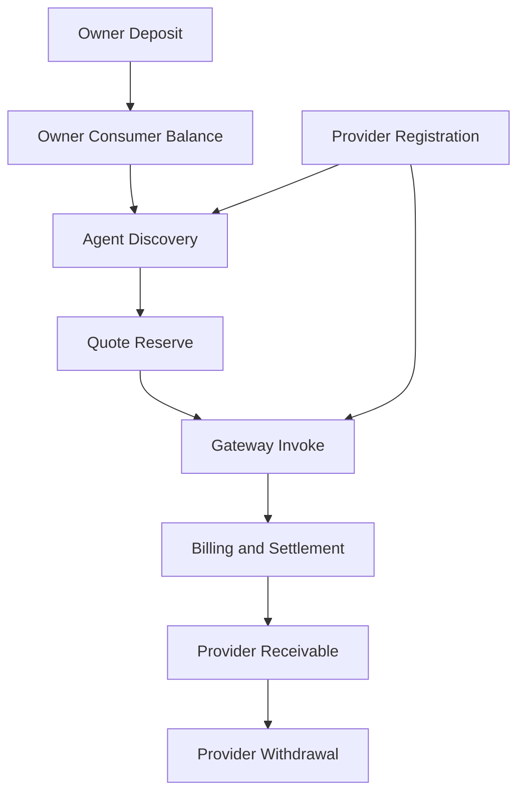

# Core Workflows

本目录定义 Synapse Network 当前最重要的五条业务链路。

这些文档的写法遵守两个原则：

1. `docs/agent/` 定义协议、身份和运行时边界。
2. 最新 SQL schema 定义表结构、状态机和持久化真相。

因此，本目录不再重复发明新的对象模型，只回答一个问题：

**Owner / Agent / Provider / Platform / Vault 这五类主体，如何在真实系统里完成资金、调用、结算和出金闭环。**

## 阅读顺序

1. `01_Deposit_and_Idempotency.md`
	先理解 Owner 入金如何进入平台资金池，以及为什么必须两阶段确认。
2. `02_Discovery_and_Gateway_Call.md`
	再理解 Agent 如何 discover -> quote -> invoke，以及 Platform 如何做代理网关。
3. `03_Billing_Settlement_and_Audit.md`
	然后理解成功调用后如何原子化扣费、分账、审计。
4. `04_Provider_Registration_and_Agreement.md`
	再看 Provider 如何注册服务、绑定收款账户并把能力挂到网络里。
5. `05_Withdrawal_and_Risk_Gates.md`
	最后看 Provider 如何提现，以及为什么必须经过风险三段阀门和 EIP-712 票据。

## 总体关系图

## 设计约束

1. Deposit 属于 Owner funding layer，不属于某个单独 Agent。
2. Discovery / Quote / Invoke 面向 Agent Runtime，不暴露 Provider 结算面。
3. Billing 必须以 ledger event 和 audit event 为核心，而不是隐式改余额。
4. Provider earnings 和 Owner consumer balance 必须严格分桶。
5. Withdrawal 必须走离链风控 + 链上签名提现的双层闭环。

## 目录边界

本目录只描述核心流程，不重复承载：

1. API 字段全集：看 `docs/api.md`
2. Error code 全集：看 `docs/Gateway_Error_Codes.md`
3. Manifest 字段标准：看 `docs/agent/03_Service_Manifest_Field_Standard.md`
4. Credential / Budget 结构：看 `docs/agent/04_Credential_Budget_Risk_Model.md`
5. SQL 完整表定义：看 `docker-compose/postgres/init/001_synapse_schema.sql`

## 每条链路必须回答的统一问题

每篇文档都围绕同一模板展开：

1. 参与者是谁
2. 触发表和状态机是什么
3. Platform 在哪里做幂等、锁、审计、回滚
4. 哪些字段属于 Agent-facing contract，哪些属于内部结算面
5. 失败后如何恢复而不破坏资金一致性
