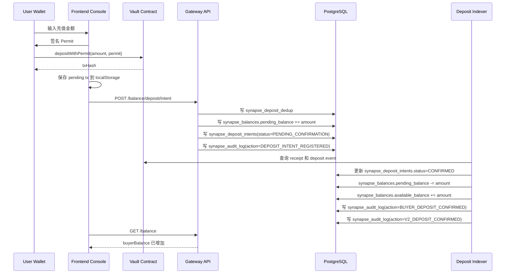

# 买家充值端到端数据流说明

本文档描述 Synapse 当前买家充值的真实数据链路，覆盖：

- 前端页面和本地状态如何推进
- 网关 API 如何登记 deposit intent
- PostgreSQL 具体写入哪些表
- 各表中的状态如何变化
- Indexer 和 Reconciliation 如何继续推进或报警
- 失败路径和异常路径分别长什么样

这不是概念稿，而是按当前仓库实现整理的执行口径。

---

## 1. 适用范围

当前链路对应以下实现：

- 前端充值入口：`apps/frontend/src/app/dashboard/console/page.tsx`
- 前端 API 封装：`apps/frontend/src/utils/balanceApi.ts`
- 网关充值路由：`gateway/src/api/routers/balance.py`
- 充值业务编排：`gateway/src/services/buyer/finance_service.py`
- PostgreSQL 原子记账：`gateway/src/storage/postgres/repositories/finance_atomic_repository.py`
- 充值索引推进：`gateway/src/services/platform/tasks/deposit_indexer/processing.py`
- 对账告警：`gateway/src/services/platform/tasks/deposit_indexer/reconciliation.py`
- PostgreSQL 表结构：`infra/docker/postgres/init/001_synapse_schema.sql`

---

## 2. 一句话总览

Synapse 的充值不是“链上成功就直接到账前端余额”，而是一个两阶段链路：

1. 用户先在链上执行 `depositWithPermit`
2. 前端把这笔链上交易登记成 `deposit intent`
3. 后端先把钱记到 `pending_balance`
4. Indexer 确认链上 receipt 和 deposit event 后，再把这笔钱从 `pending_balance` 挪到 `available_balance`
5. 前端读取 `/api/v1/balance` 后才展示为平台可用余额

所以核心桥梁不是合约本身，而是 `synapse_deposit_intents` 这张表。

---

## 3. 参与组件

### 3.1 前端

- 页面：Developer Console 的 Add Funds 弹窗
- 钱包交互：wagmi + viem + MetaMask
- 本地恢复队列：
  - `synapse_pending_deposit_tx_queue`
  - `synapse_deposit_intent_retry_queue`

### 3.2 链上

- 合约地址：`contractConfig.SynapseCore`
- 调用方法：`depositWithPermit(uint256 amount, uint256 deadline, uint8 v, bytes32 r, bytes32 s)`

### 3.3 后端网关

- 充值登记接口：`POST /api/v1/balance/deposit/intent`
- 查询充值意图接口：`GET /api/v1/balance/deposit/intents`
- 查询余额接口：`GET /api/v1/balance`

### 3.4 后端任务

- Deposit Indexer：消费 `synapse_deposit_intents`，检查链上 receipt / event，推进确认
- Reconciliation：比较链上 vault 余额和链下账本义务，必要时写审计告警

---

## 4. 端到端主流程



---

## 5. 前端数据流

## 5.1 用户点击 Add Funds

文件：`apps/frontend/src/app/dashboard/console/page.tsx`

关键前端状态：

- `topUpStep = input`
- `topUpStep = signing_permit`
- `topUpStep = executing_tx`
- `topUpError`：失败提示

前端先检查：

- 钱包是否已连接
- 网关 session 是否已鉴权
- 钱包 USDC 是否足够
- 原生币 gas 是否足够

如果这些前置条件不满足，前端只报错，不会写后端任何资金表。

## 5.2 前端发起链上交易

前端执行：

1. `signTypedDataAsync(...)` 生成 ERC-2612 Permit 签名
2. `writeContractAsync(...)` 调用 `depositWithPermit`
3. 交易一旦成功广播，立刻把 `txHash + amountUsdc` 写入本地 `synapse_pending_deposit_tx_queue`

这一阶段的关键点：

- 这只是链上广播成功，不代表平台已入账
- 平台账本此时还没有变化
- 如果这一步链上直接 revert，后端不会写 `synapse_deposit_intents`

### 5.2.1 为什么不是一广播 `depositWithPermit` 就立刻写后端

当前实现故意把“链上尝试”与“平台资金意图”分开。

原因不是做不到，而是两者语义不同：

- `depositWithPermit` 广播成功，只能证明“钱包把一笔交易发出去了”
- `synapse_deposit_intents` 则代表“平台准备把这笔链上充值纳入待确认资金链路”

如果在广播成功后立刻写后端，会带来一个好处和三个明显代价。

#### 方案 A：当前方案，receipt 成功后再登记 `deposit intent`

优点：

- `synapse_deposit_intents` 语义很干净，基本都是“有机会成为真实入账”的记录
- 后端不会因为用户取消、钱包拒签、gas 不足、合约 revert 而堆积大量无效 intent
- `pending_balance` 的增长更贴近真实资金路径，不会过早制造“平台已经接单”的错觉
- indexer 处理集合更小，主要聚焦真正已上链成功、只差确认推进的记录

缺点：

- 平台后端看不到所有用户尝试，只能看到“receipt 成功后进入平台流程”的那部分
- 如果想分析“有多少次用户点了充值但最终失败”，现在主要靠前端本地 shadow ledger 和钱包侧错误信息，不是中心化真相

#### 方案 B：广播成功后立刻写后端

优点：

- 可以更完整地统计用户发起了多少次充值尝试
- 运维后台更容易看到漏斗：发起交易、receipt 失败、receipt 成功、intent 确认、最终入账
- 更适合做产品分析，比如“用户在哪一步流失最多”

缺点：

- 会把 `synapse_deposit_intents` 从“资金待确认桥接表”污染成“前端尝试日志 + 资金桥接表”的混合物
- 用户取消、nonce 冲突、gas 不足、链上 revert 也会进入同一主表，导致状态机复杂度明显上升
- 后端必须新增一批中间状态，例如 `BROADCASTED`、`WALLET_REJECTED`、`REVERTED`、`RECEIPT_TIMEOUT`，否则同一张表无法正确表达生命周期
- 如果广播后根本拿不到最终 receipt，系统会长期保留很多“半死不活”的尝试记录，增加清理、补偿、告警噪音
- 最关键的是，资金账本和产品埋点被耦合了，后续任何报表和排障都要先区分“这是资金意图”还是“只是一次失败尝试”

### 5.2.2 当前架构为什么更偏向方案 A

Synapse 当前把 `synapse_deposit_intents` 视为资金系统主表，而不是行为分析表。

这张表后面直接连接：

- `synapse_balances.pending_balance`
- indexer 确认推进
- `BUYER_DEPOSIT_CONFIRMED`
- `V2_DEPOSIT_CONFIRMED`

所以它更适合承载“已经值得进入资金系统”的记录，而不是承载所有失败尝试。

换句话说，当前设计是在做一层硬隔离：

- 前端尝试态：留在钱包、前端本地恢复队列、前端失败日志
- 后端资金态：从 `deposit intent` 开始进入正式账本流程

这样做的核心收益是账本语义稳定，排障时不会把“支付尝试”误当成“待入账资金”。

### 5.2.3 如果未来要统计“用户发起了多少次充值尝试”，正确做法是什么

如果业务上确实要看“尝试支付次数”，更推荐新增一张独立的 append-only 表，例如：

- `synapse_payment_attempts`
- 或 `synapse_deposit_attempts`

这张表只负责记录行为漏斗，不直接驱动账本：

- `attempt_id`
- `owner_address`
- `amount_usdc`
- `client_request_id`
- `tx_hash`（如果已拿到）
- `stage`：`SIGN_REQUESTED` / `TX_BROADCASTED` / `RECEIPT_FAILED` / `RECEIPT_CONFIRMED` / `INTENT_REGISTERED`
- `failure_reason`
- `created_at`

这样会比把尝试态直接塞进 `synapse_deposit_intents` 更干净，因为：

- 行为分析和资金真相分层清楚
- 可以统计所有失败尝试
- 不会污染 `pending_balance` 和 deposit status 状态机
- 后续做风控、转化分析、漏斗分析也更自然

一句话总结：

- 如果目标是“资金正确入账”，当前方案更稳
- 如果目标是“统计完整尝试漏斗”，应该加独立 attempts 表，而不是直接把广播态写进 `synapse_deposit_intents`

## 5.3 前端等待 receipt

前端通过 `useWaitForTransactionReceipt({ hash })` 等待链上结果。

### 成功时

- 清掉 `synapse_pending_deposit_tx_queue` 中对应 tx
- 调用 `createDepositIntent(...)`
- 后续轮询余额，等待平台余额更新

### 失败时

- 清掉本地 pending tx
- `topUpStep` 重置回 `input`
- `topUpError` 写入可读失败原因
- 页面明确提示用户是“用户取消 / Gas 不足 / 合约自定义错误 / 普通 revert / nonce 问题”中的哪一类

### 页面刷新恢复时

如果用户在链上交易广播后刷新页面：

- 前端会从 `synapse_pending_deposit_tx_queue` 取出未完成 tx
- 重新查 receipt
- receipt 成功则自动补提 `deposit intent`
- 如果提 intent 时 session 失效，则转存到 `synapse_deposit_intent_retry_queue`
- 等用户重新鉴权后重试同步

所以前端本地状态不是账本真相，但它是“避免用户刷新后丢单”的补偿层。

---

## 6. 后端 API 数据流

## 6.1 `POST /api/v1/balance/deposit/intent`

入口文件：`gateway/src/api/routers/balance.py`

前端请求体核心字段：

- `ownerAddress`
- `buyerAddress`
- `txHash`
- `amountUsdc`

请求头核心字段：

- `Authorization`
- `X-User-Address`
- `X-Idempotency-Key`

网关做的事：

1. 从 session 推导 owner，而不是信任前端传来的 owner
2. 校验 `txHash` 格式
3. 校验 `amountUsdc > 0`
4. 校验幂等键
5. 进入 `BuyerFinanceService.register_deposit_intent(...)`

---

## 7. PostgreSQL 写表顺序

## 7.1 第一步：写 `synapse_deposit_dedup`

表：`synapse_deposit_dedup`

用途：物理去重，拦截同一个 `tx_hash` 的重放。

关键字段：

- `tx_hash`：主键
- `owner_address`
- `request_id`

写入时机：

- `register_deposit_intent_atomic(...)` 一开始就先插入

结果：

- 如果插入成功，继续后续流程
- 如果唯一约束冲突，直接回查 `synapse_deposit_intents` 并返回已有结果

这张表不负责余额，只负责“这笔 txHash 是否已经被系统消费过”。

## 7.2 第二步：写 `synapse_balances`

表：`synapse_balances`

用途：链下账本真相表。

在充值登记阶段，系统不会直接加 `available_balance`，而是：

- `pending_balance += amount_usdc`
- `available_balance` 不变
- `frozen_balance` 不变

对应账户：

- `owner_address = buyer wallet`
- `account_type = buyer`

为什么先加 `pending_balance`：

- 因为这笔钱虽然已经有链上 txHash，但系统还没有把它认定为“足够确认、可消费”的资金
- 在 indexer 确认前，不能让用户拿它去扣费

## 7.3 第三步：写 `synapse_deposit_intents`

表：`synapse_deposit_intents`

登记阶段写入字段：

- `id`
- `owner_address`
- `tx_hash`
- `request_id`
- `buyer_address`
- `amount_usdc`
- `idempotency_key`
- `status = PENDING_CONFIRMATION`
- `created_at`
- `updated_at`

这是充值的核心桥接表。

它把“链上某笔充值交易”变成“平台内部一条待确认的资金意图”。

## 7.4 第四步：写 `synapse_audit_log`

表：`synapse_audit_log`

动作：`DEPOSIT_INTENT_REGISTERED`

典型内容：

- `business_type = deposit`
- `owner_address = buyer wallet`
- `tx_hash = 充值链上交易哈希`
- `message / detail` 中带有 `depositIntentId`、`amountUsdc`、`idempotencyKey`

这一步表示：

- 平台已经知道这笔充值存在
- 但还没有把它标记成最终已入账

---

## 8. Indexer 如何推进确认

实现文件：`gateway/src/services/platform/tasks/deposit_indexer/processing.py`

Indexer 会定期扫描 `synapse_deposit_intents` 中状态为：

- `PENDING_CONFIRMATION`
- `PENDING`

的记录。

它对每条 intent 做三件事：

1. 查链上 receipt
2. 查 receipt 里的匹配 deposit event
3. 如果确认合法，则调用原子确认逻辑

## 8.1 如果链上还没确认

- intent 保持 `PENDING_CONFIRMATION`
- `synapse_balances.pending_balance` 保持不动
- `synapse_balances.available_balance` 保持不动

## 8.2 如果链上交易失败或事件不匹配

indexer 会把 intent 置成失败类状态，例如：

- `FAILED`
- `failureReason = CHAIN_TX_FAILED`
- `failureReason = NO_MATCHING_DEPOSIT_EVENT`
- `failureReason = INVALID_INTENT`

这意味着：

- 这条充值意图不再可确认
- 它不会被推进到可用余额

## 8.3 如果链上确认成功

系统调用 `confirm_deposit_intent_atomic(...)`，在同一个数据库事务里做三件事：

1. 锁住 `synapse_deposit_intents` 目标行
2. 锁住 `synapse_balances` 中买家余额行
3. 执行以下状态迁移：

- `pending_balance -= amount_usdc`
- `available_balance += amount_usdc`
- `synapse_deposit_intents.status = CONFIRMED`
- `synapse_deposit_intents.updated_at = now`

到这里，这笔钱才算真正变成“平台可消费余额”。

---

## 9. 状态机

## 9.1 前端状态机

前端弹窗状态：

- `input`
- `signing_permit`
- `executing_tx`

前端失败提示：

- 用户取消
- Gas 不足
- USDC 不足
- 合约自定义错误
- 普通 revert
- nonce 过期

这些状态只影响 UX，不代表账本真相。

## 9.2 `synapse_deposit_intents.status`

当前链路中常见状态：

- `PENDING_CONFIRMATION`
  - 已登记 intent
  - 已写入 `pending_balance`
  - 还没进 `available_balance`

- `PENDING`
  - 与 `PENDING_CONFIRMATION` 同类，属于待确认集合

- `CONFIRMED`
  - 已被 indexer 或确认接口推进
  - 金额已经从 `pending_balance` 转到 `available_balance`

- `FAILED`
  - 链上交易失败、事件不匹配、数据无效等
  - 不会进入可用余额

- `DUPLICATE`
  - eventKey 已处理过，避免重复入账

## 9.3 `synapse_balances` 三栏含义

- `available_balance`
  - 立即可消费的余额
  - 买家调用服务时真正会被扣减的是这一栏

- `pending_balance`
  - 已登记但还未完成最终确认的充值金额
  - 是“系统看到了充值动作，但还没放行使用”

- `frozen_balance`
  - 风控冻结或人工冻结
  - 充值主链路默认不碰这一栏

---

## 10. 审计日志动作说明

你给出的样例：

```csv
1,DEPOSIT_INTENT_REGISTERED,...,tx_hash=0xd9a315...
2,BUYER_DEPOSIT_CONFIRMED,...,status=CONFIRMED,amount_delta=10.000000
3,V2_DEPOSIT_CONFIRMED,...,tx_hash=0xd9a315...
4,V2_DEPOSIT_RECONCILIATION_ALERT,...,owner_address=0xe7f1725...
```

可以这样理解。

## 10.1 `DEPOSIT_INTENT_REGISTERED`

含义：

- 前端已经把一笔链上 txHash 提交给网关
- 网关已经成功登记 intent
- 数据已经写进 `synapse_deposit_intents`
- 同时买家 `pending_balance` 已增加

这个动作不是“到账完成”，只是“充值意图已登记”。

## 10.2 `BUYER_DEPOSIT_CONFIRMED`

含义：

- 原子确认记账成功
- 买家余额已经从 `pending_balance` 挪到 `available_balance`
- 这是最接近“资金正式到账”的账本级确认动作

从你给的样例看：

- `amount_delta = 10.000000`
- `status = CONFIRMED`
- `result_status = CONFIRMED`
- `message = confirmations=1`

说明这笔 10 USDC 已经按确认门槛完成入账。

## 10.3 `V2_DEPOSIT_CONFIRMED`

含义：

- 这是 indexer 视角写下的 V2 流程审计补充
- 它强调的是“这笔 V2 deposit 链路已经完成闭环”
- 它和 `BUYER_DEPOSIT_CONFIRMED` 不是冲突关系，而是两个层次的审计口径

可以简单理解为：

- `BUYER_DEPOSIT_CONFIRMED`：账本层面确认
- `V2_DEPOSIT_CONFIRMED`：indexer / 链路层面确认

## 10.4 `V2_DEPOSIT_RECONCILIATION_ALERT`

含义：

- 周期性 reconciliation 在比较“链上 vault 余额”和“链下账本义务”时发现有偏差
- 这条记录不是某个用户又发起了一次充值
- 它是系统对账报警

为什么 `owner_address` 会是合约地址 `0xe7f1725...`：

- reconciliation 的 owner 写的是 router / vault 合约地址
- 因为它描述的是“平台金库层面的全局对账问题”，不是某个买家的个人充值动作

所以你贴出来的 4, 5, 6, 7 这些 `V2_DEPOSIT_RECONCILIATION_ALERT`，不是用户重复充值，而是系统重复检查后持续发现链上和账本之间存在 delta。

---

## 11. 结合这次真实样例，整套时序是什么

对于 tx `0xd9a315834c3ddc346a34f8286b021c74ed566b2b8313b858f0d207ccc03c4fd6`，真实链路是：

1. 用户在前端发起 `depositWithPermit`
2. 链上交易成功，拿到 txHash
3. 前端调用 `POST /api/v1/balance/deposit/intent`
4. PostgreSQL：
   - `synapse_deposit_dedup` 插入去重记录
   - `synapse_balances(owner=buyer, account_type=buyer)` 的 `pending_balance += 10`
   - `synapse_deposit_intents` 插入一行，`status = PENDING_CONFIRMATION`
   - `synapse_audit_log` 写 `DEPOSIT_INTENT_REGISTERED`
5. Indexer 发现这笔 tx receipt 已确认且 event 匹配
6. PostgreSQL：
   - `synapse_balances.pending_balance -= 10`
   - `synapse_balances.available_balance += 10`
   - `synapse_deposit_intents.status = CONFIRMED`
   - `synapse_audit_log` 写 `BUYER_DEPOSIT_CONFIRMED`
   - `synapse_audit_log` 写 `V2_DEPOSIT_CONFIRMED`
7. 随后 reconciliation 发现全局 delta，追加 `V2_DEPOSIT_RECONCILIATION_ALERT`

从业务上说，这笔充值已经到账；后面的 alert 是平台金库对账问题，不是这笔充值本身没记账。

---

## 12. 失败路径说明

## 12.1 链上交易直接失败

例如：

- 用户取消 MetaMask
- Gas 不足
- 合约自定义错误导致 revert

当前行为：

- 前端提示失败
- 不调用成功的 `createDepositIntent` 提交流程
- PostgreSQL 不会写入新的 `synapse_deposit_intents`
- `synapse_balances` 不会增加 `pending_balance`
- 用户平台余额不会变化

## 12.2 链上成功，但前端丢失会话或刷新

当前行为：

- 前端 pending tx queue 会保存 `txHash + amountUsdc`
- 恢复页面后自动补提 `deposit intent`
- 如果提交 intent 时鉴权失效，则进入 retry queue

这条补偿链路是为了解决“链上成功但页面中断”问题。

## 12.3 intent 已登记，但链上 receipt 最终失败

当前 indexer 口径：

- intent 会被标成 `FAILED`
- 失败原因会写到 `failureReason`
- 这笔钱不会进入 `available_balance`

---

## 13. 排查时该看哪些表

## 13.1 先看充值意图

表：`synapse_deposit_intents`

重点字段：

- `tx_hash`
- `owner_address`
- `amount_usdc`
- `status`
- `updated_at`

判断：

- 查不到：前端可能没成功提交 intent
- `PENDING_CONFIRMATION`：还没完成最终确认
- `CONFIRMED`：账本应该已到账
- `FAILED`：链路失败，需要看 `failureReason`

## 13.2 再看余额表

表：`synapse_balances`

重点看买家 `account_type = buyer`：

- `available_balance`
- `pending_balance`
- `frozen_balance`

判断：

- `pending_balance > 0` 且 intent 还没确认：说明卡在确认阶段
- `available_balance` 已增加：说明平台账本已到账

## 13.3 最后看审计

表：`synapse_audit_log`

重点动作：

- `DEPOSIT_INTENT_REGISTERED`
- `BUYER_DEPOSIT_CONFIRMED`
- `V2_DEPOSIT_CONFIRMED`
- `V2_DEPOSIT_RECONCILIATION_ALERT`

判断：

- 有 register 没有 confirmed：说明 intent 已登记但未完成推进
- 有 confirmed：说明账本已经正式到账
- 有 reconciliation alert：说明平台金库和链下账本有差额，需要单独查对账，不要误判为用户没到账

---

## 14. 当前链路设计结论

当前充值链路的本质是：

- 合约负责收钱
- 前端负责把链上 txHash 报给网关
- `synapse_deposit_intents` 负责承接链上和链下之间的状态桥接
- `synapse_balances.pending_balance` 承接“已登记未确认”的中间态
- Indexer 负责最终放行到 `available_balance`
- `synapse_audit_log` 负责形成完整追溯链

所以看充值问题时，不要只看前端 toast，也不要只看链上浏览器。必须同时核对：

1. `synapse_deposit_intents`
2. `synapse_balances`
3. `synapse_audit_log`

这三者合起来，才是完整的资金真相。