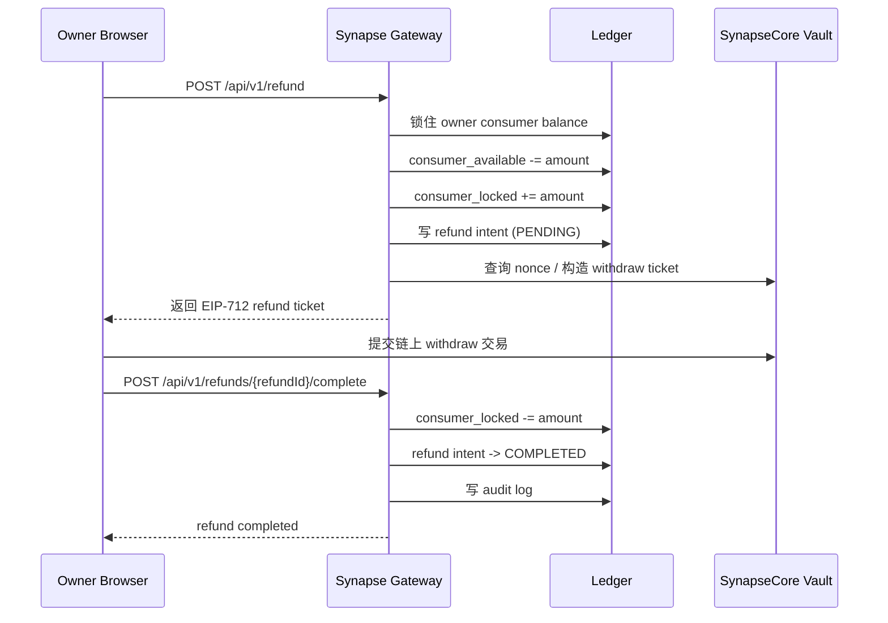

# Owner Consumer Refund Process

> 当前文档已经切到 build-for-agent 口径：退款属于 **Owner 消费侧余额出金**，不是 Provider 提现，也不是 Agent 自己持币提现。

本文档描述当前平台退款链路的真实语义，并回答一个关键问题：

**同一个 Owner 既可以是调用方，也可以是服务提供方；当同一个钱包地址同时拥有消费侧余额和供给侧收益时，退款为什么不会和 Provider 提现冲突。**

## 1. 先说结论

退款链路处理的是：

1. Owner 充值进入平台后的消费侧余额
2. 后续被 Agent Runtime 消费之前或消费之后剩余的可退款部分
3. Owner 申请把这部分消费侧余额退回链上钱包

它不处理：

1. Provider 提供服务赚到的收益
2. Provider earnings 的提现
3. Platform fee 池的出金

所以，退款的正确口径不是“买家把钱提走”，而是：

**Owner 从自己的 consumer balance bucket 中发起 route-back refund。**

## 2. 同一个 Owner 为什么可以同时退款和做 Provider

同一个 `ownerAddress` 可以同时拥有两类资金：

1. `consumer balance`
   - 来源：Owner 自己充值进 Vault 后，经平台确认得到的消费侧余额
   - 用途：给 Agent Runtime 做 Discovery / Quote / Invoke 消费
   - 相关动作：deposit、invoke charge、refund

2. `provider receivable`
   - 来源：该 Owner 以 Provider 角色提供服务后赚到的收益
   - 用途：后续发起 provider withdrawal
   - 相关动作：earning accrual、provider withdrawal

两类钱都归属于同一个 Owner，但绝不能混成一个余额数字。

## 3. 当前账务边界

当前 API 已经在返回层体现了这件事：

- `GET /api/v1/balance`
  - `consumerBalance`: 当前语义应理解为 `owner consumer spendable balance`
  - `providerReceivable`: 当前语义应理解为 `owner provider receivable`
  - `platformFeeAccrued`: 平台内部手续费池，不归 Owner 自由支配

所以对同一个 Owner 来说：

1. Refund 只影响 `consumerBalance` 这条消费侧余额语义
2. Provider Withdrawal 只影响 `providerReceivable` 这条供给侧收益语义
3. 两者 owner 相同，但 ledger bucket 不同

## 4. 退款链路回答的是什么问题

退款链路回答的是：

**在不影响 Provider earnings 的前提下，如何把 Owner 尚未消费掉的 consumer balance 安全退回链上钱包。**

它本质上是：

1. Owner-scoped
2. consumer-bucket-scoped
3. route-back only
4. owner-pays-onchain-gas

## 5. 退款不等于 Agent 提现

这里必须卡死一个边界。

Agent Runtime 虽然会消费 Owner 的预算，但 Agent 不是资金提现主体。

正确关系是：

1. Owner 充值，形成 consumer balance
2. Agent Runtime 仅在 Credential + Budget Policy 约束下消费这笔钱
3. 如果要把剩余钱拿回链上，发起退款的是 Owner 控制面，不是 Agent

所以退款接口必须继续保持：

1. owner session required
2. owner-scoped auth
3. destinationAddress 必须回到 owner address

## 6. 完整退款流程

## 7. 退款到底动哪一桶

当前语义上，退款只应该动 consumer bucket：

1. `consumer_available -> consumer_locked`
2. `consumer_locked -> withdrawn_to_owner_wallet`

当前推荐的实现口径就是：

1. `consumers[owner] -= amount`
2. `consumersLocked[owner] += amount`
3. complete 后 `consumersLocked[owner] -= amount`

重要的是：

1. 这些名字直接表达 Owner consumer bucket 模型
2. 账务语义应避免再回退到旧角色词
3. 当前文档解释已经完全切换成 Owner consumer bucket 模型

## 8. 为什么它不会和 Provider 提现冲突

因为 Provider 提现走的是另一套收益桶：

1. `provider_receivable -> provider_locked`
2. `provider_locked -> withdrawn_to_owner_wallet`

当前推荐的实现口径就是：

1. `providers[owner] -= amount`
2. `providersLocked[owner] += amount`
3. complete 后 `providersLocked[owner] -= amount`

所以同一个 owner 地址下，可能同时存在：

1. 一个 refund intent
2. 一个 provider withdrawal intent

只要系统保证：

1. 锁的是不同 ledger bucket
2. 审计事件类型不同
3. 幂等键空间和 tx replay 检查独立

这两条链路就不会互相打架。

## 9. 核心 Q&A

### Q1: Owner 退款时，Provider 收益会不会一起被退掉？

不会。

退款只能从 consumer bucket 出账，Provider earnings 属于 provider receivable bucket。

### Q2: 同一个钱包既是调用方又是服务方，为什么不会混账？

因为记账不是按“这个钱包现在像消费方还是供给方”来区分，而是按：

1. owner 归属
2. ledger bucket
3. action type

### Q3: 退款 Gas 由谁承担？

当前仍然是 Owner 自己承担链上 Gas。

也就是：

1. 平台负责签发 ticket
2. Owner 自己发链上 withdraw
3. 平台不代付链上出金 Gas

### Q4: 退款后 Agent Credential 会怎样？

Runtime 语义上不应该理解成“删掉 Agent 身份”，而应该理解成：

1. consumer balance 变少或清零
2. 相关 Agent Credential 后续再调用时，可能命中 `INSUFFICIENT_BALANCE`
3. Credential 是 runtime identity，不是余额本身

所以更准确的说法是：

**退款影响购买力，不直接等于删除 Agent 身份。**

## 10. 状态机

### 10.1 Refund Intent

当前退款状态主线：

- `PENDING`
  - refund ticket 已签发
  - consumer balance 已从 available 挪到 locked
  - 等待链上完成

- `PENDING_MANUAL_REVIEW`
  - 人工审核中
  - 仍然占用 consumer locked bucket

- `COMPLETED`
  - 已链上完成
  - locked bucket 已释放

- `REJECTED`
  - 人工拒绝或规则拒绝
  - locked bucket 回退到 consumer available

## 11. 关键约束

### 11.1 鉴权

- 必须要求有效 Owner session
- 必须由服务端 token subject 推导 owner
- 不允许仅凭 Agent Credential 发起退款

### 11.2 幂等

- `POST /api/v1/refund` 必须要求 `X-Idempotency-Key`
- 同 owner 下重复请求需要稳定返回相同语义
- 同 owner 下不同退款单不能复用同一个完成 `txHash`

### 11.3 资金安全

- 必须在单事务内完成余额锁定、intent 写入、审计落账
- 必须把 consumer balance 与 provider receivable 分桶处理
- 绝不能让 provider withdrawal 消费到 consumer bucket
- 绝不能让 refund 消费到 provider receivable bucket

## 12. UI / Workspace 设计含义

这也是为什么平台前端应该保留两个 workspace，而不是两个账号系统：

1. `Agent Workspace`
   - 看 `Spendable Balance`
   - Add Funds
   - Refund
   - Agent / Credential / Budget

2. `Provider Workspace`
   - 看 `Provider Receivable`
   - Service Manifest
   - Earnings Summary
   - Withdrawals

两边都属于同一个 Owner。

所以 UI 上最重要的不是“把用户分成消费侧或供给侧账号”，而是把两个资金桶清晰可视化：

1. `Spendable Balance`
2. `Provider Receivable`

## 13. 对当前 API 的解释口径

当前接口和实现应统一使用这些字段：

- `consumerBalance`
- `consumers[owner]`
- `consumersLocked[owner]`

它们统一表达：

**Owner consumer balance buckets**。

Provider 收益侧对应字段应统一使用：

- `providerReceivable`
- `providers[owner]`
- `providersLocked[owner]`

它们统一表达：

**Owner provider receivable buckets**。

## 14. 最终结论

退款文档的 canonical 口径应该是：

1. 退款属于 Owner 消费侧余额出金
2. Provider 提现属于 Owner 供给侧收益出金
3. 两者可以归属于同一个钱包地址
4. 两者不会冲突，因为它们锁定的是不同资金桶
5. 前端应该做两个 workspace，但只保留一套 Owner 身份和 session
