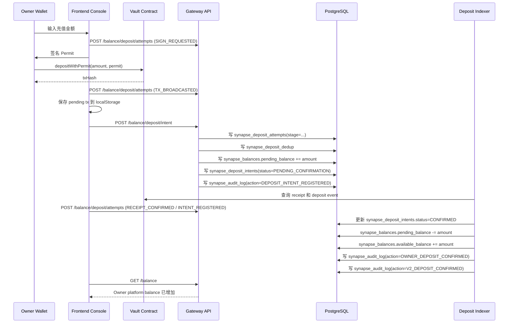

# Owner Vault Deposit End-to-End Dataflow

> 当前文档已经切到 build-for-agent 口径：**充值动作属于 Owner 为自己的 Vault 资金池入金，不属于某个单独 Agent；Agent Runtime 只是后续消费这笔 Owner 资金。**

本文档描述 Synapse 当前充值链路的真实执行口径，覆盖：

1. 前端如何发起链上入金与补偿恢复。
2. Gateway 如何登记 deposit intent。
3. PostgreSQL 如何先记 `pending_balance`，再推进到 `available_balance`。
4. Deposit Indexer 与 Reconciliation 如何继续确认或告警。
5. 这笔钱和 Agent Runtime 的关系边界是什么。

这不是未来计划稿，而是按当前仓库实现整理的运行时事实说明。

## 1. 先定语义边界

build-for-agent 口径下，充值链路要先分清三个对象：

1. **Owner**：控制面主体，负责一次性授权、充值、提现、设预算。
2. **Vault**：链上 Dumb Vault，只负责收钱和出金，不负责 Runtime 预算控制。
3. **Agent Runtime**：后续发现服务、拉 quote、发 invocation、消耗预算的执行主体。

所以这条充值链路的真正含义不是“某个运行时身份给自己单独充钱”，而是：

1. Owner 把 USDC 充值进链上 Vault。
2. 前端把这笔链上交易登记成平台侧 deposit intent。
3. Gateway 先把这笔钱记为 Owner 侧待确认资金。
4. Indexer 确认链上 receipt 和 deposit event 后，再把这笔钱放行成 Owner 平台可用余额。
5. 后续 Agent Credential / Budget Policy 才能从这笔 Owner 余额中消费。

一句话：**Deposit belongs to Owner funding, not to a single Agent invocation.**

## 2. 当前实现适用范围

当前链路对应以下实现：

- 前端充值入口：`apps/frontend/src/app/dashboard/console/page.tsx`
- 前端 API 封装：`apps/frontend/src/utils/balanceApi.ts`
- 网关充值路由：`gateway/src/api/routers/balance.py`
- 充值业务编排：`gateway/src/services/owner/finance_service.py`
- PostgreSQL 原子记账：`gateway/src/storage/postgres/repositories/finance_atomic_repository.py`
- 充值索引推进：`gateway/src/services/platform/tasks/deposit_indexer/processing.py`
- 对账告警：`gateway/src/services/platform/tasks/deposit_indexer/reconciliation.py`
- PostgreSQL 表结构：`infra/docker/postgres/init/001_synapse_schema.sql`

注意：

1. 当前仓库仍保留少量历史兼容别名，用于平滑读取旧数据与旧事件。
2. 这些兼容别名不改变 build-for-agent 语义：**它们都应理解为 Owner 资金池入金链路的历史兼容层，而不是产品对象模型里的 canonical 命名。**
3. 新增代码与文档必须统一使用 `Owner / Agent / Provider / Vault` 口径。

## 3. 一句话总览

Synapse 的充值不是“链上交易成功，前端就立刻显示可消费余额”，而是一个两阶段桥接：

1. Owner 在链上执行 `depositWithPermit`
2. 前端把这笔链上交易登记成 `deposit intent`
3. Gateway 先把金额记到平台侧 `pending_balance`
4. Deposit Indexer 确认链上 receipt 和 deposit event
5. 金额从 `pending_balance` 挪到 `available_balance`
6. 平台这时才把它视为 Owner 可用于 Agent Runtime 的可消费余额

所以真正的桥梁不是合约本身，而是平台内部的：

1. `synapse_deposit_intents`
2. `synapse_balances`
3. `synapse_audit_log`

## 4. 端到端主流程

## 5. 兼容别名与当前语义映射

当前实现为了兼容旧数据和旧事件，仍会读取少量历史兼容字段。阅读时遵守下面两条原则：

1. **兼容层只用于读取旧状态，不再作为新设计主语义。**
2. **产品语义已经切到 Owner / Agent / Provider / Vault，不再接受旧角色词作为解释主轴。**

## 6. 参与组件

### 6.1 前端

- 页面：Developer Console 的 Add Funds 弹窗
- 钱包交互：wagmi + viem + MetaMask
- 本地恢复队列：
  - `synapse_pending_deposit_tx_queue`
  - `synapse_deposit_intent_retry_queue`

### 6.2 链上

- 合约地址：`contractConfig.SynapseCore`
- 调用方法：`depositWithPermit(uint256 amount, uint256 deadline, uint8 v, bytes32 r, bytes32 s)`

### 6.3 后端网关

- 充值尝试记录接口：`POST /api/v1/balance/deposit/attempts`
- 充值登记接口：`POST /api/v1/balance/deposit/intent`
- 查询充值意图接口：`GET /api/v1/balance/deposit/intents`
- 查询余额接口：`GET /api/v1/balance`

### 6.4 后端任务

- Deposit Indexer：消费 `synapse_deposit_intents`，检查链上 receipt / event，推进确认
- Reconciliation：比较链上 Vault 余额和链下账本义务，必要时写审计告警

## 7. 前端数据流

### 7.1 Owner 点击 Add Funds

文件：`apps/frontend/src/app/dashboard/console/page.tsx`

关键前端状态：

- `topUpStep = input`
- `topUpStep = signing_permit`
- `topUpStep = executing_tx`
- `topUpError`：失败提示

前端先检查：

1. Owner 钱包是否已连接
2. Gateway session 是否已鉴权
3. Owner 钱包 USDC 是否足够
4. 原生币 gas 是否足够

如果这些条件不满足：

1. 前端只报错
2. 后端不会写任何资金主表
3. 平台不会登记 deposit intent

### 7.2 前端发起链上入金

前端执行：

1. `signTypedDataAsync(...)` 生成 ERC-2612 Permit 签名
2. `writeContractAsync(...)` 调用 `depositWithPermit`
3. 交易广播成功后，立刻把 `txHash + amountUsdc` 写入本地 `synapse_pending_deposit_tx_queue`
4. 同时把本次尝试阶段写入 `synapse_deposit_attempts`

关键点：

1. 这一步只是链上广播成功，不代表平台已经入账
2. 平台账本此时还没有新增可消费余额
3. 如果这一步链上直接 revert，后端不会写新的 `synapse_deposit_intents`

### 7.3 前端等待 receipt

前端通过 `useWaitForTransactionReceipt({ hash })` 等待链上结果。

#### 成功时

1. 清掉 `synapse_pending_deposit_tx_queue` 中对应 tx
2. 调用 `createDepositIntent(...)`
3. 后续轮询余额，等待平台侧确认完成

#### 失败时

1. 清掉本地 pending tx
2. `topUpStep` 重置回 `input`
3. `topUpError` 写入可读失败原因

#### 页面刷新恢复时

如果用户在链上交易广播后刷新页面：

1. 前端会从 `synapse_pending_deposit_tx_queue` 取出未完成 tx
2. 重新查 receipt
3. receipt 成功则自动补提 `deposit intent`
4. 如果提 intent 时 session 失效，则转存到 `synapse_deposit_intent_retry_queue`
5. 用户重新鉴权后再重试同步

所以前端本地状态不是账本真相，它只是避免 Owner 在页面中断时丢单的补偿层。

## 8. 为什么充值不直接归属某个 Agent

这点是 build-for-agent 里最容易被误解的地方。

Owner 入金后，这笔钱：

1. **先进入 Owner 平台余额池**
2. **不会在充值时直接绑定某个 Agent Profile**
3. **不会在充值时直接绑定某个 Agent Credential**
4. **不会在充值时直接做 Quote / Invocation 预算预占**

后续 Agent Runtime 只是：

1. 用 `Agent Credential` 做运行时身份
2. 用 `Budget Policy` 做预算边界
3. 从 Owner 的可用资金池里消费

所以充值链路和 Agent Runtime 的关系应该理解为：

1. Deposit 是 **funding layer**
2. Quote / Invocation 是 **runtime commerce layer**
3. 两者通过平台余额与账本衔接，但不是同一个状态机

## 9. 后端 API 数据流

### 9.1 `POST /api/v1/balance/deposit/intent`

入口文件：`gateway/src/api/routers/balance.py`

前端请求体核心字段：

- `ownerAddress`
- `txHash`
- `amountUsdc`

请求头核心字段：

- `Authorization`
- `X-User-Address`
- `X-Idempotency-Key`

网关做的事：

1. 从 session 推导 owner，而不是信任前端传来的 owner
2. 校验 `txHash` 格式
3. 校验 `amountUsdc > 0`
4. 校验幂等键
5. 进入 `OwnerFinanceService.register_deposit_intent(...)`

这里的真实业务含义是：

**register owner vault deposit intent**。

## 10. PostgreSQL 写表顺序

### 10.1 行为漏斗表：`synapse_deposit_attempts`

用途：记录一次充值尝试在前端和网关之间经过了哪些阶段。

关键字段：

- `attempt_id`
- `owner_address`
- `amount_usdc`
- `client_request_id`
- `tx_hash`
- `stage`
- `failure_reason`
- `created_at`
- `updated_at`

关键约束：

- `UNIQUE (attempt_id, stage)`

定位：

1. 它不是账本表
2. 它不会修改 `synapse_balances`
3. 它不会驱动 `pending_balance`
4. 它不会替代 `synapse_deposit_intents`

它只回答一个问题：

**这次 Owner 入金尝试到底走到了哪一步，失败在哪一步。**

### 10.2 去重表：`synapse_deposit_dedup`

用途：物理去重，拦截同一个 `tx_hash` 的重放。

关键字段：

- `tx_hash`
- `owner_address`
- `request_id`

写入时机：

1. `register_deposit_intent_atomic(...)` 一开始就先插入
2. 如果唯一约束冲突，系统直接回查已有 `synapse_deposit_intents`

这张表不负责余额，只负责“同一笔链上入金是否已经被平台消费过”。

### 10.3 余额表：`synapse_balances`

当前实现仍然使用 `synapse_balances` 作为链下余额快照表。

在充值登记阶段，系统不会直接加 `available_balance`，而是：

1. `pending_balance += amount_usdc`
2. `available_balance` 不变
3. `frozen_balance` 不变

当前记录形态的业务语义是：

- `owner_address = owner wallet`
- `account_type = owner consumer wallet snapshot`

为什么先加 `pending_balance`：

1. 这笔钱虽然已经有链上 txHash，但平台还没把它认定为可消费资金
2. 在 indexer 确认前，不能让任何 Agent Runtime 消费这笔钱

### 10.4 桥接表：`synapse_deposit_intents`

登记阶段写入字段：

- `id`
- `owner_address`
- `tx_hash`
- `request_id`
- `amount_usdc`
- `idempotency_key`
- `status = PENDING_CONFIRMATION`
- `created_at`
- `updated_at`

这张表的真正作用是：

**把一笔链上 Vault deposit 变成平台内部一条待确认的 Owner funding intent。**

注意：

1. 链上发起地址在兼容层里仍可被回填。
2. 当前语义上它始终表示发起这笔 Owner 入金的链上地址。

### 10.5 审计表：`synapse_audit_log`

登记阶段典型动作：`DEPOSIT_INTENT_REGISTERED`

它表示：

1. 平台已经知道这笔 Owner 入金存在
2. 平台已经把它纳入待确认资金链路
3. 但平台还没有把它放行成最终可消费余额

## 11. Deposit Indexer 如何推进确认

实现文件：`gateway/src/services/platform/tasks/deposit_indexer/processing.py`

Indexer 会定期扫描 `synapse_deposit_intents` 中状态为：

1. `PENDING_CONFIRMATION`
2. `PENDING`

的记录。

它对每条 intent 做三件事：

1. 查链上 receipt
2. 查 receipt 里的匹配 deposit event
3. 如果确认合法，则调用原子确认逻辑

### 11.1 如果链上还没确认

1. intent 保持 `PENDING_CONFIRMATION`
2. `pending_balance` 不动
3. `available_balance` 不动

### 11.2 如果链上交易失败或事件不匹配

intent 会被置成失败类状态，例如：

1. `FAILED`
2. `failureReason = CHAIN_TX_FAILED`
3. `failureReason = NO_MATCHING_DEPOSIT_EVENT`
4. `failureReason = INVALID_INTENT`

这意味着：

1. 这条入金意图不会被推进到可用余额
2. 它也不会变成 Agent Runtime 可消费资金

### 11.3 如果链上确认成功

系统调用 `confirm_deposit_intent_atomic(...)`，在同一个数据库事务里做三件事：

1. 锁住 `synapse_deposit_intents` 目标行
2. 锁住 `synapse_balances` 中 Owner 余额行
3. 执行以下状态迁移：

- `pending_balance -= amount_usdc`
- `available_balance += amount_usdc`
- `synapse_deposit_intents.status = CONFIRMED`
- `synapse_deposit_intents.updated_at = now`

到这里，这笔钱才算真正变成：

**Owner 在平台上的可消费余额，可被后续 Agent Credential / Budget Policy 间接使用。**

## 12. 状态机

### 12.1 前端状态机

前端弹窗状态：

- `input`
- `signing_permit`
- `executing_tx`

这些状态只影响 UX，不代表账本真相。

### 12.2 `synapse_deposit_intents.status`

当前链路常见状态：

- `PENDING_CONFIRMATION`
  - 已登记 intent
  - 已写入 `pending_balance`
  - 还没进 `available_balance`

- `PENDING`
  - 与 `PENDING_CONFIRMATION` 同类，属于待确认集合

- `CONFIRMED`
  - 已被 indexer 推进
  - 金额已经从 `pending_balance` 转到 `available_balance`

- `FAILED`
  - 链上交易失败、事件不匹配、数据无效等
  - 不会进入可用余额

- `DUPLICATE`
  - eventKey 已处理过，避免重复入账

### 12.3 `synapse_balances` 三栏含义

- `available_balance`
  - 当前 Owner 已可消费的平台余额
  - 后续 Agent Runtime 能间接消费的是这一栏

- `pending_balance`
  - 已登记但还未完成最终确认的入金金额
  - 是“平台看到了入金动作，但还没放行使用”

- `frozen_balance`
  - 风控冻结或人工冻结
  - 充值主链路默认不碰这一栏

## 13. 审计日志动作如何按新语义理解

你现在看到的审计动作名会同时出现 canonical 动作和兼容动作，例如：

1. `DEPOSIT_INTENT_REGISTERED`
2. `DEPOSIT_INTENT_CONFIRMED`
3. `V2_DEPOSIT_CONFIRMED`
4. `V2_DEPOSIT_RECONCILIATION_ALERT`

build-for-agent 口径下，应这样理解：

### 13.1 `DEPOSIT_INTENT_REGISTERED`

含义：

1. Owner 已把一笔链上 txHash 提交给平台
2. 平台已经成功登记 funding intent
3. `pending_balance` 已增加
4. 但这笔钱还不是最终可消费余额

### 13.2 `DEPOSIT_INTENT_CONFIRMED`

当前语义是：

**Owner deposit ledger confirmed**

也就是：

1. 余额已经从 `pending_balance` 挪到 `available_balance`
2. 平台账本层面正式认账

### 13.3 `V2_DEPOSIT_CONFIRMED`

这是 indexer / 链路层面的补充确认：

1. `DEPOSIT_INTENT_CONFIRMED`：账本层确认
2. `V2_DEPOSIT_CONFIRMED`：索引器与链路层确认

### 13.4 `V2_DEPOSIT_RECONCILIATION_ALERT`

这不是某个 Agent 或某个 Owner 又发起了一次充值。

它表示：

1. Reconciliation 在比较链上 Vault 余额和链下账本义务时发现有偏差
2. 这是平台金库层面的全局对账告警
3. 不能把它误解成某个单用户充值失败

## 14. 结合真实样例，这笔钱是怎么走完的

对于某笔 tx：

1. Owner 在前端发起 `depositWithPermit`
2. 链上交易成功，拿到 txHash
3. 前端调用 `POST /api/v1/balance/deposit/intent`
4. PostgreSQL：
   - `synapse_deposit_dedup` 插入去重记录
   - `synapse_balances` 的 `pending_balance += amount`
   - `synapse_deposit_intents` 插入一行，`status = PENDING_CONFIRMATION`
   - `synapse_audit_log` 写 `DEPOSIT_INTENT_REGISTERED`
5. Indexer 发现这笔 tx 的 receipt 已确认且 event 匹配
6. PostgreSQL：
   - `pending_balance -= amount`
   - `available_balance += amount`
   - `synapse_deposit_intents.status = CONFIRMED`
  - `synapse_audit_log` 写确认类审计动作
   - `synapse_audit_log` 写 `V2_DEPOSIT_CONFIRMED`
7. 如果后续 reconciliation 发现全局 delta，则追加 `V2_DEPOSIT_RECONCILIATION_ALERT`

业务结论：

1. 这笔钱已经到账 Owner 平台余额
2. 之后 Agent Runtime 才能在预算边界内消费这笔资金
3. 后面的 reconciliation alert 是平台金库层告警，不等于这笔充值没到账

## 15. 失败路径说明

### 15.1 链上交易直接失败

例如：

1. 用户取消 MetaMask
2. Gas 不足
3. 合约 revert

当前行为：

1. 前端提示失败
2. 不会创建新的 `synapse_deposit_intents`
3. `synapse_balances` 不会增加 `pending_balance`
4. Owner 平台余额不会变化

### 15.2 链上成功，但前端中断或会话丢失

当前行为：

1. 前端 pending tx queue 会保存 `txHash + amountUsdc`
2. 恢复页面后自动补提 `deposit intent`
3. 如果提交 intent 时鉴权失效，则进入 retry queue

这条补偿链路是为了解决：

**Owner 链上已成功入金，但页面流程中断，平台还没登记资金意图。**

### 15.3 intent 已登记，但链上最终不成立

当前 indexer 口径：

1. intent 会被标成 `FAILED`
2. 失败原因会写到 `failureReason`
3. 这笔钱不会进入 `available_balance`

## 16. 排查充值问题时该看哪些表

### 16.1 先看 `synapse_deposit_intents`

重点字段：

1. `tx_hash`
2. `owner_address`
3. `amount_usdc`
4. `status`
5. `updated_at`

判断：

1. 查不到：前端可能没成功提交 intent
2. `PENDING_CONFIRMATION`：还没完成最终确认
3. `CONFIRMED`：平台账本应该已到账
4. `FAILED`：链路失败，需要看 `failureReason`

### 16.2 再看 `synapse_balances`

重点看 Owner 对应余额快照行：

1. `available_balance`
2. `pending_balance`
3. `frozen_balance`

注意：当前实现里这行记录可能仍经过历史兼容值映射后再被解释。

判断：

1. `pending_balance > 0` 且 intent 未确认：说明卡在确认阶段
2. `available_balance` 已增加：说明平台账本已到账

### 16.3 最后看 `synapse_audit_log`

重点动作：

1. `DEPOSIT_INTENT_REGISTERED`
2. `DEPOSIT_INTENT_CONFIRMED`
3. `V2_DEPOSIT_CONFIRMED`
4. `V2_DEPOSIT_RECONCILIATION_ALERT`

判断：

1. 有 register 没有 confirmed：说明 intent 已登记但未完成推进
2. 有 confirmed：说明账本已经正式到账
3. 有 reconciliation alert：说明平台金库和链下账本有差额，需要单独查对账，不要误判为单笔充值没到账

## 17. 当前链路设计结论

当前充值链路的本质是：

1. Vault 合约负责收钱
2. 前端负责把链上 txHash 报给 Gateway
3. `synapse_deposit_intents` 负责桥接链上入金和链下账本确认
4. `synapse_balances.pending_balance` 承接“已登记未确认”的中间态
5. Deposit Indexer 负责最终放行到 `available_balance`
6. `synapse_audit_log` 负责形成完整可追溯链
7. 后续 Agent Credential / Budget Policy 才能从这笔 Owner 可用余额中消费

所以看充值问题时，不要只看前端 toast，也不要只看链上浏览器。必须同时核对：

1. `synapse_deposit_intents`
2. `synapse_balances`
3. `synapse_audit_log`

这三者合起来，才是当前 Owner Vault funding 的完整资金真相。
