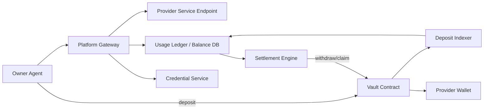

# 平台网关中转 + Deposit + Credential 核心架构设计（V2）

> 适用场景：Agent 高频、小金额调用。  
> 核心原则：Owner 不直连 Provider，所有调用先经过平台网关完成鉴权、余额校验、记账、转发。

---

## 1. 目标与范围

本方案覆盖完整业务链路：

1. Provider 连接钱包
2. Provider 创建 Agent
3. Provider 注册 Service
4. Owner 连接钱包
5. Owner 链上 Deposit（锁仓/预充值）
6. 平台签发调用凭据（`X-Agent-Credential`）
7. Owner 高频调用平台网关
8. 平台验证余额+凭据并转发到 Provider 服务
9. 平台记录调用流水并计算 Provider 应收/平台手续费
10. 周期或按需结算给 Provider

### 1.1 术语与字段约定（统一口径）

- 请求幂等键：`request_id`（HTTP 头 `X-Request-Id`）
- 可消费余额：`available_balance`
- 凭据状态：`credential_status`（`active | revoked | expired`）
- 单次价格：`unit_price`
- 平台手续费：`platform_fee`
- Provider 净收入：`provider_net`

---

## 2. 总体架构

关键点：
- Owner 请求统一进 `Gateway`，平台天然知道每次调用次数与金额。
- 链上交互低频化（Deposit / 结算），调用链路高频离链化（鉴权+记账+转发）。

---

## 3. 核心模块设计

### 3.1 Wallet & Auth（钱包连接与登录）

- Provider / Owner 均使用钱包签名登录（challenge/verify）。
- 平台会话用于控制面操作（创建 agent、注册 service、签发凭据等）。

### 3.2 Agent Registry（Agent 管理）

- Provider 在平台创建 Agent。
- 字段：`agent_id`, `owner_address`, `role`, `status`。

### 3.3 Service Registry（服务注册）

- Provider 把可售 API 注册到平台。
- 字段：`service_id`, `agent_id`, `endpoint`, `unit_price`, `fee_rate`, `is_active`。

### 3.4 Vault Contract（资金金库）

- Owner 先调用 `deposit(amount)`，把 USDC 充值进金库合约。
- 平台通过监听/确认链上事件把充值记入 `available_balance`。
- 未达到链上确认门槛前（如 N confirmations），该笔资金不得进入可消费余额。

### 3.5 Credential Service（凭据服务）

- 平台给 Owner Agent 签发 `X-Agent-Credential`（JWT/等价签名令牌）。
- 令牌包含：`owner_wallet`, `agent_id`, `service_scope`, `exp`, `max_calls`, `rpm`。
- 支持：签发、撤销、轮转、审计。

### 3.6 Gateway Forwarder（网关转发）

网关入口 `/api/v1/gateway/generate` 职责：

1. 验证 `Authorization`、`X-User-Address`、`X-Agent-Credential`
2. 验证 service scope 与凭据状态（未过期/未撤销/未超配额）
3. 验证阶段一准入条件：充值已确认入账 + 凭据有效且额度可用
4. 检查 `available_balance >= unit_price`
5. 原子扣费（预扣或实扣）
6. 转发请求到 Provider Endpoint
7. 根据结果固化或回滚账务
8. 记录 usage/audit

### 3.7 Usage Ledger（调用账本）

每次调用记录：
- `request_id`（幂等）
- `owner_address`, `provider_address`, `service_id`
- `unit_price`, `platform_fee`, `provider_net`
- `credential_id`
- `status`：`accepted | succeeded | failed | refunded`
- `latency_ms`, `timestamp`

### 3.8 Settlement Engine（结算引擎）

- 周期触发（如每 5 分钟）或达到阈值触发（如卖家应收 >= 20 USDC）。
- 把 `provider_receivable` 批量结算到 Provider 钱包。
- 把 `platform_fee_accrued` 归集到平台手续费地址。
- 记录 `batch_id`、`tx_hash`、结算范围。

---

## 4. 全流程时序（端到端）

### Phase A：Provider 上线

1. Provider 连接钱包并签名登录平台。
2. Provider 创建 Agent（`agentId`）。
3. Provider 注册 Service（`serviceName + pricing + isActive + invoke.method/url/requestSchema/responseSchema`，`serviceId` 系统生成）。

### Phase B：Owner 资金准备

1. Owner 连接钱包并签名登录平台。
2. Owner 调用金库合约 `deposit(100 USDC)`。
3. 平台监听并确认链上 `Deposit` 事件后更新：`available_balance = 100`。
4. 平台签发凭据 `X-Agent-Credential` 给 Owner Agent，并写入余额快照。
5. 形成调用通行条件：`deposit_confirmed=true` 且 `credential_valid=true`。

### Phase C：高频调用

1. Owner 调用平台 `/api/v1/gateway/generate`（不直连 Provider）。
2. 网关先做阶段准入校验（充值确认/凭据有效/额度未超），再做余额校验 + 限流。
3. 校验通过后扣费并转发到 Provider API。
4. 平台记录调用流水并累计：
  - Owner 余额减少
  - Provider 应收增加
   - 平台手续费增加

### Phase D：结算提现

1. 结算引擎周期跑批（或 Provider 手动触发）。
2. 平台链上结算给 Provider 并归集手续费。
3. 账本与链上 `txHash` 对账归档。

---

## 5. 余额与计费规则

### 5.1 阶段串联不变量（必须）

- `Deposit` 未确认：不得生成可消费余额，不得进入扣款流程。
- 未持有有效 `X-Agent-Credential`：不得调用网关计费接口。
- 授信额度超限：请求拒绝，且本次不得扣费。

### 5.2 计费公式

设：
- 每次调用单价 `P`
- 平台费率 `r`

则：
- `platformFee = P * r`
- `providerNet = P - platformFee`

实现字段映射：
- `platform_fee = P * r`
- `provider_net = P - platform_fee`

调用成功时：
- `available_balance -= P`
- `provider_receivable += provider_net`
- `platform_fee_accrued += platform_fee`

调用失败策略（建议默认）：
- Provider 5xx 或超时：全额回滚（不扣费）
- Owner 参数错误（4xx）：可配置是否扣固定手续费

---

## 6. 凭据策略（重点）

### 6.1 是否需要人类手动签发？

- 初期：可人工在控制台签发（方便运营）。
- 推荐：上线后采用“策略自动签发+自动轮转”：
  - 人类只配置策略（TTL、作用域、配额）
  - 平台自动发放与续签

### 6.2 凭据作用

凭据不是支付凭证，作用是：
- 调用身份绑定（谁在调）
- 调用范围控制（可访问哪些 service）
- 风险控制（rpm/maxCalls/撤销）
- 审计关联（usage 与 credential 可追溯）

### 6.3 凭据到期后是否可继续调用？

- 不可以。
- 网关直接返回 `401 AGENT_CREDENTIAL_EXPIRED`。
- 可通过轮转机制实现无缝续期（旧凭据短暂 grace + 新凭据生效）。

---

## 7. 关键 API（建议）

### 控制面
- `POST /api/v1/agents`
- `POST /api/v1/services`
- `POST /api/v1/credentials/issue`
- `POST /api/v1/credentials/{id}/revoke`

### 资金面
- `POST /api/v1/deposit/confirm`（由 indexer/回调写入账本）
- `GET /api/v1/balance`
- `POST /api/v1/settlement/run`

### 数据面
- `POST /api/v1/gateway/generate`（网关接入点，转发到 Provider）

---

## 8. 风险与防护

- 幂等：每次调用必须带 `request_id`（`X-Request-Id`），重复请求只计费一次。
- 原子扣费：余额扣减与流水写入必须同事务。
- 限流：owner/agent/service 三维并行限流。
- 防篡改：网关到卖家可加内部签名头（`X-Platform-Signature`）。
- 对账：每日链上余额与离链账本对账，差异报警。

---

## 9. 落地阶段建议

### Phase 1（MVP）
- 平台网关中转 + 余额校验 + usage 记账
- 手动签发凭据
- 定时批量结算

### Phase 2
- 自动凭据轮转
- 失败扣费策略分级
- 结算阈值与策略可配置

### Phase 3
- 多链结算
- 风控评分与动态费率
- 企业级审计看板

---

## 10. 一句话结论

在“卖家注册服务到平台、买家通过平台调用”的架构下，平台可完整掌握调用次数与资金流；通过 Deposit 预充值 + Credential 鉴权 + Gateway 记账转发 + 批量结算，最适合 Agent 高频小金额调用场景。

---

## 11. 充值一致性增强（Backfill + Reconciliation + Replay）

为解决“链上成功但平台未入账”的生产故障场景，V2 增加如下四个强制能力：

### 11.1 链上回补任务（Block Backfill Scanner）

1. 在 indexer loop 中按区块范围扫描 Router 相关交易。
2. 解析交易回执中的 Deposit/Transfer-to-Router 事件。
3. 若事件未关联到已有 intent，则自动创建 `source=INDEXER_BACKFILL` 的恢复 intent。
4. 复用同一套确认入账路径（原子确认 + 幂等去重），杜绝双记账。

### 11.2 强一致对账指标（Reconciliation Monitor）

每轮对账计算：

- 链上金库余额：`vault_token_balance(router)`
- 平台应付 Owner 消费侧负债：`sum(consumers.available + consumers.pending)`
- 差异：`delta = |chain - ledger|`

当 `delta > threshold`（配置项 `V2_RECONCILIATION_ALERT_DELTA_USDC`）时：

1. 写入审计事件 `V2_DEPOSIT_RECONCILIATION_ALERT`。
2. 在 `GET /api/v1/indexer/status` 暴露 `reconciliation.alert=true`。

### 11.3 前端意图上报失败兜底（Retry Queue）

1. 钱包交易成功后，若 `POST /balance/deposit/intent` 失败，前端将任务写入本地重试队列。
2. 在会话活跃期间按周期重试，采用有上限回退间隔。
3. 重试成功后自动移除队列项并刷新余额。
4. 队列跨页面刷新保留，避免用户重复打钱。

### 11.4 管理员回放补账接口（Admin Replay）

接口：`POST /api/v1/admin/deposits/replay`

1. 输入 tx hash。
2. 后端解析 receipt 并提取 deposit 事件。
3. 自动补 intent（若缺失）并执行回放确认。
4. 返回 replay summary（创建 intent 数、补账成功数、失败数）。

### 11.5 关键配置项

- `V2_BACKFILL_ENABLED`
- `V2_BACKFILL_BLOCK_BATCH`
- `V2_BACKFILL_START_BLOCK`
- `V2_RECONCILIATION_ENABLED`
- `V2_RECONCILIATION_INTERVAL_SEC`
- `V2_RECONCILIATION_ALERT_DELTA_USDC`
- `USDC_TOKEN_ADDRESS`

### 11.6 运营处理 SOP（链上成功但平台未入账）

1. 查询 `GET /api/v1/indexer/status` 查看 `backfill` 与 `reconciliation` 状态。
2. 使用 `POST /api/v1/admin/deposits/replay` 对指定 tx hash 执行补账回放。
3. 核对余额和审计日志（`OWNER_DEPOSIT_CONFIRMED` / `V2_DEPOSIT_REPLAY_ADMIN`）。
4. 若仍存在对账差异，升级为资金一致性事件处理。