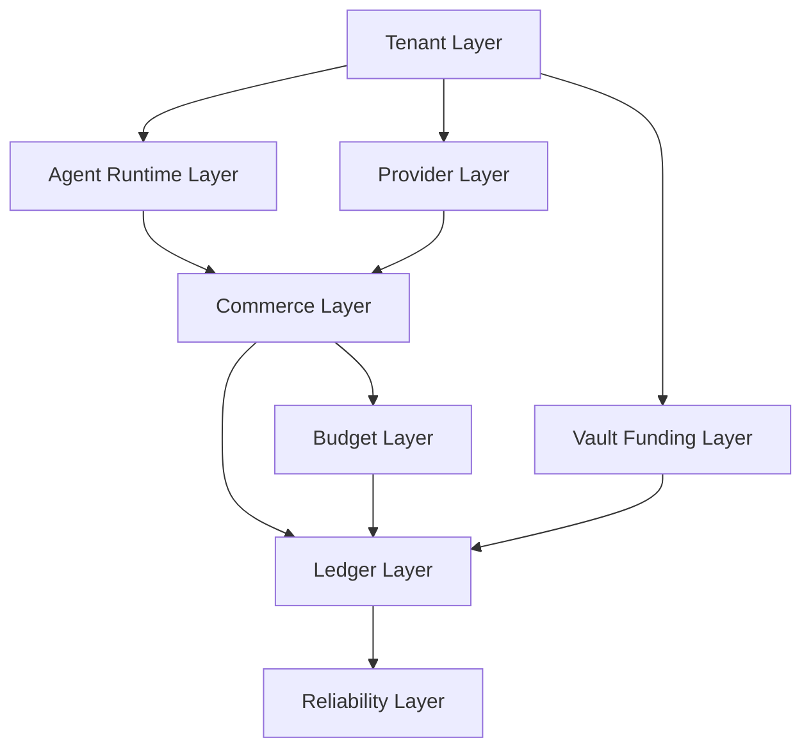

# Database Design

本目录是 Synapse Network 的数据库官方说明层。

这里不再沿用旧的 wallet / api key / buyer / seller 时代叙事，而是严格以最新 SQL schema 为准，解释：

1. 平台有哪些核心表
2. 表之间如何组成 Runtime 真相模型
3. 资金桶、账本、预算和出入金如何隔离
4. 并发、幂等、悲观锁和一致性为什么必须先于“功能完整”

## 真理源

本目录的最高优先级来源只有两个：

1. `docker-compose/postgres/init/gateway/001_synapse_schema.sql`
2. `docs/agent/06_Build_For_Agent_Database_Rebuild.md`

如果本目录和 SQL 不一致，以 SQL 为准；如果本目录和 `docs/agent/` 的对象模型冲突，以 `docs/agent/` 为准。

## 阅读顺序

1. `01_SQL_Schema_Overview.md`
	先理解 schema 的总体分层和命名哲学。
2. `02_Core_Tables_and_Relationships.md`
	再看 Owner / Agent / Provider / Service / Quote / Invocation / Vault 的主表关系。
3. `03_Balance_Ledger_and_Reservation_Model.md`
	然后理解余额快照、预算预占、ledger entry、平台抽成和收益桶。
4. `04_Concurrency_Idempotency_and_Consistency.md`
	最后看为什么金融级系统必须优先保证幂等、锁、状态机和对账闭环。

## 总体分层图

## 本目录回答的问题

1. 为什么 `synapse_owner_accounts` 是控制面根主体，而不是钱包时代的角色表
2. 为什么 `synapse_service_quotes` 和 `synapse_invocations` 是一等真相对象
3. 为什么 `synapse_account_balances` 只是余额快照，不是最终资金真相
4. 为什么 refund 和 provider withdrawal 必须共享一套 withdrawal 基础设施但严格区分 `withdrawal_kind`
5. 为什么没有悲观锁、唯一约束、状态机和审计，账本一定会漂
