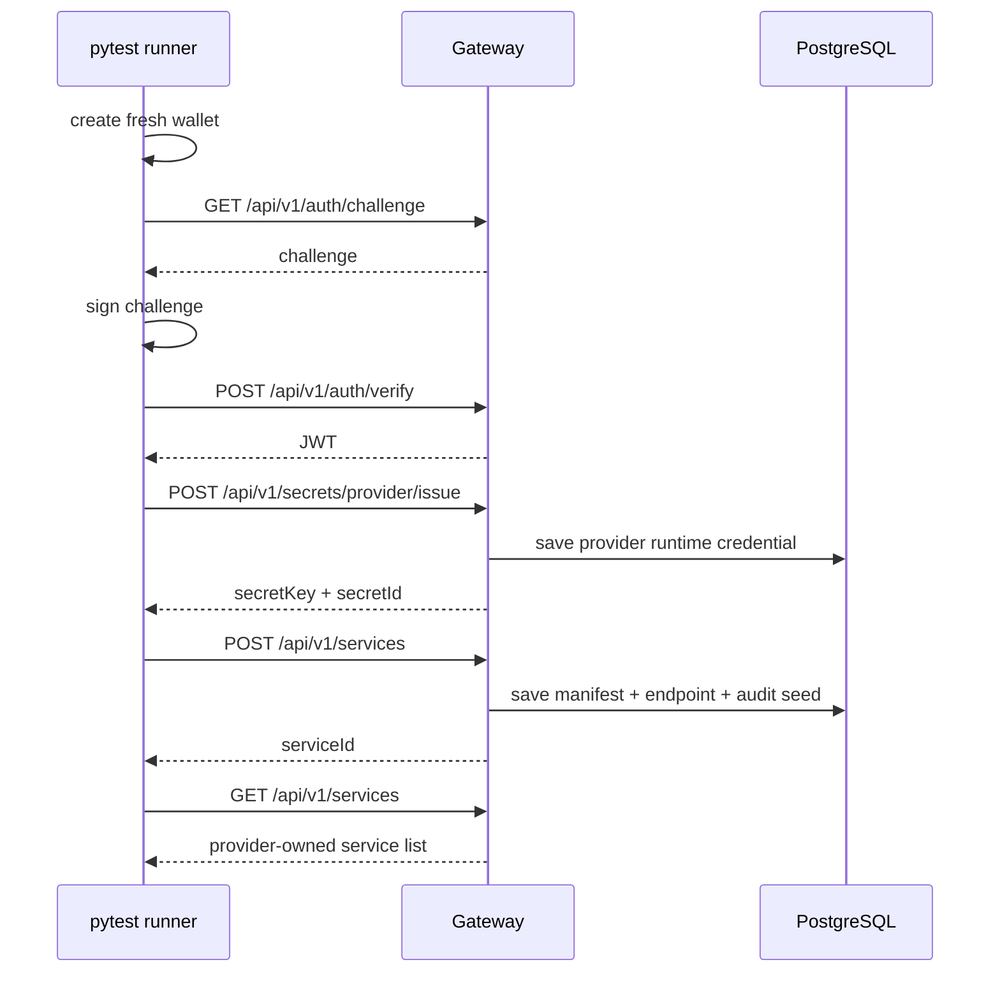

# Provider Service Deploy — 自动化测试方案

> 页面入口：`http://localhost:3000/provider/services/deploy`  
> 适用运行时：`services/gateway` 本地 E2E  
> 更新日期：2026-04-03

---

## 1. 目标

验证 Provider 真实低成本接入链路已经可用，而不是只验证前端表单能点提交。

这条链路覆盖：

1. 创建一个全新的 Provider 钱包
2. 使用钱包完成 challenge → sign → verify 登录
3. 发行 Provider Credentials（当前工程真实落点是 `provider secret/access key`）
4. 提交服务注册 payload
5. 在 Provider 自己的服务列表里确认服务已经注册成功

---

## 2. 工程真相

### 2.1 `provider/services/deploy` 对应的后端真链路

当前页面最终调用的是：

1. `GET /api/v1/auth/challenge`
2. `POST /api/v1/auth/verify`
3. `POST /api/v1/secrets/provider/issue`
4. `POST /api/v1/services`
5. `GET /api/v1/services`

### 2.2 为什么这里的 “Credentials” 不是 Agent Credential

Provider 注册服务时，真实控制面里需要先验证 Provider 自己的控制权和 secret 生命周期。

因此这里的 “创建 Credentials” 在当前工程里应解释为：

- `Provider Secret`
- `Provider Access Key`
- `Provider signing credential`

对应接口：

- `POST /api/v1/secrets/provider/issue`
- `GET /api/v1/secrets/provider/list`

它不是 `POST /api/v1/credentials/agent/issue`。

### 2.3 为什么自动化测试不直接走浏览器钱包插件

`/provider/services/deploy` 页面依赖：

1. 浏览器钱包连接
2. challenge 签名
3. 控制面会话

为了让 CI 能稳定跑通，当前自动化测试以 Gateway E2E 为 canonical truth：

- 直接在测试代码里生成本地 EOA
- 本地完成签名
- 调 Gateway 真接口
- 断言服务注册结果

这条链路比浏览器录制更硬，因为它验证的是最终控制面行为，而不是表面点击动画。

---

## 3. 最小成功路径



---

## 4. 测试断言

### Step 1 — 创建钱包并登录

断言：

1. 测试中动态生成的钱包地址以 `0x` 开头
2. `challenge` 返回成功
3. `verify` 返回有效 JWT

### Step 2 — 创建 Provider Credentials

断言：

1. `POST /api/v1/secrets/provider/issue` 返回 `status=success`
2. 返回 `secret.id`
3. 返回 `secret.secretKey`
4. `GET /api/v1/secrets/provider/list` 能查到同一个 secret

### Step 3 — 注册服务

提交 payload 必须贴近 `provider/services/deploy` 当前最小接入模式：

必填用户字段：

1. `serviceName`
2. `agentToolName`
3. `pricing.amount`
4. `summary`
5. `invoke.targets[0].url`

平台/控制面字段：

1. `auth.type = gateway_signed`
2. `providerProfile.displayName`
3. `payoutAccount.payoutAddress`
4. `payoutAccount.chainId = 31337`
5. `payoutAccount.settlementCurrency = USDC`
6. `governance.termsAccepted = true`
7. `governance.riskAcknowledged = true`
8. 最小 `request` / `response` schema
9. `healthCheck.path = /health`

断言：

1. `POST /api/v1/services` 返回 `status=success`
2. 返回 `serviceId`

### Step 4 — 校验服务注册成功

断言：

1. `GET /api/v1/services` 返回 200
2. 返回列表里存在刚注册的 `serviceId` / `agentToolName`
3. 服务归属地址等于刚创建的钱包地址

---

## 5. 文件落点

```text
services/gateway/tests/e2e/
├── helpers/auth.py
├── helpers/gateway.py
├── test_05_provider_credentials.py
└── test_05_provider_register_onboarding.py
```

其中：

1. `test_05_provider_credentials.py` 负责 fresh wallet auth + provider secret
2. `test_05_provider_register_onboarding.py` 负责用 fresh provider 会话提交服务并验证列表成功

---

## 6. 运行命令

在 `services/gateway` 目录下执行：

```bash
./.venv/bin/python -m pytest tests/e2e/test_05_provider_credentials.py tests/e2e/test_05_provider_register_onboarding.py -v --tb=short
```

如果要连同基础设施和登录前置一起跑：

```bash
./.venv/bin/python -m pytest tests/e2e/test_01_infrastructure.py tests/e2e/test_02_wallet_auth.py tests/e2e/test_05_provider_credentials.py tests/e2e/test_05_provider_register_onboarding.py -v --tb=short
```

---

## 7. 已知现实约束

1. 当前注册成功校验以 `/api/v1/services` owner list 为准，而不是 public discover
2. public discover 仍然依赖健康检查快照；新注册服务若没有探活记录，不能立即出现在公开发现结果里
3. 因此测试只把 “控制面注册成功” 和 “Provider 自己能看到服务” 作为准出条件

---

## 8. 成功标准

只要以下 4 个条件同时满足，这条 provider onboarding 自动化链就算跑通：

1. fresh wallet 成功获得 JWT
2. provider secret 成功发行并可回查
3. service register 成功返回 serviceId
4. service list 成功查到刚注册的 service
