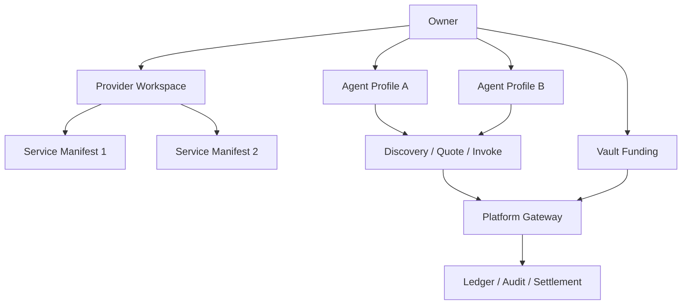

# Platform Role Identity Model

> 目标：用 build-for-agent 口径定义 Synapse 平台里的身份边界，避免继续把 Owner、Provider、Agent、Platform 混成同一层对象。

## 1. 先说结论

Synapse 不是只有 `owner / provider / platform` 三种并列身份。

当前最稳的 build-for-agent 角色模型是四层：

| 角色 | 身份层级 | 核心职责 | 典型动作 |
| --- | --- | --- | --- |
| Owner | 租户根身份 | 充值、创建 Agent、设预算、注册服务、查看账单 | 连接钱包、签 session、Add Funds、发布服务 |
| Agent | Owner 下面的运行时身份 | Discovery、Quote、Invoke、消耗预算 | 自主调用服务 |
| Provider | Owner 在供给侧的业务角色 | 把服务注册到平台、维护 Manifest、运营定价和服务健康 | `POST /api/v1/services` |
| Platform | 平台内部系统角色 | 鉴权、风控、路由、记账、审计、结算 | 处理 Quote / Invoke / Ledger / Audit |

一句话：

1. **Owner 是账户根。**
2. **Agent 是 Owner 授权出来的运行时执行体。**
3. **Provider 不是独立账户体系，而是 Owner 在供给侧扮演的业务角色。**
4. **Platform 不是租户，不和 Owner / Provider 并列记账。**

## 2. 为什么不能只分三种

如果只分 `owner / provider / platform` 三种，会立刻把两个关键边界打烂：

1. Agent Runtime 会消失，系统又会退回“人类拿 API key 调服务”的旧模型。
2. Provider 会被误解成一个独立于 Owner 的账户类型，导致注册服务、提现、审计、预算边界全乱。

build-for-agent 里必须承认：

1. `Owner` 解决控制面归属
2. `Agent` 解决运行时自主执行
3. `Provider` 解决供给侧业务角色
4. `Platform` 解决平台内部执行与结算

这四层缺一层，模型都会塌。

## 3. 四层身份的本质区别

### 3.1 Owner

Owner 是 Synapse 的根租户身份，也是几乎所有 owner-scoped 资源的最终归属主体。

Owner 负责：

1. 连接钱包并建立平台 session
2. 向 Vault 入金
3. 创建 Agent Profile
4. 签发 Agent Credential
5. 配置 Budget Policy
6. 以 Provider 角色注册或维护服务
7. 查看账单、对账、提现或收益汇总

Owner 不负责：

1. 逐次手工批准每次 Agent 调用
2. 在 Runtime 中直接持有 Agent 执行状态
3. 直接承担 Platform 的内部结算逻辑

所以 Owner 是：

**root account / tenant boundary / control-plane principal**。

### 3.2 Agent

Agent 是 Owner 授权出来的运行时身份，不是钱包，不是管理员，也不是服务提供方账户。

Agent 负责：

1. 发现服务
2. 请求 Quote
3. 发起 Invoke
4. 在 Credential + Budget Policy 约束内自主消费

Agent 不应该：

1. 接触 Owner 主钱包私钥
2. 直接操作 Provider 控制面
3. 直接修改平台账本或服务注册数据

所以 Agent 是：

**runtime execution principal**。

### 3.3 Provider

Provider 不是和 Owner 平级的另一套根身份。

在当前 build-for-agent 模型里，Provider 更准确的定义是：

**Owner 在供给侧扮演的业务角色（supply-side role）。**

也就是说：

1. 某个 Owner 可以只做消费侧
2. 某个 Owner 也可以同时做供给侧
3. 当这个 Owner 注册服务、维护 Manifest、查看收益时，他在业务上就是 Provider

但资源归属仍然是：

1. session 绑定到 Owner
2. service record 归属于 Owner
3. 收益归属于 Owner
4. Provider Console 仍然是 owner-scoped workspace

所以 `Provider 注册服务到平台` 的准确表述不是：

“一个独立于 Owner 的 Provider 账户注册服务”

而是：

**Owner 在 Provider role 下向 Platform 注册 Service Manifest。**

### 3.4 Platform

Platform 是系统内部角色，不是租户，不是用户钱包，也不是某个 Agent。

Platform 负责：

1. 会话鉴权
2. Owner 绑定
3. 服务注册校验
4. Discovery / Quote / Invoke 路由
5. 风控与预算校验
6. 平台账本、审计、对账、清算

Platform 不应该：

1. 被暴露成 Agent-facing 的业务主体
2. 和 Owner 一样被当成某种租户账户
3. 把内部结算字段直接泄漏到公开协议里

所以 Platform 是：

**system operator / protocol executor / settlement engine**。

## 4. Provider 注册服务，到底是谁在注册

答案很明确：

1. 发起注册的是当前登录的 Owner
2. 这个 Owner 此时正在执行 Provider 控制面动作
3. Platform 根据 session subject 绑定 owner scope
4. Service Manifest 最终归属到这个 Owner

对应当前 API：

- `POST /api/v1/services`
- `PUT /api/v1/services/{service_record_id}`
- `DELETE /api/v1/services/{service_record_id}`

这些接口的授权语义不是：

“provider token 可写任意 service”

而是：

**valid platform session + owner scope + owner-owned service record**。

这点非常关键，因为它决定了：

1. 不需要再造一套 Provider 根账户体系
2. 服务注册、收益、审计、提现都能统一落在 owner scope 上
3. 前端 Provider Console 本质上只是 Owner 的一个业务工作区

## 5. 同一个 Owner 既消费也供给，会不会冲突

可以，而且这正是平台应该支持的正常形态。

同一个钱包地址对应的同一个 Owner，完全可以同时做两件事：

1. 创建 Agent，让 Agent 去调用平台里的服务
2. 以 Provider 角色把自己的服务注册到平台，赚取收益

所以你前面那三句可以进一步收敛成一句更硬的规则：

**同一个 Owner 可以同时拥有 Consumer Workspace、Provider Workspace 和多个 Agent Runtime 身份。**

这里不会冲突，前提是系统设计坚持两条铁律：

1. **身份归属看 Owner。**
2. **记账归类看资金桶和业务动作，不看“这个钱包现在心情上更像买家还是卖家”。**

## 6. 为什么同一个钱包不会把退款和提现打架

关键不在“钱包地址是否相同”，而在“账本桶是否分离”。

同一个 `ownerAddress = 0xabc...`，在平台里可以同时挂着两类资金：

1. **消费侧资金**：Owner 充值进来的可消费余额，后续给 Agent Runtime 用
2. **供给侧资金**：Provider 提供服务后累计出来的应收收益，后续可提现

它们虽然都归属于同一个 Owner，但业务来源完全不同，所以账本上必须分桶。

### 6.1 当前实现口径

当前 API 行为已经说明了这件事：

1. `GET /api/v1/balance` 同时返回消费侧余额、供给侧应收和平台费视图
2. `POST /api/v1/refund` 操作的是消费侧余额
3. `POST /api/v1/providers/withdrawals/intent` 操作的是供给侧应收

也就是说，即使同一个 owner 地址同时做消费和供给，当前系统也不是靠“换一个钱包”来隔离，而是靠：

1. owner scope 相同
2. ledger bucket 不同
3. action type 不同

### 6.1.1 代码层落地口径

为了避免后端继续把历史角色词偷偷带回仓储层，DDD 里的持久化和聚合模型必须强制遵守下面三条：

1. Provider 身份表统一叫 `provider_profiles`，不再新增任何历史旧命名口径的新模型。
2. 消费侧余额聚合统一叫 `consumer_wallet`，表示 Owner 的可消费、待确认、冻结资金桶。
3. 供给侧余额聚合统一叫 `provider_wallet`，表示 Owner 在 Provider role 下的应收、锁定、冻结资金桶。

也就是说，Postgres repository 和 domain aggregate 在代码里应该表达成：

1. `OwnerAccountRecord`
2. `ProviderProfileRecord`
3. `ConsumerWalletRecord`
4. `ProviderWalletRecord`
5. `BalanceLedger` 作为 aggregate root 聚合两类 wallet，而不是再返回 `dict[str, float]` 这种弱语义结构。

这是为了防止仓储层继续输出“地址 -> 金额”的裸 map，逼着业务层自己猜这笔钱到底是消费余额、待确认余额、还是供给侧应收。那种写法不是 DDD，是架构漏水。

### 6.2 退款打的是哪一桶

Owner 退款，打的是消费侧资金桶。

当前实现语义上相当于：

1. `consumer_available -> consumer_locked`
2. 最终从 Owner 消费侧余额退回到链上钱包

所以退款影响的是：

1. Owner 充值来的可消费余额
2. Agent Runtime 后续还能不能继续花钱

退款不应该影响：

1. Provider 已赚到但尚未提现的应收
2. Provider 的提现票据状态

### 6.3 Provider 提现打的是哪一桶

Provider 提现，打的是供给侧收益桶。

当前实现语义上相当于：

1. `provider_receivable -> provider_locked`
2. 最终从 Owner 供给侧应收提现回链上钱包

所以 Provider 提现影响的是：

1. Provider Earnings
2. Provider receivable
3. Provider withdrawal intent

它不应该影响：

1. Owner 的充值余额
2. Agent 的可消费预算池
3. 消费侧退款链路

## 7. 记账上如何区分“同一个钱包地址现在是 Agent 还是 Provider”

答案是：

**不要按钱包当前扮演的情绪角色记账，要按账本账户类型和业务事件记账。**

同一个钱包地址只解决“归属给谁”，不解决“这笔钱是什么钱”。

正确区分维度至少要有三层：

### 7.1 归属主体维度

- `owner_id` / `owner_address`

它回答：

**这笔钱归谁。**

### 7.2 资金桶维度

- `consumer_available`
- `consumer_pending`
- `consumer_locked`
- `provider_receivable`
- `provider_locked`
- `platform_fee`

它回答：

**这笔钱属于哪种业务口径。**

### 7.3 业务事件维度

- `deposit`
- `refund_intent`
- `refund_complete`
- `invoke_charge`
- `provider_earning_accrual`
- `provider_withdraw_intent`
- `provider_withdraw_complete`
- `platform_fee_capture`

它回答：

**这笔钱为什么会变化。**

## 8. 给同一个 Owner 的推荐账本模型

最稳的设计不是给 Consumer 和 Provider 分两个钱包，而是给同一个 Owner 分多个子账本账户。

例如同一个 `owner = 0xabc...` 下：

| owner | ledger_account_kind | meaning |
| --- | --- | --- |
| `0xabc...` | `consumer_available` | 充值后已可消费余额 |
| `0xabc...` | `consumer_pending` | 充值待确认或中间态 |
| `0xabc...` | `consumer_locked` | 退款锁定或风险冻结 |
| `0xabc...` | `provider_receivable` | 提供服务累计应收 |
| `0xabc...` | `provider_locked` | 提现流程中的锁定收益 |
| `0xabc...` | `platform_fee` | 平台抽成，不归 Owner 自由支配 |

这样即便同一个钱包同时是调用方和服务方，也不会记混。

## 9. Agent 花钱和 Provider 赚钱，为什么也不能混

Agent Runtime 虽然代表 Owner 消费，但它不是一个独立提现主体。

正确关系是：

1. Agent 消费时，扣的是 Owner 的消费侧资金桶
2. Provider 赚钱时，加的是同一个 Owner 的供给侧收益桶
3. 两边都可能归属同一个 `ownerAddress`
4. 但它们是两条方向相反的账务流

所以系统不该问：

“这个钱包现在是 agent 还是 provider？”

而应该问：

1. 这次动作是 `consume` 还是 `earn`
2. 影响的是哪个 ledger bucket
3. actor 是 `owner`、`agent_credential`、还是 `platform_job`

## 10. 控制台应该怎么设计

现在平台提供两个控制台是对的，但不应该做成两套割裂身份体系。

最合理的是：

### 10.1 一个身份入口

统一使用同一套 Owner 登录态：

1. 钱包签名
2. platform session
3. owner-scoped API auth

不要做两套：

1. Consumer 登录
2. Provider 登录

否则同一个 Owner 会被产品结构误导成两个账户。

### 10.2 两个业务工作区

在统一 Owner 身份下，拆成两个 workspace：

1. **Agent / Consumer Workspace**
    - Add Funds
    - Agent 管理
    - Credential / Budget
    - Discovery / Quote / Invoke 观测
    - Refund

2. **Provider Workspace**
    - Service Manifest 管理
    - 健康检查 / routing / metering
    - Earnings Summary
    - Withdrawals
    - Provider 审计与收益分析

### 10.3 共用的横向基础页

两个 workspace 上方再共用一些 owner-level 页面：

1. Identity / Session
2. Wallet / Vault
3. Finance Overview
4. Unified Audit Timeline

这样好处是：

1. 同一个 Owner 不会误以为自己要注册两个账号
2. 角色切换只是 workspace 切换，不是身份切换
3. 账务虽然分桶，但总览仍可统一观察

## 11. UI 上要怎么解释给用户

前端不应该写成“你正在切换成另一套账户身份”。

更好的表达是：

1. `Agent Workspace` 或 `Use Services`
2. `Provider Workspace` 或 `Sell Services`

同时在财务模块明确区分两张卡片：

1. `Spendable Balance`
    - 给 Agent Runtime 花钱用
    - 对应充值 / refund

2. `Provider Receivable`
    - 给服务收益提现用
    - 对应 provider withdrawal

这样同一个钱包地址用户一眼就懂：

**我还是同一个 Owner，只是我在平台里有两种业务面。**

## 12. 角色不是账户类型，而是分层身份

build-for-agent 最容易犯的错，就是把“角色”和“账户类型”写成一个东西。

正确拆法应该是：

### 5.1 账户根身份层

- `Owner`

### 5.2 运行时身份层

- `Agent`
- `Agent Credential`

### 5.3 业务角色层

- `Provider`
- `Consumer`

### 5.4 平台系统层

- `Platform`
- `Vault`
- `Indexer`
- `Audit / Risk / Settlement jobs`

这意味着：

1. 一个 Owner 可以同时具有 Consumer 与 Provider 两种业务角色
2. 一个 Owner 可以创建多个 Agent
3. Platform 与 Vault 是系统执行层，不是租户身份

## 13. 推荐的心智模型

最清晰的理解方式是下面这张图：

读法：

1. Owner 是根
2. Agent 和 Provider Workspace 都挂在 Owner 下面
3. Platform 负责执行和记账
4. Vault 只负责资金托管，不承担 Runtime 身份逻辑

## 14. 当前文档应该怎么理解这些词

### 7.1 Owner

看到 `ownerAddress`、`owner_wallet`、owner-scoped session、owner-scoped config 时，都应理解为：

**租户根身份与控制面归属主体。**

### 7.2 Provider

看到 Provider Console、Provider earnings、Provider withdrawals、Provider service management 时，应理解为：

**Owner 在供给侧业务工作区里的动作。**

### 7.3 Platform

看到 platform fee、platform routing、platform audit、platform admin 时，应理解为：

**平台系统内部能力，不进入租户身份模型。**

## 15. 设计红线

后续任何新设计，只要踩到下面任一条，就说明身份模型又开始漂了：

1. 把 Provider 设计成独立于 Owner 的另一套根账户。
2. 让 Agent 直接持有 Owner 钱包级授权。
3. 把 Platform 内部账本字段暴露成 Agent-facing 默认返回。
4. 把服务注册设计成“手工申请 provider key 后才能发布”的旧控制面。
5. 继续用旧角色词和 API key 作为 Runtime 主视角。

## 16. 最终结论

所以，对你问题的直接回答是：

1. 不是只有 `owner / provider / platform` 三种角色。
2. build-for-agent 的 canonical 模型至少要明确 `Owner / Agent / Provider / Platform` 四层。
3. `Provider 注册服务到平台` 的真实含义是：**Owner 以 Provider 角色向 Platform 注册服务。**
4. Provider 是业务角色，不是独立于 Owner 的根账户体系。
5. 同一个 Owner 可以同时消费和供给，不需要切换钱包。
6. Owner 退款和 Provider 提现不会冲突，前提是消费侧余额桶与供给侧收益桶严格分离。
7. 两个控制台应该是同一 Owner 身份下的两个 workspace，而不是两套账户系统。

如果要继续收敛文档，后续凡是写到注册服务、收益、提现、Provider Console，都应该默认沿用这套解释。
