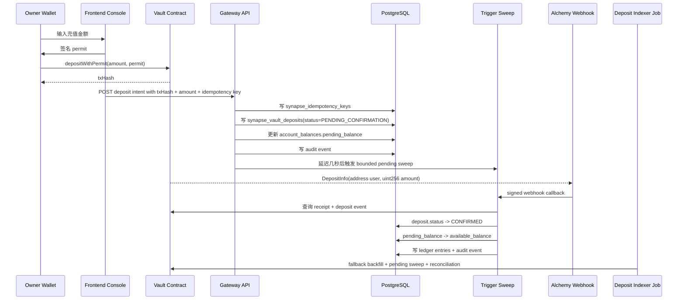
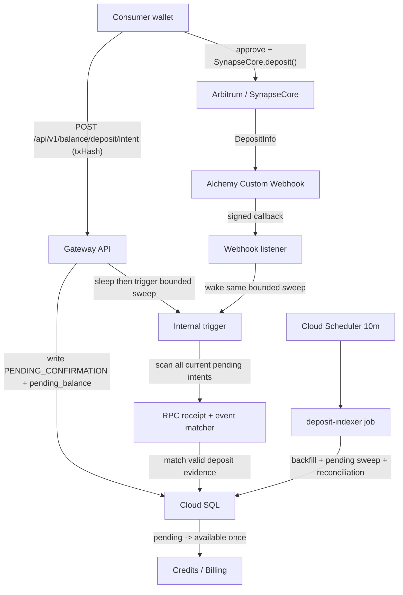

# Deposit and Idempotency

## 1. 目标

Deposit 链路的职责不是“给某个 Agent 单独充值”，而是把 Owner 的链上 USDC 安全桥接进 Platform 的消费资金池。

Deposit 完成后，Agent Runtime 才能在后续 Quote / Invoke 中消耗这笔资金。

一句话：

**Deposit belongs to Owner funding, then Budget Policy decides how Agent spends it.**

## 2. 参与者

1. `Owner`
   控制面根身份，决定入金金额和钱包签名。
2. `Vault Contract`
   只负责收钱和签名出金，不负责预算控制。
3. `Platform Gateway`
   负责接收入金登记、幂等校验、账本推进和审计。
4. `Deposit Indexer / Reconciliation`
   负责确认链上事实并把 pending 资金放行成 available 资金。
5. `PostgreSQL`
   作为资金和状态真相源，持久化 deposit、余额、分录和审计事件。

## 3. 核心表

最新 SQL 下，Deposit 链路的核心真相表是：

| 表 | 作用 |
| --- | --- |
| `synapse_vault_deposits` | 记录 Owner 的链上入金事实和确认状态 |
| `synapse_ledger_accounts` | 定义 Owner consumer wallet 账户 |
| `synapse_account_balances` | 保存 `available_balance / pending_balance / frozen_balance` 快照 |
| `synapse_ledger_entries` | 保存 append-only 资金分录 |
| `synapse_idempotency_keys` | 保存 API 级幂等键 |
| `synapse_audit_events` | 保存入金登记、确认、失败、回放等审计事件 |

补充约束：

1. 每张核心表都带数据库内部用的自增 `id` 作为 surrogate key，便于运维排障、分页和后续分区。
2. 对外业务语义仍然以 `deposit_id / owner_id / tx_hash` 这些业务键为准，不能把数据库自增 `id` 暴露成业务合同字段。
3. `synapse_vault_deposits` 除主资金字段外，还要持久化 `owner_address / target_account_id / client_request_id / client_ip / user_agent`，否则审计和重复请求排查会断链。

## 4. 状态机

`synapse_vault_deposits.status` 只允许三种状态：

1. `PENDING_CONFIRMATION`
   链上交易已被登记，但还没有被索引器确认为最终入账事实。
2. `CONFIRMED`
   receipt、event、金额和归属全部校验通过，资金可以进入 `available_balance`。
3. `FAILED`
   交易失败、回执无效、金额不匹配或对账失败，不能进入可消费余额。

## 5. 主流程



### 5.1 Step A: Owner 发起链上入金

1. Owner 在前端输入 USDC 金额。
2. 前端拉起 ERC-2612 Permit 签名。
3. 钱包执行 Vault `depositWithPermit(...)`。
4. 链上返回 `txHash`。

这里有一个硬边界：

1. 链上广播成功，不等于平台已经入账。
2. 平台必须先看到一笔可验证的 deposit record，才能开始链下账本推进。

### 5.2 Step B: Gateway 登记 Deposit

Gateway 收到 `txHash + amount + owner scope + idempotency key` 后，必须先做四件事：

1. 从 session 推导 Owner，不信任前端传来的 owner。
2. 校验 `tx_hash` 格式与金额合法性。
3. 检查 `synapse_idempotency_keys`，保证同一请求不会重复入账。
4. 检查 `synapse_vault_deposits.tx_hash` 唯一约束，防止重复登记同一链上交易。

登记事务提交成功后，Gateway 会在**同一个外部请求还活着时**等待一个短缓冲，再 best-effort 触发一次 bounded pending sweep：

1. 触发目标必须是 Gateway 的真实 internal URL，而不是 `127.0.0.1` loopback。
2. sweep 在一个有界窗口内轮询当前所有 `PENDING_CONFIRMATION` intents，而不是只扫一次。
3. 这次 sweep 只处理当前 pending intents，不顺手跑 full backfill/reconciliation。
4. 触发失败不会回滚这次 intent 登记；Cloud Scheduler 里的 `deposit-indexer` job 继续作为最终一致性兜底。
5. 这意味着 `POST /api/v1/balance/deposit/intent` 可能比过去慢几秒，但通常能明显缩短 pending 资金转 spendable 的等待时间。

登记成功后，事务内执行：

1. 写 `synapse_vault_deposits(status=PENDING_CONFIRMATION)`
2. 找到 Owner 对应的 `consumer_wallet` 账户
3. 更新 `synapse_account_balances.pending_balance += amount_usdc`
4. 写入一条或多条 `synapse_audit_events`

这里的落库最少要包含：

1. `deposit_id` 作为业务主键
2. `owner_id + owner_address` 同时保留，保证租户绑定和审计可读性
3. `target_account_id` 指向 Owner 的 `consumer_wallet`
4. `tx_hash UNIQUE` 作为链上事实防重放主锚点
5. `client_request_id / client_ip / user_agent` 作为请求侧证据链

### 5.3 Step C: Indexer 确认链上事实

Deposit Indexer 异步校验：

1. receipt 存在
2. 交易状态成功
3. event 中的 amount 与登记金额一致
4. event 的接收方和链上合约地址匹配

正常主路径下，这次校验优先由 **intent-triggered bounded pending sweep** 立即尝试；如果 RPC 还没看到交易、trigger 失败、webhook 未送达或实例锁冲突，才回退到低频 scheduled `deposit-indexer` job。

Alchemy Custom Webhook 只是推送加速器：

1. 只监听 **Arbitrum Mainnet 上 SynapseCore 的 `DepositInfo(address,uint256)`**。
2. 它不会直接记账，只会唤醒同一个 bounded pending sweep。
3. 资金真相源仍然是 **Gateway deposit intent + ledger**，不是 webhook payload 自己。
4. prod callback 固定为 `https://api.synapse-network.ai/internal/webhooks/alchemy/deposits`。
5. staging callback 固定为 `https://api-staging.synapse-network.ai/internal/webhooks/alchemy/deposits`。

只有全部通过，才能推进到 `CONFIRMED`。

### 5.4 Step D: 资金从 pending 进入 available

确认成功后，Platform 在事务内执行：

1. `synapse_vault_deposits.status = CONFIRMED`
2. `pending_balance -= amount_usdc`
3. `available_balance += amount_usdc`
4. 写入对应的 `synapse_ledger_entries`
5. 写入 `synapse_audit_events`

确认审计事件至少要带上：

1. `owner_id = owner:<wallet>` 作为统一租户主键，禁止只写裸钱包地址
2. `ownerAddress` 继续放在 `detail_json`，保证人类可读
3. `depositIntentId / txHash / requestId / eventKey`
4. `amount_delta / before_balance / after_balance`
5. `result_status = CONFIRMED` 与确认次数等证据字段

这一步完成后，这笔钱才真正成为 Owner 可供 Agent Runtime 消费的资金。

## 6. 幂等与防重放

Deposit 链路必须同时做 API 级幂等和链上事实级防重放。

### 6.1 API 级幂等

平台使用 `synapse_idempotency_keys` 实现：

1. 同一个 `scope + owner_id + idempotency_key`
2. 同 payload 重试返回同结果
3. 同 key 不同 payload 直接拒绝

### 6.2 链上事实级防重放

平台使用 `synapse_vault_deposits.tx_hash UNIQUE` 实现：

1. 同一笔链上 deposit 只允许登记一次
2. 即使前端重复提交 intent，也不能重复入账
3. 任何回放行为都必须走审计事件，不允许绕过 deposit 主记录

### 6.3 两层都需要

只做 idempotency key 不够，因为：

1. 用户可能换浏览器或重发请求
2. 同一链上交易可能被多个请求重复提交

只做 `tx_hash UNIQUE` 也不够，因为：

1. API 超时重试需要稳定回包
2. 业务层需要区分“重复请求”和“重复链上事实”

## 7. 失败路径

### 7.1 链上交易失败

1. 不写 `CONFIRMED`
2. 不进入 `available_balance`
3. 可以标记为 `FAILED` 并写审计事件

### 7.2 receipt 找不到、广播被丢弃或 event 不匹配

1. 如果用户在钱包里取消签名 / 根本没广播链上交易，则前端**不应创建** deposit intent。
2. 如果 intent 已创建，但链上始终没有 receipt，则 bounded retry 和 webhook 可以继续尝试确认。
3. 超过 `DEPOSIT_PENDING_INTENT_STALE_AFTER_SEC` 后，intent 统一转 `FAILED`，并写 `failureReason=MISSING_TX_RECEIPT_TIMEOUT`。
4. 如果 receipt 存在但交易失败，标记 `CHAIN_TX_FAILED`。
5. 如果 receipt 存在但没有匹配到合法 deposit 事件，标记 `NO_MATCHING_DEPOSIT_EVENT`。

### 7.3 API 重试

1. 如果首个请求已成功登记，后续相同请求直接返回原记录
2. 不重复增加 `pending_balance`
3. 同一 `tx_hash` 在 replay window 内再次命中时，服务端必须返回已存在的 deposit intent，而不是抛 409

## 8. Alchemy Webhook 配置与安全边界

### 8.1 Dashboard 配置路径

在 Alchemy Dashboard 中，推荐固定按下面路径配置：

1. 进入 [Alchemy Dashboard](https://dashboard.alchemy.com/)。
2. 选择目标 app：
   1. prod：`synapse-network-prod`
   2. staging：`synapse-network-staging`
3. 左侧导航进入 `Data -> Webhooks`。
4. 点击 `Create Webhook`。
5. 类型选择：
   1. prod/staging 当前推荐都使用 `Address Activity`
   2. 不要把 `Custom Webhook` 当成省流量方案；Alchemy 会按最新 canonical block 持续投递 Custom Webhook，即使过滤后的 `logs` 为空
6. 网络固定为：
   1. `Chain = Arbitrum`
   2. prod `Network = Mainnet`
   3. staging `Network = Sepolia`，必须和 staging 当前真实 SynapseCore 部署网络保持一致
7. `Webhook URL` 固定填：
   1. prod：`https://api.synapse-network.ai/internal/webhooks/alchemy/deposits`
   2. staging：`https://api-staging.synapse-network.ai/internal/webhooks/alchemy/deposits`
8. Address Activity 地址固定只填 `SynapseCore`：
   1. prod address：生产 `SynapseCore`
   2. staging address：`0x0bA1dcE1Cc8d877052ab1C3CE2362830459D8FF4`
9. 如果只是为了研究历史或临时排查而创建 `Custom Webhook`，它的 GraphQL filter 也必须锁死：
   1. `addresses = [SynapseCore]`
   2. `topic0 = 0x25444993e521e5a804289b2bc7720c808ea8583f4ead8d7c65f5435f03ea8015`
   3. 但它不应作为长期 deposit wakeup 配置保留在生产或 staging
10. `Test Webhook` 只是 Alchemy UI 侧的便捷校验，不是唯一真相源。最终可用性必须以 Gateway 实际回调行为为准：
   1. `GET` callback 返回 `405`
   2. 无签名 `POST` 返回 `401`
   3. 正确 `X-Alchemy-Signature` 的 `POST` 返回 `200`
11. 创建完成后进入该 webhook 详情页，从右上角复制 `Signing Key`。
12. 把 Signing Key 写入目标环境：
   1. prod：`synapse-prod-alchemy-deposit-webhook-signing-key`
   2. staging：`synapse-staging-alchemy-deposit-webhook-signing-key`
13. Cloud Run 在 revision 启动时把 Signing Key 注入 `ALCHEMY_DEPOSIT_WEBHOOK_SIGNING_KEY` 环境变量；运行时请求不得按次调用 Secret Manager。

### 8.2 推荐监听范围

Address Activity webhook 只跟踪 `SynapseCore` 地址本身：

1. staging：`0x0bA1dcE1Cc8d877052ab1C3CE2362830459D8FF4`
2. prod：生产 `SynapseCore`

Gateway callback 会从 Alchemy payload 中提取 `event.activity[].hash` /
`event.activity[].transactionHash`，再唤醒 bounded pending sweep。

如果只是在临时排查里需要 `Custom Webhook`，其 GraphQL filter 也必须严格锁住：

```graphql
{
  block {
    logs(
      filter: {
        addresses: ["0x0bA1dcE1Cc8d877052ab1C3CE2362830459D8FF4"]
        topics: [["0x25444993e521e5a804289b2bc7720c808ea8583f4ead8d7c65f5435f03ea8015"]]
      }
    ) {
      topics
      account {
        address
      }
      transaction {
        hash
      }
    }
  }
}
```

但这条 GraphQL 只适合短时分析，不适合作为长期实时 wakeup，因为 Alchemy
Custom Webhook 会按区块投递，即使 `logs` 为空也可能继续触发回调。

### 8.3 安全边界

Alchemy webhook 的安全模型固定如下：

1. 主信任根是 `X-Alchemy-Signature` 的 HMAC SHA-256 校验。
2. 当前 prod/staging 的 `api*.synapse-network.ai` 使用 Cloud Run domain mapping，不是已经挂好 Cloud Armor 的负载均衡入口。
3. 因此当前**没有**可宣称为正式安全边界的 infra IP allowlist；不得把应用层 `X-Forwarded-For` 判断包装成“真实 IP 白名单”。
3. 当前官方公开的 webhook 源 IP 是：
   1. `54.236.136.17`
   2. `34.237.24.169`
4. 真正的 IP allowlist 只作为后续基础设施增强项：
   1. `api*.synapse-network.ai` 前挂 External Application Load Balancer
   2. serverless NEG 指向 Cloud Run
   3. Cloud Armor allowlist 只放 Alchemy 官方源 IP
   4. HMAC 保留，形成双保险
5. Webhook 不会直接 credit 资金；它只能唤醒 bounded pending sweep。
6. 真正入账仍然必须同时满足：
   1. 已存在 deposit intent
   2. receipt 与合法 `DepositInfo` 事件匹配成功
   3. Gateway 在一个事务内完成 `pending -> available`
7. 因此开放公网 callback 不会天然变成直接的资金窃取面，但它仍然是需要严格验签、限流和审计的入口。

## 9. 数据一致性原则

Deposit 链路必须遵守下面三个不变量：

1. `CONFIRMED` deposit 的金额必须体现在 Owner `available_balance` 中。
2. `PENDING_CONFIRMATION` deposit 的金额只能停留在 `pending_balance`，不能提前消费。
3. 任意时刻都必须能从 `synapse_vault_deposits + synapse_ledger_entries + synapse_account_balances` 三者互相对账。

## 10. 与 Agent Runtime 的关系边界

Deposit 不直接绑定：

1. `agent_id`
2. `credential_id`
3. `quote_id`
4. `invocation_id`

Deposit 的职责只是把 Owner 的钱送进平台资金层。

后续真正消费这笔钱的，是：

1. `synapse_agent_credentials`
2. `synapse_budget_policies`
3. `synapse_service_quotes`
4. `synapse_invocations`

## 11. 文档结论

Deposit 是一条 **Owner funding workflow**，不是一条 Agent execution workflow。

只有把入金确认、幂等、pending/available 分层和 ledger 审计全部做实，后面的 Quote / Invoke 才不会建立在假余额之上。

## 12. 当前生产/演练架构图



## 13. Entry Path Trade-Off

当前文档默认按 `permit + depositWithPermit + txHash intent registration` 描述主流程。

如果需要评估是否把 Owner 充值入口切换成更接近普通钱包转账的模式，请继续阅读：

`06_Deposit_Entry_Architecture_Comparison.md`

那篇专题会集中比较：

1. 合约层语义差异
2. 前端钱包交互差异
3. 索引器确认事实差异
4. 审计证据链差异
5. 为什么“直接转账”必须区分受控直转和非受控直转
