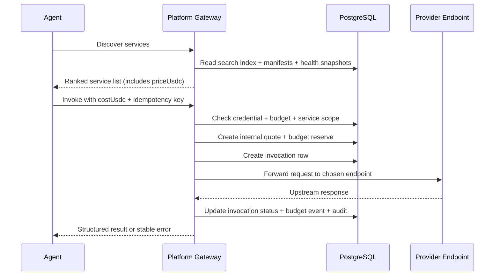

# Discovery and Gateway Call

- Status: canonical
- Code paths: `gateway/src/`, `sdk/python/`, `apps/frontend/src/`
- Verified with: `npm run ci:gateway`, `npm run ci:sdk-python`, `npm run ci:frontend`, `npm run ci:docs`
- DB sources: `docker-compose/postgres/init/gateway/001_synapse_schema.sql`
- Supersedes: former `docs/agent/02_Discovery_Quote_Invoke_API_Design.md` for workflow semantics of discover and invoke
- Last verified against code: 2026-07-07

## 1. 目标

这条链路定义 Agent Runtime 如何完成：

1. 找到可用服务
2. 拿到可执行报价
3. 由 Platform Gateway 代为转发调用
4. 在不暴露 Provider 结算面的前提下拿回结果

Synapse 的核心不是“给人手工点 API”，而是让 Agent 在受控预算下自动完成 `discover -> quote -> invoke`。

当前 discover / quote / invoke 的主流程语义以本文件为 canonical。former `docs/agent/02_Discovery_Quote_Invoke_API_Design.md` 已完成退役，不再单独定义长期流程真相。

## 2. Agent-facing 协议分层

这三类 API 优先服务 Agent Runtime，而不是前端页面。

统一边界如下：

1. Discovery 负责给 Agent 返回结构化决策输入，而不是营销卡片。
2. Invoke 是正式执行与记账入口；Gateway 内部完成价格锁定（quote），不暴露为独立 Agent API。
3. Agent-facing 协议默认不暴露卖家钱包、平台分账明细、内部路由节点或内部账本主键。

控制台 Discovery 与 Agent Discovery 必须分层：

1. 面向控制台与公开浏览页的 discover 结果可以更偏人类阅读和页面排序。
2. 面向 Agent Runtime / SDK 的 discover 结果必须保持字段稳定、语义稳定、错误码稳定。
3. 底层 ranking / filtering / discoverability 逻辑必须复用同一套 registry service，禁止维护两套 discover 真相。

## 3. 参与者

1. `Agent`
   真正做 discover、选择服务、发起调用的运行时主体。
2. `Agent Credential`
   Runtime 支付身份和预算约束入口。
3. `Platform Gateway`
   承担发现、路由、转发、审计和扣费决策。
4. `Provider Service`
   真正执行上游能力的服务提供方。
5. `PostgreSQL`
   保存 Service Catalog、Quote、Invocation、Budget Event 和 Audit Event。

## 4. 核心表

| 表 | 作用 |
| --- | --- |
| `synapse_service_manifests` | Service 的公开能力、价格和 schema 主体 |
| `synapse_service_endpoints` | 真实上游 endpoint 和运行约束 |
| `synapse_service_health_snapshots` | 健康度、延迟、成功率 |
| `synapse_service_search_index` | discovery 检索索引 |
| `synapse_service_quotes` | 报价、TTL、约束和价格锚点 |
| `synapse_invocations` | 调用生命周期、状态和结果摘要 |
| `synapse_budget_events` | reserve / capture / release 预算事件 |
| `synapse_audit_events` | discover、invoke 过程中的关键审计事件 |

## 5. 主流程总览



## 6. Discovery

Discovery 只做一件事：

**让 Agent 得到足够结构化的服务决策输入，而不是营销卡片。**

### 6.0 Provider Service 生命周期

Provider 侧注册服务必须走明确状态机，不能用物理删除破坏审计链路。

服务状态分两层，不允许混用：

1. 控制面生命周期：`draft / active / inactive / suspended / deleted`
2. 运行时健康：`unknown / probing / healthy / degraded / unhealthy / stale`

其中 `active` 表示 Provider 或平台允许服务承载流量；`healthy / degraded / unhealthy / stale` 是 Gateway 探活产生的运行时事实。健康失败只能自动摘流，不能自动把 `active` 改成 `inactive`。

1. `draft`
   刚创建或尚未完成发布收敛，不对外承载流量。
2. `active`
   Provider 明确启用。Gateway 会持续定时探活，即使当前已经 `unhealthy` 也继续探活；长期不健康后进入 slow lane 降频探活。只有健康检查存在可用 target 时，才会进入 discover / invoke 候选。
3. `inactive`
   Provider 主动下线。Gateway 不再允许新的 discovery 命中或新的转发调用，并停止自动探活；只允许管理员或 Provider 手动 force probe。
4. `suspended`
   平台风控或合规冻结。Gateway 不允许 discovery / invoke，但仍按 slow lane 频率保留探活，用于观察恢复条件和保留审计事实。
5. `deleted`
   逻辑删除终态。记录保留在注册表中用于审计、归因与问题追溯；默认不再出现在 Provider 日常服务列表，也不会参与探活、发现或调用。

运行时健康语义：

1. `unknown`：尚无有效探活结果。
2. `probing`：探活执行中或等待首轮结果。
3. `healthy`：至少一个 target 在健康窗口内满足成功阈值。
4. `degraded`：部分 target 可用，或失败尚未达到不健康阈值。
5. `unhealthy`：连续失败达到阈值，当前没有可路由 healthy target。
6. `stale`：最近探活结果超过有效窗口，不能作为可调用依据。

V1 删除规则：

1. 只有服务 owner 可以删除自己的 service
2. `active` 不能直接删除，必须先切到 `inactive`
3. 删除必须是逻辑删除，禁止物理删除注册记录
4. 删除动作必须追加 audit event

### 6.1 Discovery 读取的数据

Gateway 至少要组合：

1. `synapse_service_search_index`
2. `synapse_service_manifests`
3. `synapse_service_health_snapshots`

### 6.2 必须返回给 Agent 的最小信息

1. `service_id`
2. `service_name`
3. `description_for_model`
4. `price_model` / `base_price_usdc`
5. `input_schema` / `output_schema`
6. `health_score`
7. `p95_latency_ms`
8. `success_rate_24h`
9. `quote_required`

### 6.3 不允许暴露给 Agent 的信息

1. `provider_wallet`
2. `payout_account_id`
3. 内部 `endpoint_url`
4. 路由权重和真实 target 列表
5. 平台内部账本主键

## 7. Quote（内部步骤，非 Agent-facing API）

Quote 现在是 Gateway 在 `POST /agent/invoke` 内部自动创建的，不再作为独立的 Agent-facing API 暴露。Agent 只调用一次 invoke，Gateway 在内部完成价格锁定、预算预占与 quote 记录写入。

### 7.1 Quote 必须解决的问题

1. 当前 credential 是否有权调用这个 service
2. 当前预算是否允许承担这次调用
3. 当前价格和约束在短窗口内是否锁定
4. 后续 invoke 是否有足够的信息直接执行

### 7.2 Quote 写入的真相

在最新 schema 中，Quote 至少会落两类记录：

1. `synapse_service_quotes`
   保存 `quote_id`、`service_id`、`credential_id`、`quoted_price_usdc`、`status`、`expires_at`
2. `synapse_budget_events`
   以 `reserve` 形式预占预算窗口

### 7.3 Quote 状态机

`synapse_quote_status` 只允许：

1. `OPEN`
2. `EXPIRED`
3. `CONSUMED`
4. `CANCELLED`

任何已经 `CONSUMED` 或 `EXPIRED` 的 quote，不能再次被 invoke。

## 8. Invoke

Invoke 是 Discovery / Invoke 这条链路的执行点。

### 8.1 Invoke 前的校验顺序

Gateway 必须按成本从低到高执行：

1. Credential 是否存在
2. Credential 是否 active 且未过期
3. Service 是否仍处于可调用状态
4. Budget policy 是否允许
5. Owner 资金池是否足以支撑调用金额
6. Idempotency key 是否冲突

其中第 4 条的服务可调用状态，至少要同时满足：

1. `is_active = true`
2. `status = active`
3. 运行时健康未过期
4. 至少一个 target 在健康窗口内为 `healthy`

只要 Provider 把服务切到 `inactive`，平台把服务切到 `suspended` / `deleted`，或者当前没有 healthy target，调用链就必须在进入上游转发前被网关硬拦截。

在进入上游转发和扣费前，Gateway 还会对选中的 `serviceId + targetUrl` 执行动态并发准入：

1. `DOWNSTREAM_ADAPTIVE_CONCURRENCY_ENABLED=1` 时，每个 target 都有独立的 adaptive concurrency window。
2. Provider 可在 `constraints.maxConcurrency` 声明更低的目标并发；平台仍会用 `DOWNSTREAM_ADAPTIVE_MAX_CONCURRENCY` 和 `maxQps * timeoutMs` 推导值做硬上限。
3. 下游 p95 延迟高于 `DOWNSTREAM_ADAPTIVE_LATENCY_TARGET_MS`，或出现 timeout / 429 / 5xx / 连接错误时，Gateway 使用 AIMD 快速降并发。
4. 下游恢复健康后，Gateway 每个窗口只 `+1` 慢升，避免刚恢复就被流量再次打垮。
5. 达到并发上限时返回 `SERVICE_BUSY`；连续严重失败打开熔断时返回 `SERVICE_CIRCUIT_OPEN`。这两类拒绝都发生在扣费前。
6. 已转发但超时的调用返回 `SERVICE_TIMEOUT`，继续走现有失败回滚和审计链路。
7. 多 Gateway 实例下，Redis 可用时用全局 in-flight counter 兜底；Redis 不可用时退回本地保守并发并写入 degraded analytics 事件。

自动摘流规则：

1. `active + unhealthy` 不会被 Gateway 改写成 `inactive`。
2. `active + unhealthy/stale` 不出现在 discovery，也不能进入 invoke 上游转发。
3. `active + unhealthy` 连续不健康超过 `SERVICE_HEALTH_SLOW_LANE_AFTER_SEC` 后进入 slow lane，降低探活频率但不从探活队列剔除。
4. 周期探活受 `SERVICE_HEALTH_MAX_CONCURRENCY` 全局并发上限保护，并通过 stable jitter 把 normal / slow lane 探活分散到不同时间片。
5. 后续正常探活、slow lane 探活或手动 `Force probe` 重新达到 healthy 阈值后，服务自动恢复 discovery / invoke。
6. `Force probe` 会绕过 jitter due 判断，但仍受全局并发上限保护。
7. `inactive` 与 `deleted` 不参与自动探活；`suspended` 按 slow lane 探活但永不承载流量。

### 8.2 Invocation 记录

Gateway 在转发前先写 `synapse_invocations`，至少包含：

1. `invocation_id`
2. `service_id`
3. `endpoint_id`
4. `credential_id`
5. `agent_id`
6. `idempotency_key`
7. `status = PENDING`

后续根据执行推进到：

1. `RUNNING`
2. `SUCCEEDED`
3. `FAILED_RETRYABLE`
4. `FAILED_FINAL`
5. `SETTLED`

### 8.3 Gateway 转发原则

Gateway 不是透明代理，而是 **带风控和结算语义的平台代理层**。

它必须负责：

1. 根据健康度和权重挑选 `synapse_service_endpoints`
2. 附加内部 trace / request id
3. 执行 timeout、payload 限制和 response mode 约束
4. 把上游原始 HTTP 成败映射成平台的执行结果
5. 根据下游实时延迟和失败率动态调整并发，保护 Provider endpoint 不被慢响应和重试流量打垮

### 8.4 单次调用路径：POST /v1/agent/invoke（cost_usdc 价格断言）

Agent 通过 Discovery 获取服务价格后，使用 **单次调用路径** 将 `costUsdc` 带入 invoke。Gateway 内部完成价格断言和 quote 写入。

**请求体：**

```json
{
  "serviceId": "svc_quotes_top3",
  "idempotencyKey": "job-007-step-1",
  "costUsdc": 0.05,
  "payload": { "body": { "topic": "resilience" } },
  "responseMode": "sync"
}
```

**`costUsdc` 语义：**

- 取自 Discovery 响应中 `pricing.amount` 字段（Agent 观察到的价格）
- 这是**精确断言**，而不是上限（`max_cost`）
- Gateway 检查 `|live_price - costUsdc| ≤ 1e-6`
- 如果价格已变动，返回 `422 PRICE_MISMATCH`，Agent 必须重新 discover 后重试

**422 PRICE_MISMATCH 响应：**

```json
{
  "detail": {
    "code": "PRICE_MISMATCH",
    "message": "Service price has changed. You expected 0.050000 USDC but current is 0.150000 USDC.",
    "expectedPriceUsdc": 0.05,
    "currentPriceUsdc": 0.15
  }
}
```

**Gateway 内部执行顺序：**

1. 验证 credential
2. 查询服务及当前实时单价
3. 断言价格：`|live_price - costUsdc| ≤ 1e-6`，否则 422
4. 构建内部 ephemeral quote（写入 `synapse_service_quotes`，供审计）
5. 执行调用管线（预算检查 → 扣费 → 转发 → 写结果）
6. 返回 invocation 结果

**SDK 使用模式：**

```python
# Python SDK
services = client.discover_services(intent="quotes")
svc = services.services[0]
result = client.invoke(svc.serviceId, {"topic": "resilience"}, cost_usdc=svc.price_usdc)
```

```typescript
// TypeScript SDK
const services = await client.discover();
const result = await client.invoke(services[0].serviceId, { topic: "resilience" }, {
  costUsdc: services[0].priceUsdc,
});
```

**为什么是精确断言而不是上限：**

1. `max_cost` 上限让 Agent 在价格悄然上涨时被静默多扣费
2. `cost_usdc` 精确断言强制透明：Agent 永远知道自己实际支付了多少
3. 价格变动时 Gateway 主动报错，Agent 重新 discover 拿最新价格后重试，决策权在 Agent 手中

## 9. 成功与失败映射

### 9.1 成功路径

如果上游完成有效交付：

1. `synapse_invocations.status -> SUCCEEDED`
2. 内部 Quote 标记 `CONSUMED`
3. 预算事件从 `reserve` 走向 `capture`
4. 进入后续结算流程

### 9.2 失败路径

如果上游失败、超时、连接错误或返回不可接受结果：

1. `synapse_invocations.status -> FAILED_RETRYABLE` 或 `FAILED_FINAL`
2. 内部 Quote 保持可审计但不再作为成功结算依据
3. 预算执行 `release`
4. 写稳定错误码和 `error_action`

### 9.3 为什么不能直接把 Provider 响应原封不动吐给 Agent

因为 Platform 还必须统一处理：

1. 超时和重试语义
2. 预算释放
3. 账本动作
4. 风险审计
5. 不泄露 Provider 内部拓扑和结算字段

## 10. 幂等

Invoke 的业务幂等由 `synapse_invocations UNIQUE (credential_id, idempotency_key)` 保证。

含义是：

1. 同一个 credential 在同一个业务步骤重复提交，只能落一条 invocation 真相
2. 网络重试不会导致重复扣费
3. 平台可以稳定返回同一次调用的最终状态

## 11. 数据边界结论

## 12. 为什么删除必须是逻辑删除

物理删除看起来干净，实际上会把生产系统最关键的证据链直接抹掉。

逻辑删除更符合 Synapse 的注册-发现-调用-审计闭环：

1. 保留 `service_id` 与 owner 的历史绑定关系，避免账单、审计、告警和历史调用失去归因
2. 保留状态迁移轨迹，支持回答“这个服务何时下线、何时删除、删除前是否仍在被调用”
3. 避免因为注册行被物理移除而造成 health history、invocation、quote、budget event 的孤儿记录
4. 允许控制面默认隐藏 `deleted`，同时让审计面继续可追溯

这条链路必须永远守住两条边界：

1. 对 Agent 暴露的是 `service / invocation / result / stable error`
2. 对平台内部保留的是 `endpoint / routing / payout / ledger / audit`

Synapse 的 Gateway 不是让 Agent 直接撞向 Provider，而是在 Runtime 语义上替 Agent 完成了：

**结构化发现、预算前置、平台代理转发和稳定错误收敛。**
