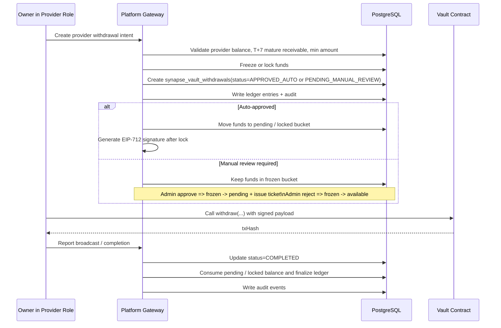

# Withdrawal and Risk Gates

## 1. 目标

Withdrawal 链路定义 Provider 如何把已经结算的离链收益提现到链上钱包。

这条链路必须同时满足：

1. 提现目标明确，只动 Provider 收益桶
2. 风控拦截前置，不允许直接裸提
3. 链上防重放可靠，必须使用 EIP-712 票据
4. 账本、状态机、审计全链可追溯

## 2. 参与者

1. `Owner in Provider Role`
   发起提现申请的人。
2. `Platform Gateway`
   负责风控、锁仓、签名票据和审计。
3. `Vault Contract`
   负责执行链上 withdraw。
4. `PostgreSQL`
   负责持久化 withdrawal intent、余额冻结、ledger entry 和 audit event。

## 3. 核心表

| 表                          | 作用                                                                   |
| --------------------------- | ---------------------------------------------------------------------- |
| `synapse_vault_withdrawals` | 提现主记录，保存 kind、状态、ticketId、ticketHash、deadline、signature |
| `synapse_ledger_accounts`   | 定义 provider wallet 账户                                              |
| `synapse_account_balances`  | 保存 provider 可提现余额和冻结余额                                     |
| `synapse_ledger_entries`    | 保存锁仓、出金、释放等资金分录                                         |
| `synapse_audit_events`      | 保存创建 intent、签名、广播、确认、失败等审计                          |

## 4. 状态机

当前 Gateway 对 `provider_withdrawal` 暴露的业务状态为：

1. `APPROVED_AUTO`
2. `PENDING_MANUAL_REVIEW`
3. `REJECTED`
4. `COMPLETED`
5. `CANCELLED`

其中：

1. `APPROVED_AUTO` 表示风控已放行，ticket 已签发，资金已进入 `provider pending / locked`。
2. `PENDING_MANUAL_REVIEW` 表示资金已冻结在 `provider frozen`，等待平台审核。
3. `REJECTED` 表示人工审核拒绝，冻结金额已释放回 `provider available`。
4. `COMPLETED` 表示链上 withdraw 已完成并被 Gateway 收口。
5. `CANCELLED` 表示已签发 ticket 过期失效，原先锁定在 `provider pending / locked` 的金额已释放回 `provider available`。

`withdrawal_kind` 当前允许：

1. `consumer_refund`
2. `provider_withdrawal`
3. `platform_distribution`

本文件只讲 `provider_withdrawal`。

## 5. 风险三段阀门

Provider 提现必须先过三道门，而不是先签名再说。

### 5.1 第一段：业务资格阀门

先检查：

1. 当前 session 是否绑定正确 Owner
2. 当前 Owner 是否已经建立 Provider role
3. `provider_wallet` 账户是否存在并 active
4. `available_balance` 是否足够
5. 金额是否达到最低提现额：默认 `PROVIDER_WITHDRAW_MIN_USDC=10`
6. 收益是否已过 T+7 争议沉淀期：只有 `earnedAt + 7 days` 之前入账的 provider charge 收益可提现

如果显式 `amountUsdc` 超过成熟收益，Gateway 返回 `400 PROVIDER_RECEIVABLE_NOT_MATURED`，不创建 withdrawal、不签票、不锁仓。若 `amountUsdc` 低于最低额，或留空全额提现时成熟收益低于最低额，Gateway 返回 `400 MIN_WITHDRAWAL_AMOUNT_NOT_MET`。

### 5.2 第二段：资金锁仓阀门

在签发链上票据前，Platform 必须先把收益锁住：

1. 自动通过单：`available_balance -= amount_usdc`，`pending_balance += amount_usdc`
2. 人工审核单：`available_balance -= amount_usdc`，`frozen_balance += amount_usdc`
3. 写对应 `synapse_ledger_entries`
4. 写 `synapse_vault_withdrawals`

没有锁仓，就不允许继续往下走。

大额/高频风控只能让合法资金进入 `PENDING_MANUAL_REVIEW`；最低额、余额不足、成熟收益不足、资金桶不匹配属于硬失败。

### 5.3 第三段：签名与重放保护阀门

提现票据必须带：

1. `signature`
2. `ticketId`
3. `ticketHash`
4. `deadline`

这些字段直接保存在 `synapse_vault_withdrawals`，并由链上合约校验。

它的作用是：

1. 防止旧票据无限重放
2. 防止不同请求串用签名
3. 让离链审批结果和链上执行绑定为一个可追溯对象

链上接口不新增 nonce 字段。Gateway 继续签包含 `user`, `amount`, `fee`, `ticketId`, `deadline` 的 EIP-712 payload，合约以 `consumedTickets[ticketHash]` 防重放，以 `deadline` 拒绝过期票据。

## 6. 主流程



## 7. Step A: 创建提现意图

Gateway 收到提现请求后，至少要先做：

1. 校验当前 Owner scope
2. 找到对应 `provider_id`
3. 找到对应 `provider_wallet` 账户
4. 检查可提现余额是否足够
5. 检查 T+7 成熟收益是否足够
6. 检查最低提现额是否满足

只有全部通过，才能创建 `synapse_vault_withdrawals` 主记录。

## 8. Step B: 锁仓

提现不是从 consumer bucket 扣钱，而是从 Provider 收益桶锁钱。

因此平台必须保证：

1. 创建提现时，`provider_wallet.available_balance` 一定减少
2. 自动通过单进入 `provider_wallet.pending_balance`
3. 人工审核单进入 `provider_wallet.frozen_balance`
4. 审核通过后，金额从 `frozen_balance -> pending_balance`
5. 审核拒绝后，金额从 `frozen_balance -> available_balance`
6. 锁仓金额与 withdrawal.amount 完全一致
7. 对应 ledger entry / audit 证据可追溯
8. Provider 自定义提现金额输入统一按 USDC 金额校验，最多允许小数点后 2 位；空值代表按当前可提现余额整额创建 intent
9. 空值整额提现以成熟收益为上限，不包含未过 T+7 的新收益

## 9. Step C: 生成 EIP-712 提现票据

Platform 在离链生成：

1. `ticketId`：由 `withdrawalId:v2:claim:1` 派生，同一 withdrawal 只允许生成一次
2. `ticketHash`：EIP-712 final digest，包含 user、amount、fee、ticketId、deadline、chainId 和 contract address
3. `deadline`：默认 30 分钟
4. `signature`

这些值进入 `synapse_vault_withdrawals`，成为链上提现前必须持有的授权材料。

对于人工审核单，这一步发生在 `APPROVE` 之后，而不是创建 intent 当下。

一笔 withdrawal 只有一个 ticket 生命周期。`ticket_id`、`ticket_hash`、`deadline`、`signature` 写入后不可刷新；若 ticket 超时未上链，Gateway 只能在链头时间也越过安全窗口后把单据结案为 `FAILED_EXPIRED` 并释放 pending。用户若仍要提现，必须重新创建新的 withdrawal。

### 9.1 为什么一定要走 EIP-712

因为它同时解决了：

1. 链上签名可验证
2. 离链审批和链上执行绑定
3. ticketHash + deadline 防重放

## 10. Step D: 链上广播与确认

Owner 在钱包中发起链上 withdraw 后，Platform 应推进：

1. `APPROVED_AUTO -> COMPLETED`
2. 记录 `tx_hash`
3. 消耗 `provider pending / locked` 金额
4. 完成最终分录与审计闭环

`APPROVED_AUTO` 只表示 ticket 已签发、资金已锁仓，并不等于提现成功。
Provider 提现成功的唯一产品语义是：Owner 自己的钱包完成
`SynapseCore.withdraw(...)`，Gateway 收到 complete 回调或 watcher 匹配到链上
`WithdrawInfo` 事件，并把 `synapse_vault_withdrawals.status` 推进到
`COMPLETED`。

### 10.1 人工审核子流程

当提现进入 `PENDING_MANUAL_REVIEW` 时：

1. Admin `APPROVE`：
   - `frozen_balance -= amount`
   - `pending_balance += amount`
   - 生成 EIP-712 ticket
   - 状态推进到 `APPROVED_AUTO`
2. Admin `REJECT`：
   - `frozen_balance -= amount`
   - `available_balance += amount`
   - 状态推进到 `REJECTED`
3. 24h 内未审核：
   - `frozen_balance -= amount`
   - `available_balance += amount`
   - 状态推进到 `FAILED_EXPIRED`
   - 用户通知必须明确说明冻结收益已安全退回可提现余额

## 11. 失败路径

### 11.1 签名前失败

1. 审核拒绝：`PENDING_MANUAL_REVIEW -> REJECTED`
2. 释放冻结金额回 `available`
3. 写失败 / review audit
4. 审核超过 `WITHDRAWAL_MANUAL_REVIEW_EXPIRY_SEC`（默认 24h）自动过期：
   `PENDING_MANUAL_REVIEW -> FAILED_EXPIRED`，释放冻结金额回
   `available`，并写 `PROVIDER_WITHDRAW_MANUAL_REVIEW_EXPIRED` audit。
5. Reaper 每轮最多处理 `WITHDRAWAL_REAPER_BATCH_SIZE` 条（默认 100），
   历史积压由多轮短事务消化，避免上线首轮长事务锁表。

### 11.2 链上失败或过期

1. 链上交易 `revert` 不等于业务失败。只要 ticket 未过期且 `isTicketConsumed(ticketHash)=false`，用户可以用同一 ticket 重新发起链上 claim。
2. 已签票但未完成的单据最终需要可回收 / 可失效。
3. Reaper 只能在本地时间超过 `deadline + WITHDRAW_TICKET_EXPIRY_BUFFER_SEC`、RPC 链头时间超过 `deadline + WITHDRAW_RPC_FINALITY_MARGIN_SEC`、且合约返回 `isTicketConsumed(ticketHash)=false` 后释放对应的 `pending / locked` 金额。
4. 业务状态推进到 `FAILED_EXPIRED`，用户若仍需提现必须重新创建 withdrawal；系统不刷新旧 ticket。
5. 如果历史脏数据导致 `pending / locked` 已被其他补偿路径提前清空，过期清理也不能报错打断列表接口；系统应把单据推进到 `FAILED_EXPIRED`，并在 audit 中记录 `releasedAmountUsdc` 与 `releaseShortfallUsdc`。
6. Admin soft revoke 不发送链上 `cancelTicket`，只进入“等待过期释放”的运营语义。若用户在 deadline 前抢跑 claim，链上事实优先，最终状态仍为 `COMPLETED`。

### 11.2.1 Release evidence

一次一签提现模型的 release evidence 固定为 10 个场景：

1. Consumer normal claim
2. Consumer expired reaper
3. Consumer soft revoke race claim
4. Consumer soft revoke expire
5. Provider normal claim
6. Provider expired reaper
7. Provider soft revoke race claim
8. Provider soft revoke expire
9. Consumer replay attack
10. Provider on-chain revert retry

运行命令：

```bash
npm run e2e:withdrawal-one-ticket-evidence
npm run ci:withdrawal-one-ticket-evidence
```

`provider-onchain-revert-retry` 使用极低 `gasLimit` 触发第一次链上
Out-of-Gas revert，然后在 deadline 前用同一 ticket 正常 gas retry 成功。
这证明链上失败 receipt 不会让 Gateway 提前进入 `FAILED_EXPIRED` 或释放
pending funds。

### 11.2.2 幂等并发 evidence

提现幂等和并发安全由单独的专项 E2E 验证，避免把所有风险压进
`withdrawal-risk-policy` 一条脚本：

```bash
npm run e2e:withdrawal-idempotency-concurrency
npm run ci:withdrawal-idempotency-concurrency-evidence
```

Provider 场景必须同时证明：

1. 创建提现并发只能产生一次有效锁仓，`available -> pending/frozen` 只移动一次。
2. 同一 `X-Idempotency-Key` + 同一 payload 返回同一业务结果；同 key 不同 payload 返回 `409 IDEMPOTENCY_KEY_REUSED_WITH_DIFFERENT_PAYLOAD`。
3. 同一人工审核单的并发 `APPROVE` 只能签发一次 ticket，`frozen -> pending` 只移动一次。
4. 同一人工审核单的并发 `REJECT` 只能释放一次，最终 `available` 只恢复一次。
5. `APPROVE` / `REJECT` 交叉并发只能落到一个合法终态，不能同时出现 ticket 和 rejected release。
6. 链上 claim 成功后，并发 complete 只能推进一次 `COMPLETED`，`tx_hash` 保持稳定，`pending` 不重复消费。
7. 同一 `ticketHash` 第一次链上 claim 成功后，合约 `consumedTickets[ticketHash] = true`，后续 replay 必须被合约拒绝。

这套 evidence 只验证资金不变量和并发幂等；人工审核 UI、权限、OTP、截图、
通过/拒绝运营链路仍由 `withdrawal-review-dogfood` 与
`admin-withdrawal-approval` 负责。

### 11.3 严禁的行为

1. 失败后不释放冻结金额
2. 直接修改余额，不写 ledger entry
3. 用 consumer balance 替 Provider 兜底提现

## 12. 与 Refund 的严格隔离

最新 schema 明确把两类出金放在同一张 `synapse_vault_withdrawals` 表，但通过 `withdrawal_kind` 强隔离：

1. `consumer_refund` 只作用于 Owner 消费资金桶
2. `provider_withdrawal` 只作用于 Provider 收益桶

即使归属同一个 Owner，也不能混用：

1. source account
2. 风控规则
3. 业务解释
4. 审计维度

## 13. 文档结论

Provider withdrawal 的正确顺序不是“先提现，再补风控”，而是：

**资格校验 -> 收益锁仓 -> 自动签票或人工审核 -> 链上广播 -> 状态确认 -> 审计闭环**

这就是 Synapse 在供给侧收益出金上的金融级最小闭环。
