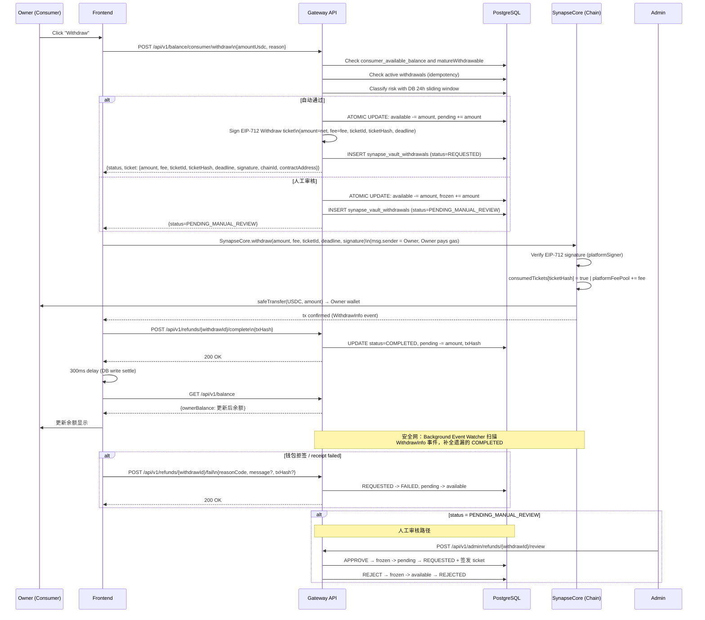

# Consumer Withdrawal and Risk Gates

## 1. 目标

Consumer Withdrawal 链路定义 Owner（买家）如何把**未消费的预存 USDC** 提回自己的链上钱包。

这条链路与 Provider Withdrawal（05 号文档）并行存在，但严格隔离：

- 资金来源：`consumer_wallet` 账户，不得碰 `provider_wallet`
- 出金依据：未被消耗且已成熟的 consumer 充值资金
- 风控规则：独立一套，阈值可配置

## 2. 参与者

| 参与者                         | 职责                                                                |
| ------------------------------ | ------------------------------------------------------------------- |
| `Owner (Consumer Role)`        | 发起提现申请，链上执行 `SynapseCore.withdraw()`                     |
| `Platform Gateway`             | 风控校验、余额冻结、幂等控制、EIP-712 签票、记录存储                |
| `SynapseCore` (Vault Contract) | 链上出金执行：验证 EIP-712 签名，转 USDC 给用户，收取平台费         |
| `Background Event Watcher`     | 安全网：监控链上 `WithdrawInfo` 事件，自动补全遗漏的 COMPLETED 状态 |
| `PostgreSQL`                   | 持久化余额变更、提现记录、审计事件                                  |

## 3. 核心表

| 表                          | 作用                                                        |
| --------------------------- | ----------------------------------------------------------- |
| `synapse_account_balances`  | 保存 `available_balance / pending_balance / frozen_balance` |
| `synapse_ledger_accounts`   | 定义 consumer_wallet 账户，关联 owner                       |
| `synapse_vault_withdrawals` | 提现主记录（`withdrawal_kind = 'consumer_refund'`）         |
| `synapse_runtime_state`     | 存储 `refundType = CONSUMER_BALANCE_WITHDRAW` 等元数据      |
| `synapse_audit_events`      | 保存审计链                                                  |

## 4. 状态机

```text
REQUESTED
  -> COMPLETED
  -> FAILED
  -> CANCELLED

PENDING_MANUAL_REVIEW
  -> REQUESTED
  -> REJECTED
  -> FAILED
```

| 状态                    | 语义                                                              | 余额变化                                        |
| ----------------------- | ----------------------------------------------------------------- | ----------------------------------------------- |
| `REQUESTED`             | 小额自动通过，已签发 ticket，等待 owner 钱包执行链上 `withdraw()` | `available -= amount`, `pending += amount`      |
| `PENDING_MANUAL_REVIEW` | 大额或频率超限，等待人工审核                                      | `available -= amount`, `frozen += amount`       |
| `COMPLETED`             | 链上交易已成功并完成收口                                          | `pending -= amount`                             |
| `FAILED`                | 钱包拒签、链上回执失败或前端显式失败回调                          | `pending -> available` 或 `frozen -> available` |
| `REJECTED`              | 审核拒绝                                                          | `frozen -> available`                           |
| `FAILED_EXPIRED`        | ticket 过期未执行，或人工审核超过 24h 自动取消                    | `pending -> available` 或 `frozen -> available` |

## 5. 风险三段阀门

### 5.1 第一段：业务资格阀门

| 检查项     | 条件                                                  |
| ---------- | ----------------------------------------------------- |
| 连接钱包   | `isConnected = true`                                  |
| 已签名会话 | JWT / wallet session 有效                             |
| 账户存在   | `consumer_wallet` 账户已建立                          |
| 余额充足   | `consumer_available_balance >= amountUsdc`            |
| 最小金额   | `amountUsdc >= CONSUMER_WITHDRAW_MIN_USDC` (默认 $10) |
| 资金成熟   | `amountUsdc <= matureWithdrawable`                    |

Consumer 已确认充值资金 T+7 后才允许提现，但 T+7 前仍可用于平台内 API 消费。Gateway 不给每笔充值打提现 lot 标签，而是使用聚合 FIFO 口径：

```text
matureWithdrawable = max(0,
  depositsConfirmedBefore7d
  - lifetimeConsumerSpend
  - lifetimeConsumerWithdrawnOrLocked
)
```

这等价于默认消费和提现优先消耗最老充值资金。请求金额超过该值时直接返回 `400 INSUFFICIENT_MATURE_CONSUMER_BALANCE`，不创建提现单、不签 ticket、不发 Lark。

### 5.2 第二段：频率与幂等阀门

| 检查项     | 规则                                                                           |
| ---------- | ------------------------------------------------------------------------------ |
| 24h 日限额 | 同一钱包过去 24 小时内最多 `CONSUMER_WITHDRAW_MAX_DAILY_COUNT` 笔（默认 3）    |
| 幂等保护   | 相同 `X-Idempotency-Key` + `request_hash` → 返回缓存响应，不重复扣款           |
| 活跃单保护 | 已有 REQUESTED / PENDING_MANUAL_REVIEW 状态的单 → 直接返回已有记录，不重复扣款 |

24h 统计必须以数据库时间戳滑动窗口为准：`created_at >= NOW() - INTERVAL '24 hours'`。不得用自然日 0 点重置、Redis bucket 或内存数组作为最终风控依据。

### 5.3 第三段：金额阈值阀门（**可配置**）

| 条件                                                       | 结果                                         |
| ---------------------------------------------------------- | -------------------------------------------- |
| `amount < CONSUMER_WITHDRAW_MANUAL_REVIEW_THRESHOLD_USDC`  | `status = REQUESTED`（自动通过）             |
| `amount >= CONSUMER_WITHDRAW_MANUAL_REVIEW_THRESHOLD_USDC` | `status = PENDING_MANUAL_REVIEW`（人工审核） |
| `daily_count >= CONSUMER_WITHDRAW_MAX_DAILY_COUNT`         | `status = PENDING_MANUAL_REVIEW`（频率超限） |

> **可配置入口：** 环境变量 `CONSUMER_WITHDRAW_MANUAL_REVIEW_THRESHOLD_USDC`（默认 500），
> 运行时通过 `finance_constants.py` 注入，无需重新部署代码，只需重启 Gateway。

## 6. 资金锁仓规则

提现**必须先锁仓**，再记录意图：

```
自动通过单：
  available_balance -= amount
  pending_balance   += amount

人工审核单：
  available_balance -= amount
  frozen_balance    += amount
```

锁仓通过单笔 SQL 原子 UPDATE（`WHERE available_balance >= amount`）完成，
若并发写导致余额低于请求金额，UPDATE 行数为 0，立即抛出 `INSUFFICIENT_CONSUMER_BALANCE_ATOMIC`。

人工审核单超过 `WITHDRAWAL_MANUAL_REVIEW_EXPIRY_SEC`（默认 24h）仍未处理时，
processor 会自动标记 `FAILED_EXPIRED`，把 `frozen_balance -> available_balance`，
并发送明确说明“冻结资金已安全退回可用余额”的站内信 / 邮件。过期处理每轮最多
`WITHDRAWAL_REAPER_BATCH_SIZE` 条（默认 100），历史积压由多轮短事务消化。

**已冻结 / pending 的余额不计入 `consumer_available_balance`，因此：**

- 不能再用于 API 消费计费
- 不能被二次提现
- 不能被任何其他出金路径消耗

## 7. 主流程

> **统一 Withdraw 模型**：Consumer 和 Provider 提现复用同一条链上路径 `SynapseCore.withdraw()`。
> Gateway 签发一次性 EIP-712 票据（`ticketId + ticketHash + deadline`，默认 30 分钟，含手续费），前端执行链上交易，用户付 gas。



### 7.1 手续费模型

| 项目                         | 值                                                       |
| ---------------------------- | -------------------------------------------------------- |
| `CONSUMER_WITHDRAW_FEE_USDC` | 0.50 (默认)                                              |
| 合约处理                     | `amount` (净额) 转给用户，`fee` 累加到 `platformFeePool` |
| gas 费                       | 用户自付（`msg.sender = Owner`）                         |

合约视角：`withdraw(net_wei, fee_wei, ticketId, deadline, sig)`

- `safeTransfer(msg.sender, net_wei)` → 用户收到净额
- `platformFeePool += fee_wei` → 平台手续费留在合约内
- Vault 总减少 = `net_wei`（fee 不离开合约，仅重新分配）
- 如果链上交易因为低 gas、临时 pause、vault 流动性等原因 revert，但
  deadline 未到且 `isTicketConsumed(ticketHash)=false`，Gateway 不得把业务
  单据判为终态失败；用户可以使用同一 ticket 在 deadline 前重试。

### 7.2 Background Event Watcher（安全网）

`consumer_withdraw_processor.py` 不再直接执行链上交易。改为 **事件监听器**：

1. 每 10 秒扫描 `REQUESTED` 状态的消费者提现记录
2. 扫描 `WithdrawInfo(user, ticketHash, amount, fee)` 事件匹配
3. 找到匹配 → 自动标记 `COMPLETED`（含 txHash）
4. 若本地时间超过 `deadline + buffer`、RPC 最新区块时间超过 `deadline + margin`、且 `isTicketConsumed(ticketHash)=false` → 自动标记 `FAILED_EXPIRED` 并释放 pending

这覆盖了两种极端场景：

- 前端链上成功后崩溃，没来得及调 `/complete`
- owner 迟迟不执行，ticket 自然过期，余额需要自动回滚

## 8. 为什么提现后 UI 余额会立即变化

修复后，前端不再等后台刷新才更新余额，而是创建成功后立即建立 optimistic state：

1. `POST /api/v1/balance/consumer/withdraw` 成功返回
2. 页面立刻把活跃单写入 `pendingWithdrawal`
3. 页面立刻把 `displayedRemainingBalance` 降到 `targetBalance`
4. `Withdraw` 按钮马上禁用，防止重复发起
5. 随后再异步 `handleRefresh()` / `fetchPendingWithdrawal()` 与后端状态对齐

如果钱包拒签或 receipt failed：

1. 前端调用 `/api/v1/refunds/{refundId}/fail`
2. 后端释放 `pending` 或 `frozen`
3. 前端清掉 optimistic override
4. Credits 页面恢复正确可提现余额

## 9. 提现记录在 Billing 页的显示

`useFundsData` hook 从两个来源合并记录到 Payments 表：

1. `listDepositIntents()` → 充值记录 (type = Deposit)
2. `listConsumerWithdrawals()` → 提现记录 (type = Withdraw)

提现记录的 `type` 字段通过 `typeLabelForRecord(row.type)` 映射为带颜色标签：

| type                               | 显示文字 | 颜色 |
| ---------------------------------- | -------- | ---- |
| consumer withdrawal row            | Withdraw | 橙色 |
| `SYSTEM_FAILURE` / `MANUAL_APPEAL` | Refund   | 蓝色 |
| Claim                              | Claim    | 紫色 |
| 其他                               | Deposit  | 绿色 |

Payments 的状态映射固定为：

| 提现状态                | Payments 状态 |
| ----------------------- | ------------- |
| `REQUESTED`             | `PENDING`     |
| `PENDING_MANUAL_REVIEW` | `PENDING`     |
| `COMPLETED`             | `COMPLETED`   |
| `FAILED`                | `FAILED`      |
| `REJECTED`              | `FAILED`      |
| `CANCELLED`             | `FAILED`      |

`REQUESTED` / `PENDING_MANUAL_REVIEW` 只能在 Billing 中显示为 pending 类状态。
Consumer 提现成功必须等链上 `SynapseCore.withdraw(...)` 成功，并且 Gateway
`/api/v1/refunds/{withdrawId}/complete` 或 watcher 把数据库推进到
`COMPLETED`。E2E 截图和 DOM checkpoint 必须在 complete 之后验证
`Completed`，不能只验证页面存在或 ticket 已准备。

## 10. 配置参数速查

| 参数                                             | 默认值                         | 含义                                 |
| ------------------------------------------------ | ------------------------------ | ------------------------------------ |
| `CONSUMER_DEPOSIT_MIN_USDC`                      | 5.0                            | 最小充值金额 (USDC)                  |
| `CONSUMER_WITHDRAW_MIN_USDC`                     | 10.0                           | 最小提现金额 (USDC)                  |
| `CONSUMER_WITHDRAW_MATURITY_ENFORCEMENT_ENABLED` | local=false, staging/prod=true | 是否执行 T+7 成熟期；prod 禁止 false |
| `CONSUMER_WITHDRAW_MATURITY_SECONDS`             | 604800                         | 充值确认后 T+7 才进入可提现额度      |
| `CONSUMER_WITHDRAW_FEE_USDC`                     | 0.50                           | 平台手续费 (USDC)，从提现金额中扣除  |
| `CONSUMER_WITHDRAW_MANUAL_REVIEW_THRESHOLD_USDC` | 500.0                          | 超过此金额进人工审核                 |
| `CONSUMER_WITHDRAW_MAX_DAILY_COUNT`              | 3                              | 24h 内最大提现次数                   |
| `CONSUMER_WITHDRAW_PROCESSOR_INTERVAL_SEC`       | 10.0                           | 后台事件监听器扫描间隔               |

这些参数通过环境变量覆盖，无需代码变更。

## 11. 安全保障

| 威胁               | 防护手段                                                                                |
| ------------------ | --------------------------------------------------------------------------------------- |
| 余额超提           | 原子 SQL UPDATE + `WHERE available >= amount`                                           |
| 并发双花           | 互斥锁 `_mutation_lock.lock(f"{owner}:consumer_withdraw_intent")`                       |
| 重复提交           | Redis 幂等 + 活跃单保护（双重）                                                         |
| 大额快速出金       | 金额阈值 + 日频次限制 → PENDING_MANUAL_REVIEW                                           |
| consumer 余额混用  | withdrawal_kind 强隔离，consumer 与 provider 路径完全独立                               |
| 伪造签名           | 合约验证 `ECDSA.recover(hash, signature) == platformSigner`                             |
| 重放已用票据       | 合约 `consumedTickets[ticketHash]` 强制每张 EIP-712 final digest 只能用一次             |
| 过期票据           | `require(block.timestamp <= deadline)` — 默认 30 分钟有效期                             |
| 平台私钥泄露       | 二方协作：即使 signer key 泄露，攻击者仍需用户钱包私钥（msg.sender）才能执行            |
| 链上失败 receipt   | 未过 deadline 且 ticket 未 consumed 时保持 active，不释放 pending                       |
| Release regression | `npm run e2e:withdrawal-one-ticket-evidence` 覆盖 10 场景，包括 replay 和 low-gas retry |

### 11.1 幂等并发专项验证

Consumer 风险策略和最终成功态由 `withdrawal-risk-policy` 覆盖；资金节点的
幂等并发安全由单独 E2E 覆盖：

```bash
npm run e2e:withdrawal-risk-policy
npm run e2e:withdrawal-idempotency-concurrency
npm run ci:withdrawal-idempotency-concurrency-evidence
```

`withdrawal-idempotency-concurrency` 必须同时断言 HTTP、DB、链上和资金桶：

1. 10 个并发创建请求只能造成一次有效锁仓，`available -> pending/frozen` 只移动一次。
2. 同一 `X-Idempotency-Key` + 同一 payload 返回同一结果；同 key 不同 payload 返回 `409 IDEMPOTENCY_KEY_REUSED_WITH_DIFFERENT_PAYLOAD`。
3. 人工审核 `APPROVE` 并发只能让 `frozen -> pending` 发生一次，ticket 只签发一次。
4. 人工审核 `REJECT` 并发只能把 `frozen -> available` 释放一次。
5. `APPROVE` / `REJECT` 交叉并发只能落到一个合法终态，不能同时签 ticket 又释放为 rejected。
6. 链上 claim 成功后，并发 complete 只能消费一次 pending，最终 `status=COMPLETED` 且 `tx_hash` 稳定。
7. 同一 `ticketHash` 首次 claim 后必须被合约标记 consumed，二次 replay 被拒绝。

人工审核通过/拒绝的完整 UI、权限、截图和运营证据不在这条脚本里；它们由
`withdrawal-review-dogfood` 与 `admin-withdrawal-approval` 覆盖。

## 12. 文档结论

Consumer withdrawal 正确顺序：

**资格校验 → 频率/幂等校验 → 余额原子锁仓 → 创建意图记录 + EIP-712 签票 → 前端链上执行 → /complete 回调 → UI 刷新 → 审计闭环**

与 Provider withdrawal 的关系：

- **复用同一条链上路径**：`SynapseCore.withdraw()` — EIP-712 签名验证，用户执行
- 资金来自 `consumer_wallet` 而非 `provider_wallet`
- 风控阈值、日限额独立配置
- 手续费：Consumer 0.50 USDC / Provider 0 USDC（可分别配置）
- 安全模型：Gateway（platformSigner）签票 + User（msg.sender）执行，二方协作安全
