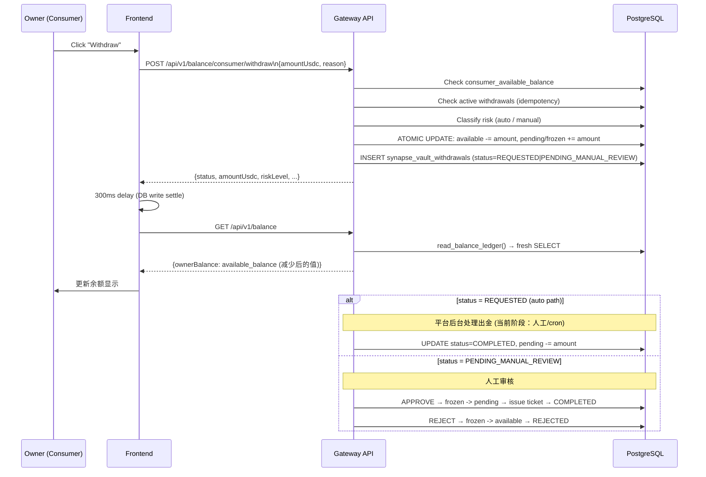

# Consumer Withdrawal and Risk Gates

## 1. 目标

Consumer Withdrawal 链路定义 Owner（买家）如何把**未消费的预存 USDC** 提回自己的链上钱包。

这条链路与 Provider Withdrawal（05 号文档）并行存在，但严格隔离：
- 资金来源：`consumer_wallet` 账户，不得碰 `provider_wallet`
- 出金依据：未被消耗的 `available_balance`（即充值进来扣减掉 API 消费费用后剩余部分）
- 风控规则：独立一套，阈值可配置

## 2. 参与者

| 参与者 | 职责 |
| --- | --- |
| `Owner (Consumer Role)` | 发起提现申请 |
| `Platform Gateway` | 风控校验、余额冻结、幂等控制、记录存储 |
| `Vault Contract` *(未来)* | 链上出金执行（当前阶段通过平台人工/自动处理） |
| `PostgreSQL` | 持久化余额变更、提现记录、审计事件 |

## 3. 核心表

| 表 | 作用 |
| --- | --- |
| `synapse_account_balances` | 保存 `available_balance / pending_balance / frozen_balance` |
| `synapse_ledger_accounts` | 定义 consumer_wallet 账户，关联 owner |
| `synapse_vault_withdrawals` | 提现主记录（`withdrawal_kind = 'consumer_refund'`）|
| `synapse_runtime_state` | 存储 `refundType = CONSUMER_BALANCE_WITHDRAW` 等元数据 |
| `synapse_audit_events` | 保存审计链 |

## 4. 状态机

```
REQUESTED                    ← 小额自动通过（< threshold）
PENDING_MANUAL_REVIEW        ← 大额或频率超限，人工审核
REJECTED                     ← 人工拒绝，资金归还 available
COMPLETED                    ← 出金已完成
CANCELLED                    ← 已超时或手动取消，资金归还 available
```

**REQUESTED** 下资金：`available -= amount`, `pending += amount`
**PENDING_MANUAL_REVIEW** 下资金：`available -= amount`, `frozen += amount`

## 5. 风险三段阀门

### 5.1 第一段：业务资格阀门

| 检查项 | 条件 |
| --- | --- |
| 连接钱包 | `isConnected = true` |
| 已签名会话 | JWT / wallet session 有效 |
| 账户存在 | `consumer_wallet` 账户已建立 |
| 余额充足 | `consumer_available_balance >= amountUsdc` |
| 最小金额 | `amountUsdc >= CONSUMER_WITHDRAW_MIN_USDC` (默认 $1) |

### 5.2 第二段：频率与幂等阀门

| 检查项 | 规则 |
| --- | --- |
| 24h 日限额 | 同一钱包 24 小时内最多 `CONSUMER_WITHDRAW_MAX_DAILY_COUNT` 笔（默认 3） |
| 幂等保护 | 相同 `X-Idempotency-Key` + `request_hash` → 返回缓存响应，不重复扣款 |
| 活跃单保护 | 已有 REQUESTED / PENDING_MANUAL_REVIEW 状态的单 → 直接返回已有记录，不重复扣款 |

### 5.3 第三段：金额阈值阀门（**可配置**）

| 条件 | 结果 |
| --- | --- |
| `amount < CONSUMER_WITHDRAW_MANUAL_REVIEW_THRESHOLD_USDC` | `status = REQUESTED`（自动通过）|
| `amount >= CONSUMER_WITHDRAW_MANUAL_REVIEW_THRESHOLD_USDC` | `status = PENDING_MANUAL_REVIEW`（人工审核）|
| `daily_count >= CONSUMER_WITHDRAW_MAX_DAILY_COUNT` | `status = PENDING_MANUAL_REVIEW`（频率超限）|

> **可配置入口：** 环境变量 `CONSUMER_WITHDRAW_MANUAL_REVIEW_THRESHOLD_USDC`（默认 500），
> 运行时通过 `finance_constants.py` 注入，无需重新部署代码，只需重启 Gateway。

## 6. 资金锁仓规则

提现**必须先锁仓**，再记录意图：

```
自动通过单：
  available_balance -= amount
  pending_balance   += amount

人工审核单：
  available_balance -= amount
  frozen_balance    += amount
```

锁仓通过单笔 SQL 原子 UPDATE（`WHERE available_balance >= amount`）完成，
若并发写导致余额低于请求金额，UPDATE 行数为 0，立即抛出 `INSUFFICIENT_CONSUMER_BALANCE_ATOMIC`。

**已冻结 / pending 的余额不计入 `consumer_available_balance`，因此：**
- 不能再用于 API 消费计费
- 不能被二次提现
- 不能被任何其他出金路径消耗

## 7. 主流程



## 8. 为什么提现后 UI 余额没有变化

**根本原因（已修复，commit `a4aecc77`）：**

1. `onSuccess` prop 类型是 `() => void`，但传入的是 async 函数
2. `handleSubmit` 调用 `onSuccess()` 时**没有 `await`**
3. 导致：modal 关闭时 `handleRefresh()` 根本没有被执行，页面余额停留在旧值

**修复内容：**

```tsx
// 修复 1：类型改为 () => Promise<void>
type WithdrawModalProps = {
  onSuccess: () => Promise<void>;
  ...
};

// 修复 2：加上 await
await onSuccess();
onClose();

// 修复 3：父组件加 300ms 等待让 DB 写入沉淀
onSuccess={async () => {
  await new Promise((resolve) => setTimeout(resolve, 300));
  await Promise.all([handleRefresh(), fetchSpendingLimit()]);
}}
```

**数据流（修复后）：**

```
handleSubmit
  → requestConsumerWithdraw() → POST /api/v1/balance/consumer/withdraw
  → Platform: reserve_consumer_balance_for_withdrawal()
       SQL: available_balance = 0, pending_balance = 20
  → await onSuccess()
       → 300ms
       → handleRefresh()
            → getV2Balance() → GET /api/v1/balance
                 → read_balance_ledger() → SQL SELECT
                 → returns ownerBalance = 0
       → setStats({ ownerBalance: "0.00" })
  → UI 显示 $0.00
```

## 9. 提现记录在 Billing 页的显示

`useFundsData` hook 从两个来源合并记录到 Payments 表：

1. `listDepositIntents()` → 充值记录 (type = Deposit)
2. `listConsumerWithdrawals()` → 提现记录 (type = Withdraw)

提现记录的 `type` 字段通过 `typeLabelForRecord(row.type)` 映射为带颜色标签：

| type | 显示文字 | 颜色 |
| --- | --- | --- |
| `CONSUMER_BALANCE_WITHDRAW` | Withdraw | 橙色 |
| `SYSTEM_FAILURE` / `MANUAL_APPEAL` | Refund | 蓝色 |
| Claim | Claim | 紫色 |
| 其他 | Deposit | 绿色 |

## 10. 配置参数速查

| 参数 | 默认值 | 含义 |
| --- | --- | --- |
| `CONSUMER_WITHDRAW_MIN_USDC` | 1.0 | 最小提现金额 (USDC) |
| `CONSUMER_WITHDRAW_MANUAL_REVIEW_THRESHOLD_USDC` | 500.0 | 超过此金额进人工审核 |
| `CONSUMER_WITHDRAW_MAX_DAILY_COUNT` | 3 | 24h 内最大提现次数 |

这三个参数通过环境变量覆盖，无需代码变更。

## 11. 安全保障

| 威胁 | 防护手段 |
| --- | --- |
| 余额超提 | 原子 SQL UPDATE + `WHERE available >= amount` |
| 并发双花 | 互斥锁 `_mutation_lock.lock(f"{owner}:consumer_withdraw_intent")` |
| 重复提交 | Redis 幂等 + 活跃单保护（双重）|
| 大额快速出金 | 金额阈值 + 日频次限制 → PENDING_MANUAL_REVIEW |
| consumer 余额混用 | withdrawal_kind 强隔离，consumer 与 provider 路径完全独立 |

## 12. 文档结论

Consumer withdrawal 正确顺序：

**资格校验 → 频率/幂等校验 → 余额原子锁仓 → 创建意图记录 → UI 刷新展示 → 平台执行出金 → 审计闭环**

区别于 Provider withdrawal：
- 无需 EIP-712 签名（当前阶段平台人工/自动出金）
- 资金来自 consumer_wallet 而非 provider_wallet
- 风控阈值、日限额独立配置
