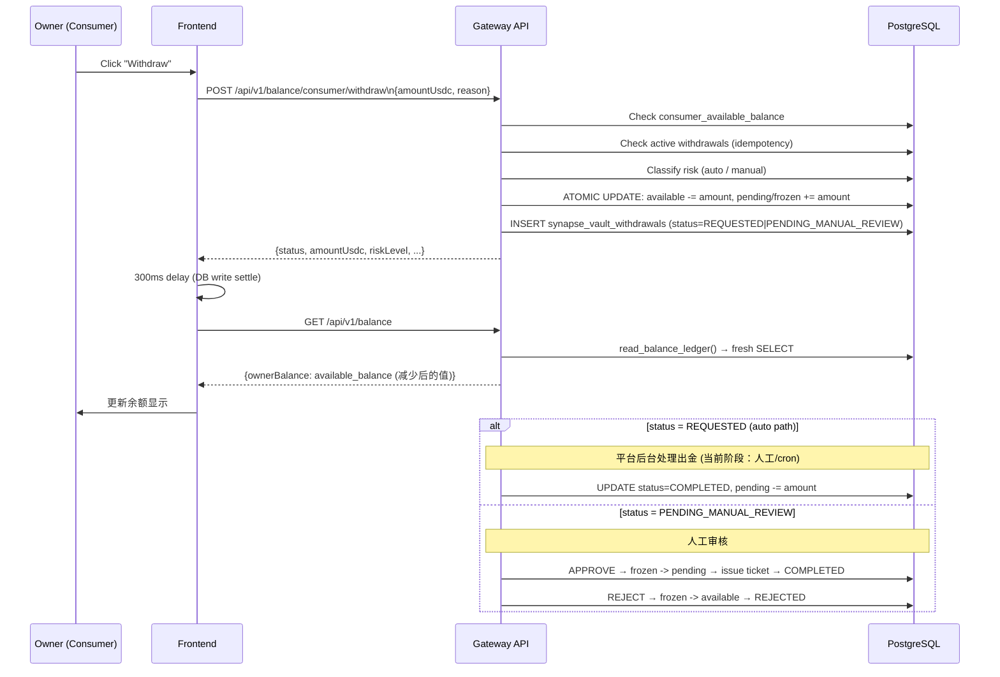

# Consumer Withdrawal and Risk Gates

## 1. 目标

Consumer Withdrawal 链路定义 Owner（买家）如何把**未消费的预存 USDC** 提回自己的链上钱包。

这条链路与 Provider Withdrawal（05 号文档）并行存在，但严格隔离：
- 资金来源：`consumer_wallet` 账户，不得碰 `provider_wallet`
- 出金依据：未被消耗的 `available_balance`（即充值进来扣减掉 API 消费费用后剩余部分）
- 风控规则：独立一套，阈值可配置

## 2. 参与者

| 参与者 | 职责 |
| --- | --- |
| `Owner (Consumer Role)` | 发起提现申请 |
| `Platform Gateway` | 风控校验、余额冻结、幂等控制、记录存储 |
| `Vault Contract` *(未来)* | 链上出金执行（当前阶段通过平台人工/自动处理） |
| `PostgreSQL` | 持久化余额变更、提现记录、审计事件 |

## 2.1 Bug 记录与修复状态

> 最后验证：2026-04-08，自动化测试 4 张截图全部通过 ✅

### Bug-001 — 提现后 UI 余额没有变化（前端 `onSuccess` 未 await）

**严重级别：** High  
**状态：** 已修复 ✅  
**发现时间：** 2026-04-08  
**修复 commit：** `a4aecc77`

**根本原因：**  
`WithdrawBalanceModal.handleSubmit` 调用 `onSuccess()` 时**未 `await`**，导致父组件的 `handleRefresh()` 在 modal 尚未关闭时就被跳过，页面余额显示旧值。

**修复内容（`OwnerCreditsPage.tsx`）：**
1. `onSuccess` prop 类型从 `() => void` → `(result: ConsumerWithdrawIntent) => Promise<void>`  
2. `handleSubmit` 加 `await onSuccess(result)` + `await onClose()`  
3. 父组件 `onSuccess` 中加 300 ms 等待让 DB 写入沉淀，再调 `handleRefresh()`  

---

### Bug-002 — 刷新页面后余额恢复原值（乐观覆盖未持久化）

**严重级别：** Medium  
**状态：** 已修复 ✅  
**发现时间：** 2026-04-08

**根本原因：**  
`optimisticBalanceOverride` 只存在 React state 中，页面刷新后 state 消失。如果 DB 中 `available_balance` 在提现 REQUESTED 期间仍显示原值（因链上延迟或历史状态），刷新后 UI 会恢复 pre-withdraw 金额。

**修复内容（`OwnerCreditsPage.tsx`）：**
1. 新增 `optimisticStorageKey = synapse_credits_optimistic_${address}` per-wallet sessionStorage 键  
2. `onSuccess` 成功后同步写入 `sessionStorage`  
3. 组件挂载时从 `sessionStorage` 恢复 `optimisticBalanceOverride`（本次会话内跨刷新有效）  
4. 当服务端余额已降至 `≤ targetBalance` 时清除 sessionStorage 并解除覆盖  
5. 新增 `clearOptimisticOverride()` 统一清除 state + sessionStorage  

---

### Bug-003 — `consumerPendingWithdrawBalance` 字段名错误

**严重级别：** Low  
**状态：** 已修复 ✅  
**发现时间：** 2026-04-08  
**影响文件：** `scripts/credits_withdraw_validation.js`

**根本原因：**  
自动化脚本中读取待提现余额使用字段 `consumerPendingWithdrawBalance`，但网关实际返回字段为 `consumerPendingBalance`，导致 `pending` 永远显示 0。

**修复：** 改为 `balance.body?.balance?.consumerPendingBalance`

---

### Bug-004 — Deposit Indexer 重复确认已 CONFIRMED 存款导致提现预留被覆盖

**严重级别：** High（历史数据已污染；当前代码已修复）  
**状态：** 已修复 ✅（`confirm_deposit_intent_atomic` 加 `CONFIRMED` 早退卫兵，单元测试覆盖）  
**发现时间：** 2026-04-08  
**修复文件：** `services/gateway/src/storage/postgres/repositories/finance_atomic_deposit_mixin.py`

---

#### 根本原因（经审计日志追溯确认）

钱包 `0xd856907d..` 的审计事件印证了如下时序：

```
2026-04-07 10:02:30  CONSUMER_DEPOSIT_CONFIRMED  delta=20.0  ← 原始存款正常入账
2026-04-08 00:51:50  CONSUMER_WITHDRAW_INTENT_CREATED        ← 提现申请创建
                                                              available=0, pending=20 ✓
2026-04-08 00:51:50  CONSUMER_DEPOSIT_CONFIRMED_REPAIRED delta=20.0  ← 同一秒！覆盖了提现预留
2026-04-08 02:16:10  CONSUMER_DEPOSIT_CONFIRMED_REPAIRED delta=20.0  ← indexer 又跑了一次
2026-04-08 02:16:34  CONSUMER_DEPOSIT_CONFIRMED_REPAIRED delta=20.0
2026-04-08 02:26:22  CONSUMER_DEPOSIT_CONFIRMED_REPAIRED delta=20.0
2026-04-08 02:46:03  DEPOSIT_INTENT_REGISTERED               ← 用户新充 20 USDC
2026-04-08 02:46:05  CONSUMER_DEPOSIT_CONFIRMED  delta=20.0  ← 第二笔存款正常入账
```

**早期代码缺陷（已修复）：**  
`processing.py` 的 `_repair_confirmed_intent_if_needed()` 与 deposit indexer 定期轮询  
不断对 **已是 CONFIRMED** 的存款 `80b91a3d-c14`（tx `0x9702ba5a..`）调用  
`confirm_deposit_intent_atomic`，而旧版方法**没有 CONFIRMED 早退**：

```python
# 旧代码（已删除）：缺少状态检查，直接重新写入余额
next_available = available_balance + row.amount_usdc   # ← 每次执行都 +20 USDC
self._upsert_balance_triplet(...)
self._append_withdrawal_audit(action="CONSUMER_DEPOSIT_CONFIRMED_REPAIRED", ...)
```

每次执行 → `available_balance += 20`，提现 reserve 被逐一还原。

---

#### 修复方案

`confirm_deposit_intent_atomic`（`finance_atomic_deposit_mixin.py`，当前已合入）中加了早退卫兵：

```python
if row.status.upper() == "CONFIRMED":
    # 已确认的存款已完整计入 consumer available balance。
    # 对 CONFIRMED 重放 pending→available 修复操作是不安全的，
    # 因为提现预留也会使用同一个 pending 分桶；
    # 这样会错误地解冻活跃的提现预留。
    return row   # ← 直接返回，不修改余额，不写 REPAIRED 审计事件
```

配套单元测试（`test_postgres_repositories_unit.py`）验证：

```python
def test_finance_atomic_repository_confirmed_deposit_is_idempotent_without_balance_repair():
    # status="CONFIRMED" 的存款
    confirmed = repo.confirm_deposit_intent_atomic(command)
    assert confirmed.status == "CONFIRMED"
    executed_sql = ...
    assert "UPSERT" not in executed_sql                          # ← 余额未修改
    assert "CONSUMER_DEPOSIT_CONFIRMED_REPAIRED" not in executed_sql  # ← 无污染审计
```

---

#### 当前 DB 存量状态说明

| 钱包 | avail | pending | 说明 |
|------|-------|---------|------|
| `0xd856907d..` | 20.0 | 20.0 | **合法**：第一笔提现待处理（pending=20）+ 第二笔充值（avail=20）|
| `0x3a5f04b2..` | 10.0 | 10.0 | 疑似历史污染，或确为先充 20 再提 10 后余 10 |

`0xd856907d` 钱包的最终状态（avail=20, pending=20）来自：  
- 第一笔提现 20 USDC（REQUESTED，pending=20）  
- 第二笔独立充值 20 USDC（02:46 确认，avail=20）  
该余额**当前是正确的**。

---

#### 修复后表现（自动化测试验证）

- 2026-04-08 新钱包测试：`available=0, pending=10` ✅  
- `CONSUMER_DEPOSIT_CONFIRMED_REPAIRED` 事件不再被代码路径写入

**建议（后续）：** 对 `0x3a5f04b2` 等疑似受污染钱包进行审计追溯，确认余额可信后 mark 为 reviewed。


## 3. 核心表

| 表 | 作用 |
| --- | --- |
| `synapse_account_balances` | 保存 `available_balance / pending_balance / frozen_balance` |
| `synapse_ledger_accounts` | 定义 consumer_wallet 账户，关联 owner |
| `synapse_vault_withdrawals` | 提现主记录（`withdrawal_kind = 'consumer_refund'`）|
| `synapse_runtime_state` | 存储 `refundType = CONSUMER_BALANCE_WITHDRAW` 等元数据 |
| `synapse_audit_events` | 保存审计链 |

## 4. 状态机

```
REQUESTED                    ← 小额自动通过（< threshold）
PENDING_MANUAL_REVIEW        ← 大额或频率超限，人工审核
REJECTED                     ← 人工拒绝，资金归还 available
COMPLETED                    ← 出金已完成
CANCELLED                    ← 已超时或手动取消，资金归还 available
```

**REQUESTED** 下资金：`available -= amount`, `pending += amount`
**PENDING_MANUAL_REVIEW** 下资金：`available -= amount`, `frozen += amount`

## 5. 风险三段阀门

### 5.1 第一段：业务资格阀门

| 检查项 | 条件 |
| --- | --- |
| 连接钱包 | `isConnected = true` |
| 已签名会话 | JWT / wallet session 有效 |
| 账户存在 | `consumer_wallet` 账户已建立 |
| 余额充足 | `consumer_available_balance >= amountUsdc` |
| 最小金额 | `amountUsdc >= CONSUMER_WITHDRAW_MIN_USDC` (默认 $1) |

### 5.2 第二段：频率与幂等阀门

| 检查项 | 规则 |
| --- | --- |
| 24h 日限额 | 同一钱包 24 小时内最多 `CONSUMER_WITHDRAW_MAX_DAILY_COUNT` 笔（默认 3） |
| 幂等保护 | 相同 `X-Idempotency-Key` + `request_hash` → 返回缓存响应，不重复扣款 |
| 活跃单保护 | 已有 REQUESTED / PENDING_MANUAL_REVIEW 状态的单 → 直接返回已有记录，不重复扣款 |

### 5.3 第三段：金额阈值阀门（**可配置**）

| 条件 | 结果 |
| --- | --- |
| `amount < CONSUMER_WITHDRAW_MANUAL_REVIEW_THRESHOLD_USDC` | `status = REQUESTED`（自动通过）|
| `amount >= CONSUMER_WITHDRAW_MANUAL_REVIEW_THRESHOLD_USDC` | `status = PENDING_MANUAL_REVIEW`（人工审核）|
| `daily_count >= CONSUMER_WITHDRAW_MAX_DAILY_COUNT` | `status = PENDING_MANUAL_REVIEW`（频率超限）|

> **可配置入口：** 环境变量 `CONSUMER_WITHDRAW_MANUAL_REVIEW_THRESHOLD_USDC`（默认 500），
> 运行时通过 `finance_constants.py` 注入，无需重新部署代码，只需重启 Gateway。

## 6. 资金锁仓规则

提现**必须先锁仓**，再记录意图：

```
自动通过单：
  available_balance -= amount
  pending_balance   += amount

人工审核单：
  available_balance -= amount
  frozen_balance    += amount
```

锁仓通过单笔 SQL 原子 UPDATE（`WHERE available_balance >= amount`）完成，
若并发写导致余额低于请求金额，UPDATE 行数为 0，立即抛出 `INSUFFICIENT_CONSUMER_BALANCE_ATOMIC`。

**已冻结 / pending 的余额不计入 `consumer_available_balance`，因此：**
- 不能再用于 API 消费计费
- 不能被二次提现
- 不能被任何其他出金路径消耗

## 7. 主流程



## 8. 为什么提现后 UI 余额没有变化

**根本原因（已修复，commit `a4aecc77`）：**

1. `onSuccess` prop 类型是 `() => void`，但传入的是 async 函数
2. `handleSubmit` 调用 `onSuccess()` 时**没有 `await`**
3. 导致：modal 关闭时 `handleRefresh()` 根本没有被执行，页面余额停留在旧值

**修复内容：**

```tsx
// 修复 1：类型改为 () => Promise<void>
type WithdrawModalProps = {
  onSuccess: () => Promise<void>;
  ...
};

// 修复 2：加上 await
await onSuccess();
onClose();

// 修复 3：父组件加 300ms 等待让 DB 写入沉淀
onSuccess={async () => {
  await new Promise((resolve) => setTimeout(resolve, 300));
  await Promise.all([handleRefresh(), fetchSpendingLimit()]);
}}
```

**数据流（修复后）：**

```
handleSubmit
  → requestConsumerWithdraw() → POST /api/v1/balance/consumer/withdraw
  → Platform: reserve_consumer_balance_for_withdrawal()
       SQL: available_balance = 0, pending_balance = 20
  → await onSuccess()
       → 300ms
       → handleRefresh()
            → getV2Balance() → GET /api/v1/balance
                 → read_balance_ledger() → SQL SELECT
                 → returns ownerBalance = 0
       → setStats({ ownerBalance: "0.00" })
  → UI 显示 $0.00
```

## 9. 提现记录在 Billing 页的显示

`useFundsData` hook 从两个来源合并记录到 Payments 表：

1. `listDepositIntents()` → 充值记录 (type = Deposit)
2. `listConsumerWithdrawals()` → 提现记录 (type = Withdraw)

提现记录的 `type` 字段通过 `typeLabelForRecord(row.type)` 映射为带颜色标签：

| type | 显示文字 | 颜色 |
| --- | --- | --- |
| `CONSUMER_BALANCE_WITHDRAW` | Withdraw | 橙色 |
| `SYSTEM_FAILURE` / `MANUAL_APPEAL` | Refund | 蓝色 |
| Claim | Claim | 紫色 |
| 其他 | Deposit | 绿色 |

## 10. 配置参数速查

| 参数 | 默认值 | 含义 |
| --- | --- | --- |
| `CONSUMER_WITHDRAW_MIN_USDC` | 1.0 | 最小提现金额 (USDC) |
| `CONSUMER_WITHDRAW_MANUAL_REVIEW_THRESHOLD_USDC` | 500.0 | 超过此金额进人工审核 |
| `CONSUMER_WITHDRAW_MAX_DAILY_COUNT` | 3 | 24h 内最大提现次数 |

这三个参数通过环境变量覆盖，无需代码变更。

## 11. 安全保障

| 威胁 | 防护手段 |
| --- | --- |
| 余额超提 | 原子 SQL UPDATE + `WHERE available >= amount` |
| 并发双花 | 互斥锁 `_mutation_lock.lock(f"{owner}:consumer_withdraw_intent")` |
| 重复提交 | Redis 幂等 + 活跃单保护（双重）|
| 大额快速出金 | 金额阈值 + 日频次限制 → PENDING_MANUAL_REVIEW |
| consumer 余额混用 | withdrawal_kind 强隔离，consumer 与 provider 路径完全独立 |

## 12. 文档结论

Consumer withdrawal 正确顺序：

**资格校验 → 频率/幂等校验 → 余额原子锁仓 → 创建意图记录 → UI 刷新展示 → 平台执行出金 → 审计闭环**

区别于 Provider withdrawal：
- 无需 EIP-712 签名（当前阶段平台人工/自动出金）
- 资金来自 consumer_wallet 而非 provider_wallet
- 风控阈值、日限额独立配置
