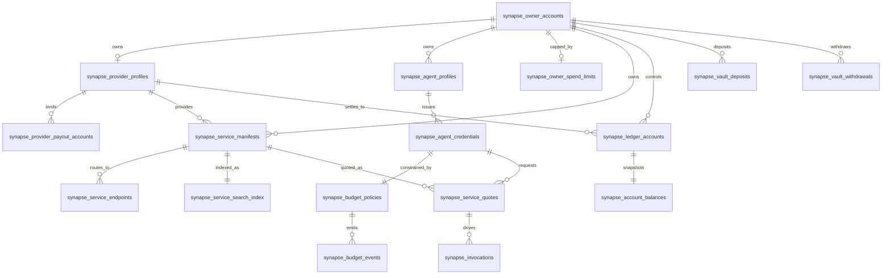

# Core Tables and Relationships

## 1. 目标

本文件回答一个问题：

**最新 SQL 中，哪些表是核心主表，它们之间怎么连，分别服务哪个业务边界。**

## 2. 根关系图

## 3. Tenant and Identity

### 3.1 `synapse_owner_accounts`

这是控制面根表。

关键字段：

1. `owner_id`
2. `owner_wallet`
3. `status`
4. `default_currency`

所有其他业务主线，最终都要能回到 `owner_id`。

### 3.2 `synapse_provider_profiles`

`provider_id` 是 Provider role 的平台内业务标识。

最重要的约束是：

1. `owner_id UNIQUE`

这表示当前版本里，一个 Owner 对应一个 Provider profile，而不是允许无限扩张成多租供给树。

### 3.3 `synapse_provider_payout_accounts`

这个表定义收益接收地址，但不面向 Agent 暴露。

关键约束：

1. `UNIQUE (provider_id, payout_address, chain_id)`

这能防止同一个 Provider 把同一条链上的同一个 payout 地址重复登记多次。

## 4. Agent Runtime

### 4.1 `synapse_agent_profiles`

一个 Owner 可以拥有多个 Agent。

字段重点：

1. `agent_id`
2. `owner_id`
3. `name`
4. `purpose`
5. `status`

### 4.2 `synapse_agent_credentials`

一个 Agent 可以拥有自己的 Runtime credential。

字段重点：

1. `credential_id`
2. `agent_id`
3. `secret_hash`
4. `secret_prefix`
5. `status`
6. `expires_at`

关键约束：

1. `secret_hash UNIQUE`

这保证凭据秘密不会被重复注册。

### 4.3 `synapse_budget_policies`

预算策略与 credential 是 `1:1` 关系。

关键约束：

1. `credential_id UNIQUE`

这意味着当前模型里，平台选择“每个 credential 对应一套预算约束”，而不是一套 credential 绑定多套可选 policy。

### 4.4 `synapse_owner_spend_limits`

这是 Owner 账户级 billing-cycle spend cap 表。

字段重点：

1. `owner_address`
2. `spending_limit_usdc`
3. `cycle_interval`
4. `created_at`
5. `updated_at`

关键约束：

1. `owner_address UNIQUE`
2. `cycle_interval` 当前固定为 `monthly`

这张表解决的是账户总额度，而不是 credential 局部额度。

## 5. Service Catalog

### 5.1 `synapse_service_manifests`

这是服务的公开契约表。

同时绑定：

1. `owner_id`
2. `provider_id`

这体现了一个关键边界：

1. 服务归属到 Owner 控制面
2. 服务运营属于 Provider role

### 5.2 `synapse_service_endpoints`

Manifest 和真实 endpoint 解耦。

这允许平台：

1. 一个 service 绑定多个 region target
2. 基于 health 和 weight 做内部路由
3. 不把真实 target 暴露给 Agent

### 5.3 `synapse_service_health_snapshots`

主键是：

1. `(service_id, endpoint_id)`

说明平台把“服务健康度”建模成 service-endpoint 粒度，而不是仅看 service 粒度平均值。

### 5.4 `synapse_service_health_runtime`

唯一约束是：

1. `UNIQUE (service_id, target_url)`

这是 Gateway 探活的当前状态表。每次 probe 都通过 `ON CONFLICT (service_id, target_url) DO UPDATE` 刷新 `status`、`last_checked_at`、`latency_ms`、失败计数和 `updated_at`，避免旧 KV 缓存让前端看到“健康但时间卡死”的状态。

### 5.5 `synapse_service_health_events`

这是 7 天诊断窗口内的 append-only 状态翻转事件表。

连续同状态 probe 不写事件；`healthy -> unavailable`、`unavailable -> healthy` 这类翻转才写入。TTL 清理由独立低频 job 执行，不进入 60 秒探活主循环。

### 5.6 `synapse_service_search_index`

这是 Discovery 的读优化层，不是 Service Contract 主表。

它的存在说明：

1. search 需要聚合能力、标签、embedding、可靠性等检索信号
2. 不应该直接对 Manifest 主表做所有搜索逻辑

## 6. Commerce State Machine

### 6.1 `synapse_service_quotes`

Quote 同时绑定：

1. `service_id`
2. `credential_id`
3. `agent_id`

这表示报价不是一个抽象价格片段，而是特定 Agent + Credential + Service 在某个时刻的可执行报价窗口。

### 6.2 `synapse_invocations`

Invocation 绑定：

1. `quote_id`
2. `service_id`
3. `endpoint_id`
4. `credential_id`
5. `agent_id`

并通过：

1. `UNIQUE (credential_id, idempotency_key)`

保证业务幂等。

这条约束是防重复扣费的核心之一。

## 7. Budget and Ledger

### 7.1 `synapse_budget_events`

Budget event 绑定 policy、credential、quote、invocation。

这使得每一笔 reserve / capture / release 都能回答：

1. 由谁消耗
2. 为哪个 quote 预占
3. 为哪个 invocation 扣减或释放

### 7.2 `synapse_ledger_accounts`

这张表通过 `account_kind` 强制账户语义：

1. `consumer_wallet`
2. `provider_wallet`
3. `platform_revenue`
4. `budget_hold`

`CHECK` 约束进一步规定不同账户类型下 `owner_id/provider_id` 的组合必须正确。

这非常关键，因为它把“资金桶隔离”从业务口号变成了数据库级约束。

### 7.3 `synapse_account_balances`

这是账户的快照层。

字段只保留：

1. `available_balance`
2. `pending_balance`
3. `frozen_balance`

它说明平台只接受三态余额，而不是让每条业务链路自己发明新的余额字段名。

### 7.4 `synapse_ledger_entries`

这是资金的 append-only 主真相。

关键字段：

1. `reference_type`
2. `reference_id`
3. `business_type`
4. `debit_account_id`
5. `credit_account_id`
6. `amount_usdc`

关键约束：

1. `UNIQUE (reference_type, reference_id, debit_account_id, credit_account_id)`

它防止同一业务参考对象对同一借贷账户对重复入账。

## 8. Vault Funding

### 8.1 `synapse_vault_deposits`

Deposit 绑定：

1. `owner_id`
2. `target_account_id`
3. `tx_hash`

`tx_hash UNIQUE` 是链上事实级防重放根约束。

### 8.2 `synapse_vault_withdrawals`

Withdrawal 绑定：

1. `owner_id`
2. `provider_id` 可空
3. `source_account_id`
4. `withdrawal_kind`
5. `signature`
6. `nonce`
7. `deadline`

这让同一套 withdrawal 主表可以同时服务：

1. consumer refund
2. provider withdrawal
3. platform distribution

但通过 `withdrawal_kind` 和 `CHECK` 保持语义隔离。

## 9. Reliability and Sidecars

### 9.1 `synapse_audit_events`

这张表把核心业务对象都保留了可关联外键位：

1. `owner_id`
2. `provider_id`
3. `agent_id`
4. `credential_id`
5. `service_id`
6. `quote_id`
7. `invocation_id`

所以审计不是一条无结构日志，而是可做多维过滤和追因的事件表。

### 9.2 `synapse_idempotency_keys`

这张表负责 API 级幂等。

唯一约束：

1. `UNIQUE (scope, owner_id, idempotency_key)`

它说明平台不是全局共享一把幂等键，而是分 scope、分 owner 做命名空间隔离。

### 9.3 `synapse_runtime_state`

这是 typed sidecar 表。

用于保存：

1. invocation billing 补充信息
2. withdrawal meta
3. cursor / checkpoint
4. 其他不适合进入主表但又必须持久化的结构化状态

Provider health 不再放在这里。高频探活状态属于 `synapse_service_health_runtime`，状态翻转历史属于 `synapse_service_health_events`。

它的价值是：

1. 减少主表膨胀
2. 保持流程补充信息有持久化落点
3. 避免为了少数字段频繁改动核心交易表

## 10. 文档结论

这套表关系最重要的不是数量，而是边界非常硬：

1. 根主体和运行时主体分离
2. 服务契约和真实 endpoint 分离
3. 报价和调用状态机分离
4. 余额快照和账本分录分离
5. 入金/出金和 Runtime commerce 分离

这正是金融级 Runtime 平台应有的数据库骨架。
