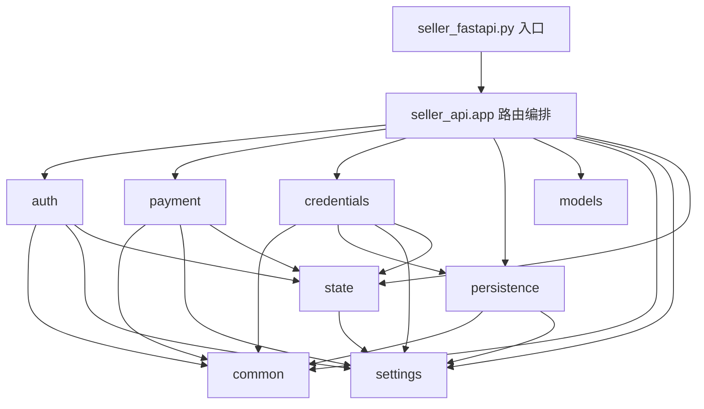

# Python SDK / Seller API 维护说明

本文档说明 `python_sdk` 下 Seller FastAPI 的模块化结构、请求链路与扩展建议。

## 目录结构

- `buyer_sdk/`
  - 买家侧 SDK（服务发现 + 付费调用封装）。
  - `client.py` 暴露 `AgentPayBuyer`。
  - `models.py`/`exceptions.py` 提供类型与错误边界。
- `seller_fastapi.py`
  - 薄入口文件，仅负责暴露 `app` 与本地 `uvicorn` 启动。
- `seller_api/app.py`
  - 路由层（FastAPI endpoint 定义）。
  - 负责把请求编排到鉴权、支付、凭证、持久化等能力模块。
- `seller_api/settings.py`
  - 所有环境变量与常量配置。
- `seller_api/state.py`
  - 进程内共享状态（`w3`、锁、限流窗口、挑战 nonce 缓存等）。
- `seller_api/models.py`
  - Pydantic 请求模型。
- `seller_api/common.py`
  - 通用纯函数（如 serviceId/wallet 规范化、pending 响应封装）。
- `seller_api/auth.py`
  - 钱包签名挑战、token 签发/验证、`require_auth` 依赖与 owner 权限校验。
- `seller_api/payment.py`
  - 链上支付校验（收据查询、确认数检查、事件匹配、重放防护）。
- `seller_api/credentials.py`
  - Agent 凭证、配额消费、限流治理（owner/agent/service）。
- `seller_api/persistence.py`
  - 文件持久化读写（service registry / credential / audit logs）。

## 模块依赖关系图



说明：
- `app` 只做请求编排，不承载核心业务算法。
- `settings` 与 `state` 是底层共享层，被多个能力模块复用。
- `auth`、`payment`、`credentials` 是核心业务能力层。
- `persistence` 是存储边界层，便于后续替换为 DB/Redis。

## 请求链路（核心）

### 1) 控制面（服务管理）

`/api/v2/services*`

1. `app.py` 接收请求。
2. `auth.require_auth` 完成 token + `X-User-Address` 一致性校验。
3. `credentials.enforce_rate_limit("owner", ...)` 做 owner 维度限流。
4. `persistence` 执行持久化。
5. `persistence.append_audit_log` 写审计。

#### V2 服务管理请求示例

1) 创建服务（系统生成 `serviceId`）

```bash
curl -X POST http://127.0.0.1:8000/api/v2/services \
  -H "Content-Type: application/json" \
  -H "Authorization: Bearer <token>" \
  -H "X-User-Address: <owner_wallet>" \
  -d '{
    "agentId": "seller-agent",
    "serviceName": "获取名人名言",
    "role": "Provider / Seller",
    "address": "0x70997970c51812dc3a010c7d01b50e0d17dc79c8",
    "pricing": "0.05",
    "isActive": true,
    "summary": "输入主题返回名人名言",
    "tags": ["quote", "cn"],
    "invoke": {
      "method": "POST",
      "url": "http://127.0.0.1:8100/api/v1/quotes/famous",
      "timeoutMs": 30000,
      "request": {
        "contentType": "application/json",
        "schema": {
          "type": "object",
          "required": ["text"],
          "properties": {
            "text": { "type": "string" }
          }
        }
      },
      "response": {
        "schema": {
          "type": "object",
          "properties": {
            "quote": { "type": "string" }
          }
        }
      }
    }
  }'
```

2) 查询服务列表

```bash
curl -X GET "http://127.0.0.1:8000/api/v2/services?ownerAddress=<owner_wallet>" \
  -H "Authorization: Bearer <token>" \
  -H "X-User-Address: <owner_wallet>"
```

3) 更新服务（按记录 id）

```bash
curl -X PUT http://127.0.0.1:8000/api/v2/services/<service_record_id> \
  -H "Content-Type: application/json" \
  -H "Authorization: Bearer <token>" \
  -H "X-User-Address: <owner_wallet>" \
  -d '{
    "serviceName": "获取名人名言",
    "pricing": "0.06",
    "isActive": true,
    "summary": "输入主题返回名人名言",
    "tags": ["quote", "cn", "inspiration"],
    "invoke": {
      "method": "POST",
      "url": "http://127.0.0.1:8100/api/v1/quotes/famous",
      "timeoutMs": 30000,
      "request": {
        "contentType": "application/json",
        "schema": {
          "type": "object",
          "required": ["text"],
          "properties": {
            "text": { "type": "string" }
          }
        }
      },
      "response": {
        "schema": {
          "type": "object",
          "properties": {
            "quote": { "type": "string" }
          }
        }
      }
    }
  }'
```

4) 删除服务（按记录 id）

```bash
curl -X DELETE http://127.0.0.1:8000/api/v2/services/<service_record_id> \
  -H "Authorization: Bearer <token>" \
  -H "X-User-Address: <owner_wallet>"
```

### 2) 数据面（Paid Generate）

`/api/v1/generate`

1. 校验 `serviceId`（header/body 一致性）。
2. 如传入 `X-Agent-Credential`：
   - `credentials.find_active_credential_or_unauthorized` 校验凭证。
   - `credentials.enforce_generate_rate_limits` 执行三维限流。
3. `payment.verify_payment` 校验链上支付事实。
4. 成功后 `credentials.consume_credential_call` 消费调用额度。
5. 返回业务结果。

## 扩展建议

- 新增路由时，优先只在 `app.py` 放“编排逻辑”，不要下沉业务细节。
- 纯逻辑优先放 `common.py` / `credentials.py` / `payment.py`，避免路由膨胀。
- 新配置必须统一进入 `settings.py`，避免散落 `os.getenv`。
- 共享可变状态统一放 `state.py`，并通过 `lock` 保护并发写路径。
- 新增持久化介质（DB/Redis）时，建议仅替换 `persistence.py` 接口实现，保持路由层不变。

## 本地运行

在 `python_sdk` 目录下：

- 启动开发服务：`python seller_fastapi.py`
- 或使用项目脚本：`./test/setup_local_env.sh`

## 买家 SDK 使用（新增）

先在 `python_sdk` 目录安装（开发模式）：

```bash
pip install -e .
```

示例脚本：`examples/buyer_sdk_discover_invoke.py`

```python
from buyer_sdk import AgentPayBuyer

client = AgentPayBuyer(
  credential_token="<X-Agent-Credential>",
  gateway_url="http://127.0.0.1:8000",
)

discovery = client.discover_services(intent="名人名言")
service_id = discovery["services"][0]["serviceId"]

result = client.invoke_service(
  service_id=service_id,
  payload={"prompt": "hello provider"},
  tx_hash="<支付成功后拿到的 TX_HASH>",
)
```

说明：当前 SDK 调用链路对接 `/api/v1/generate`（携带 `X-Agent-Credential` + `X-Tx-Hash`）。

## 关键兼容点

- 保持原入口导入方式不变：`from seller_fastapi import app`
- 控制面服务管理路径：`/api/v2/services*`
- 数据面推理调用路径：`/api/v1/generate`
- 前端依赖的鉴权/凭证头不变：
  - `Authorization: Bearer <token>`
  - `X-User-Address`
  - `X-Agent-Credential`（可选/可强制）
